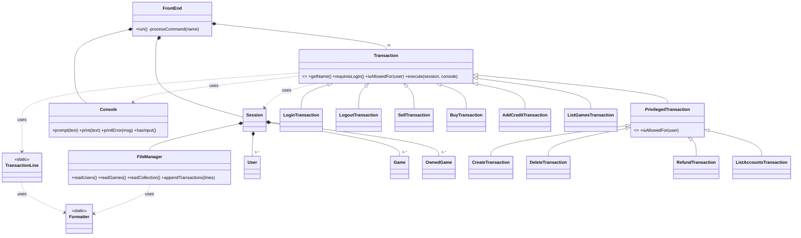

# CSCI3060U Phase 2 — Generative AI Disclosure

Generative AI (Claude, by Anthropic, via Claude Code) was used for this phase.
This file holds the complete prompt and response history for the session that
produced the Phase 2 design and code. Tool actions Claude took (reading/writing
files, compiling, running tests) are shown as one-line notes in italics.

## Session: Phase 2: understanding the handout, class design, writing the Front End, study notes

### Prompt 1

read 

<pasted_content id="766f">
CSCI 3060U - Fall 2026 
Course Project Phase #2 - Front End Rapid Prototype 
Due Monday, October 19th, 2026 (8:00pm) 
In this assignment, you will design and rapidly program the first version of your team’s Front End. Since the next 
assignment will involve running your Requirements Tests from Assignment #1, do not do full testing of your Front End at 
this time (no marks are for correctness yet!) 
• You should hand in: 
(1) A design document for your Front End, giving the overall structure of your solution, showing the classes and 
methods in a human-readable UML class diagram and a brief (one sentence) description of the intention of 
each method and class in a table.  
(2) The first version of the C++ source code to implement your design. This version should run on at least some 
inputs, but should not yet be completely tested (since that will be the next assignment, and it’s better to leave 
some failures until then). You will lose marks if you complete the front end before phase 3.  
• Your solution to this assignment will be judged on the clarity and readability of the design and the code, so work at using 
your best programming practices, including naming variables, classes and methods meaningfully and commenting 
liberally to make it easy for another programmer to understand. 
• Your solution to this assignment will not be judged on its correctness. This is to be a rapid first version, not a final 
product. So design and program it to work correctly, but don’t worry about getting it fully debugged or tested yet since 
that’s what we’ll do next. 
• Hand-ins must be completed electronically through Canvas by 8:00pm on the due date. Your electronic submission 
should include your design document (doc, pdf) and a separate zip file that contains the first version of your code (zip 
containing .cpp and .h files). You must also have committed all files to your Github repository by the due date. 
• If Generative AI was used in your project, you must also submit the complete history of prompts and responses 
pertaining to the work you submitted; otherwise, you must submit a distinct file containing a written statement promising 
that no Generative AI was used in this project phase. Submissions with neither of these will receive a grade of zero. 
Marking Scheme for Phase #2 
Marking for Phase #2 will be out of ten, according to the following criteria. In each category, marks will be assigned 
between zero and the number of marks shown, to a resolution of 1/2 mark. The X marks for group effort may be positive 
or negative and are up to the discretion of the TA (based on attendance, the Github repository and group feedback forms) 
Category  Content  Grade 
Design (Primarily in the design document) 
Architecture  - clearly documents structure of solution and accurately reflects solution structure 
- explicitly describes intention of each class and method 
- clearly shows where inputs and outputs fit in 
2 marks 
Completeness  - evidently addresses all required functionality 
- has all specified inputs and outputs (both std streams and files) 
2 marks 
Source Code (Details of the code itself)   
Structure/Format  - code is structured and formatted such that architecture is clearly visible in code 
- naming of classes and methods clearly reflect their role in the solution 
- as little cloning or redundancy as possible 
2 marks 
Maintainability  - avoidance of coding tricks and hacks 
- simplest solution possible, no frills, extras, or gratuitous optimizations 
- cleanest solution possible, adheres to object oriented programming principles 
2 marks 
Internal 
Documentation 
- clear naming of all variables and constants to reflect their role in the solution 
- comments at beginning of every class and method clearly documenting their 
interface and intention 
- comment at beginning of main program documenting overall program intention, 
input and output files, and how the program is intended to be run 
2 marks 
Other   
Group Effort 
 
- any penalties for failure to present work to TA client in lab 
- any penalties for failure to adapt to project requirement changes/clarifications 
- individual adjustment based on fair group member contribution 
X Marks 
Total  10 marks
</pasted_content id="766f">

 and explain in simple terms what Phase 2 asks me to hand in and how it's marked

*[Claude used tool `Bash`: Check deadlines file and project folder]*

*[Claude used tool `Bash`: Check Phase 2 weight and existing files]*

**Claude:**

**Heads up first:** this is due **Monday Oct 19, 8:00 PM**, which is two days from now. CSCI3052U's PM3 is due the same day. Phases 2–6 together are worth 50% of your grade. If you haven't started, start today.

## What you hand in

1. **Design document (doc or PDF)**
   - A **UML class diagram** of your Front End that a person can actually read (classes, methods, how they connect).
   - A **table** with a one-sentence description of what each class and each method is for.
   - It has to show where the **inputs and outputs** come in: stdin/stdout and the files you read and write.

2. **C++ source code (zip of `.cpp` and `.h` files)**
   - A first rough version that **runs on at least some inputs**.
   - **Don't finish it.** You lose marks if the front end is complete before Phase 3. Phase 3 is where you run your Phase 1 requirements tests against it, so some bugs should still be there for that.

3. **Everything committed to your GitHub repo** by the deadline.

4. **AI disclosure (mandatory):** either the full history of prompts and responses for any AI you used, or a signed statement that you used none. **If you submit neither, you get a zero.** You've used AI in this repo, so plan on exporting the logs (`project/export_ai_log.py` is already there).

## How it's marked (out of 10)

They're **not grading correctness.** They grade how clean and understandable the design and code are.

| Category | Marks | What they want |
|---|---|---|
| Architecture | 2 | The document matches the real code structure, every class and method has its purpose explained, and the I/O is clearly shown |
| Completeness | 2 | The design covers **all** required functionality and every input/output (streams and files), even where the code isn't done yet |
| Structure/Format | 2 | The architecture is visible in the code, names make sense, and nothing is copy-pasted |
| Maintainability | 2 | Simple, clean OOP with no hacks, clever tricks or extra features |
| Internal Documentation | 2 | Clear variable and constant names, a header comment on every class and method, and a main-file comment covering what the program does, its I/O files and how to run it |
| Group Effort | ±X | The TA adjusts this up or down based on lab attendance, GitHub activity and peer feedback forms |

**Bottom line:** the design has to cover everything, but the code only has to partly work. Put your effort into the diagram, the method table, good names and lots of comments. Don't spend it debugging, since that's Phase 3.

You already have `project/phase2.md`. Want me to check where you're at against this list?

### Prompt 2

what does it mean by not graded for correctness

**Claude:**

It means the TA won't run your program and take marks off when it gives wrong output.

**What they don't check:**
- Whether each transaction gives the right result
- Whether your output files match the expected format exactly
- Edge cases, error handling and bugs in general

**What they do check:** whether the code is *readable and well-designed*. That means sensible classes, good names, comments, no copy-paste, and a design doc that matches the code.

**Why:** Phase 3 is when you run your Phase 1 requirements tests against this front end and fix what fails. If it already passed everything, Phase 3 would have nothing to do. That's why they say you'll lose marks for finishing early.

**The catch:** "not graded for correctness" doesn't mean you can hand in garbage.
- The code still has to **run on at least some inputs**. Code that won't compile or crashes on everything won't pass.
- You're supposed to *try* to write it correctly ("design and program it to work correctly"). You just don't have to test and debug it fully.
- The **design** still has to cover all the required functionality, even where the code is buggy or unfinished.

In practice: write each feature the way you think it should work, test the basic happy path once, and stop there. Bugs you find later are for Phase 3.

### Prompt 3

so if they are not running the program what does the front end actually have to produce

*[Claude used tool `Bash`: Read Phase 2 notes and project I/O requirements]*

*[Claude used tool `Bash`: Check front end I/O in Phase 2 guide]*

**Claude:**

I overstated that last time. The TA might run it, since it has to "run on at least some inputs." What they won't do is take marks off for wrong results. Phase 2 doesn't change what the front end is *supposed* to produce. That's still the Games Distribution spec, and the only difference this phase is that nobody checks it closely yet.

Going by your `phase2-explained.md` and the client answers in `reqs.md`, the front end does this:

**Inputs**
- **Keyboard (stdin):** commands (`login`, `sell`, `buy`, etc.) and the answers to each prompt. For testing, this gets redirected from your Phase 1 `*_input.txt` files.
- **`users.txt`, `games.txt`, `collection.txt`:** read on each login. They're only read, never rewritten.

**Outputs**
- **Screen (stdout):** prompts, success messages and `Error: ...` messages, worded exactly like your Phase 1 expected outputs.
- **`transactions.txt` (daily transaction file):** one fixed-width line for each *successful* transaction. Failed ones aren't written. If the input ends without a `logout`, nothing gets written.

That daily transaction file is the main output. The back end (Phases 4–5) reads it and updates the real files.

**What that means for Phase 2:**
- The **design doc** has to show all of these inputs and outputs (that's the 2-mark Completeness category).
- The **code** has to actually produce them for at least the simple cases, like login → logout. Whether every line is exactly right gets checked in Phase 3, when you run your Phase 1 tests and diff the results.

**Something to watch:** your `phase2.md` says I already wrote a full first version with every transaction. Only login and logout have been run so far, but if the rest of it also works, that's close to the "complete before Phase 3" line the handout says costs marks. Your plan to rebuild your own version from it as a template makes sense, as long as the rebuild is a real first draft and not a polished copy.

### Prompt 4

ok theres a side req my ta mentioned for us which is "Add a new transaction that outputs to the terminal all active accounts and the relevant information (privileged transaction)" what does that mean

*[Claude used tool `Bash`: Search requirements for privileged/list transaction details]*

**Claude:**

It's a change request. The client (your TA) is adding a feature on top of the original spec, and the Group Effort marks include a penalty for not adapting to requirement changes like this one. Taking it phrase by phrase:

- **"a new transaction":** a new command alongside `login`, `buy`, `sell` and the others.
- **"outputs to the terminal":** it prints to the screen (stdout) only and doesn't change any files. It's a lookup.
- **"all active accounts":** every user currently in the user accounts file. "Active" most likely means deleted users don't show up.
- **"the relevant information":** what an account holds, so most likely username, account type (AA/FS/BS/SS) and credit. That's my reading. The TA didn't say exactly.
- **"(privileged transaction)":** **admin only**, same as `create` and `delete`. A non-admin who tries it gets an `Error:` and nothing is listed.

It's the same pattern as the `LIST` games transaction from `reqs.md` line 169, except it lists users instead of games, and only admins can run it.

**For Phase 2 you need:**
- It in the **UML diagram and method table** (that's the Completeness marks).
- Code that runs it. Your `src/` already has `ListAccountsTransaction.cpp/.h` built on `PrivilegedTransaction`, so the admin check is shared with `create`/`delete`.

**Things the TA hasn't told you, so ask them:**
1. **The command name.** `listaccounts` is a placeholder in your `phase2.md`.
2. **Whether it writes a line to `transactions.txt`.** It's a read-only command, so probably not, but your team already asked the same thing about the games list (`reqs.md` line 35) and I don't see an answer.
3. **Exactly which fields to show and in what format,** since your Phase 3 tests will need exact expected output.

You'll need answers to all three before Phase 3, because those tests diff the exact output.

### Prompt 5

List every requirement change or clarification from the client and professor that affects Phase 2. : 

<pasted_content id="766f">
"Add a new transaction that outputs to the terminal all active accounts and the relevant information (privileged transaction)"

@Victoria S. Finn (client) Hi, a few clarification questions on the Front End requirements:


User type input: The handout says create asks for the type as "admin or full-standard, buy-standard, sell-standard," but the files use AA/FS/BS/SS. What should the user actually type at the prompt, and is it case-sensitive (e.g. is "aa" ok)?
Permission errors: If a loggedin user types a transaction their account type isn't allowed to use (e.g. a standard user typing create, or a sell-standard user typing buy), should the Front end print a permission error, or treat it like an unknown transaction?
Ending a session: If the input ends without the user typing logout, should the Front End still write the daily transaction file? And after a logout, does the program exit or accept a new login (and does a second session overwrite or append to the daily file?
Newly created users: Can a user created by an admin log in during the same session, or only after the accounts file is updated overnight? And can a username freed by a delete be reused in the same session?

Up to you if you want the users to be able to type out the full type name, but it would be recommended to have them use the abbreviations. You decide if you wish it to be case sensitive 
Up to you 
I would say no if the user doesn't log out. And ideally if the user has not logged out, they should still be logged in when rebooting, but this would entail your group determining how to accomplish this
To the first part, I would encourage you to consider what would be the simplest. As for the other part, I'd say yes


Hi @Victoria S. Finn (client), quick clarification needed, we got two different answers on the same topic earlier you told us new accounts default to 0 credit and create doesnt ask for an amount. More recently answering a similar question you said the user enters the initial credit. Which one is correct? does create ask for a starting credit, or does every new account just start at 0?


Hi @Victoria S. Finn (client),
I have a few questions from our Phase 2 design :

Is there a required name for the new transaction that lists all active accounts? We're calling it "listaccounts" for now. What fields should it show per account we're displaying username, type, and credit. Also, is it admin-only and not written to the daily transaction file?
If the Front End runs more than one session back-to-back (login → logout → login again without restarting), should the second session start fresh from the original accounts and games files, or carry over changes from the first session? We're reloading the files at every login.
Can a game be listed with a price of 0.00, or does it have to be above zero?
Does the $1000.00 per-session addcredit limit apply when an admin adds credit too, either to their own account or to someone else's? We're applying it to every account regardless.
For buy, we ask for the game name and then the seller's username. If the game exists but the seller entered doesn't match the actual owner, should that be an error even if the entered user has a valid account? We're rejecting it as a mismatch.

Since the client may not get around to answering requirements questions today and will officially begin communications blackout at 8pm, I'll answer these as best I can, bearing in mind that some questions don't need complete answers until phase 3:

1) For phase 2, give it a unique name that makes the transaction purpose clear, but be sure to get the client's required name by phase 3. The other subquestions aren't relevant for phase 2.
2) I am not sure what you mean by 'original accounts and games files'. If you are modifying accounts or games files using your front end, you have implemented the system incorrectly. Re-read the original project description to see how this is the back end's responsibility.
3) Steam has plenty of free games, I see no reason this system can't have some too.
4) The $1000 limit applies to all addcredit transactions whether by an admin or not.
5) If the seller name is wrong then the transaction is invalid.

@Victoria S. Finn (client) can give more complete answers when she returns, or correct any discrepancies if needed. (edited) 
Victoria S. Finn (client)  [6:02 PM]
Just replying to say that the professor's response is fairly accurate
</pasted_content id="766f">

*[Claude used tool `Bash`: Find earlier client answers about starting credit]*

**Claude:**

Everything below comes from the thread you pasted, plus `reqs.md` for the starting-credit history. Your team's current approach is from `phase2.md`.

## Requirement change

**1. New privileged "list all active accounts" transaction** (TA/client)
- It prints every active account to the terminal and only admins can use it.
- **Phase 2:** use a unique name that makes its purpose obvious. The professor says `listaccounts` is fine for now. The fields shown and whether it writes to the daily file "aren't relevant for phase 2."
- **Phase 3:** you need the client's official name by then.
- Status: already in your `src/` and `phase2.md`.

## Clarifications

**2. User type at the `create` prompt:** your team decides. The client recommends the abbreviations (AA/FS/BS/SS). Case sensitivity is also up to you. Pick one and write it in the design doc.

**3. Permission errors** (e.g. a sell-standard user typing `buy`): up to you. Show either a permission error or an unknown-command error, and keep it consistent.

**4. Input ends without `logout`:** **don't write** the daily transaction file. That matches what you have.
- ⚠️ She also said that "ideally" the user should still be logged in after a reboot, and left how to do that up to your group. That's a stretch goal, not a requirement. The handout penalizes "frills, extras," so I'd skip it for Phase 2. Mention it as a future option in the design doc at most.

**5. Logging in as a newly created user in the same session:** "consider what would be the simplest." Since the front end never writes the accounts file (see #7), the simplest answer is **no, not until the back end runs.**

**6. Reusing a deleted username in the same session:** **yes, allowed.**

**7. Front end must never modify the accounts or games files** (professor)
- Updating those files is the back end's job. The front end only reads them and writes `transactions.txt`.
- This is why the "carry changes into the second session" question doesn't apply. Each login just re-reads files that haven't changed.
- Your design already does this ("files are only read, never rewritten").

**8. Games can be free:** a price of **$0.00 is valid**. Check that your `sell` validation doesn't reject 0.

**9. The $1000 addcredit limit applies to everyone, admins included,** whether they're adding to their own account or someone else's. That matches your current approach.

**10. `buy` with the wrong seller name:** the transaction is **invalid** even if that user exists. That matches your current approach.

## Still unresolved ⚠️

**11. Starting credit on `create`:** your question got **no answer** in this thread.
- The earlier client answer in `reqs.md` (line 103) says the default is **0** and `create` doesn't ask for an amount.
- Your team says a later answer contradicted that.
- Until she clarifies, go with **0 / no prompt**: it's the answer you have on record, and it matches the original "ask for username and type" requirement. Flag it as an open question in the design doc.

## To check in your code before Monday
- `sell` accepts a price of 0.00 (#8)
- The case sensitivity and permission-error behavior you picked are written in the design doc (#2, #3)
- The starting-credit assumption is written down as an assumption (#11)

Want me to add these to `reqs.md` and the open-questions list in `phase2.md`?

### Prompt 6

read my phase 1 test cases what needs to be changed or modified

*[Claude used tool `Bash`: Locate Phase 1 test case files]*

*[Claude used tool `Bash`: Read test case doc and inventory test folders]*

**Claude:**

Next I'll check the actual test files against the doc, focusing on the ones the new clarifications affect.

*[Claude used tool `Bash`: Inspect tests affected by new clarifications]*

*[Claude used tool `Bash`: Check addcredit tests involving admin]*

**Claude:**

For Phase 2 you don't need to change any of these tests. The tests only get run in Phase 3, so most of this is prep for then. I checked the doc (`project/phase1-test-cases.md`) and the actual test files (`phase1/tests/`) against the new clarifications. Here's what's out of date.

## Must fix (contradicts the new answers)

**1. DELETE-11 (`delete/delete_11`) is wrong**
- The professor said the front end never modifies the accounts file. So after `logout` and a fresh `login`, the file gets re-read and `buyuser` is still in it.
- That means re-logging in as `buyuser` should **succeed**. The test expects `Error: user does not exist.`
- Fix: change the expected output to `Login successful. Welcome buyuser (BS).` You'll also need to fix the input. Right now it types `login` and `admin` straight after, which will now hit "already logged in" and then an invalid command. Simplest is to change it to `login, buyuser, logout`.
- In the doc, change the DELETE-11 row and P31 ("Front End remembers deletions for the whole run") to match.

## Missing tests (new requirements with no coverage)

**2. The list-active-accounts transaction:** there are no tests for it at all. Add a section, using `listaccounts` as the placeholder name:
- Admin runs it → ✓ shows every account (username, type, credit), and nothing goes in `transactions.txt`
- FS/BS/SS run it → ✗ privileged (one test per type)
- Before login → ✗
- After a `create`/`delete` in the same session → your call on whether the change shows up. Pick one.

**3. Reusing a deleted username in the same session:** the client said **yes**, but there's no test for it.
- Add: delete `buyuser`, then `create buyuser` → ✓
- Update P16, which currently says "deleted users can't be used at all."

**4. Input ends without `logout`:** the client said **no** transaction file gets written. All 300+ of your input files end with `logout`, so this is untested.
- Add: `login fulluser`, `sell ...`, then end of input → transactions file is empty or not created.

**5. The admin $1000 limit:** the professor said the limit also applies to admins. ADD-09 still holds, since the limit is per account. But nothing tests an admin going *over* the limit.
- Add: admin adds 600 then 500 to `fulluser` → second one ✗

**6. Lowercase user type (`fs`):** the client said case sensitivity is your call. Decide, then add one `create` test that locks it in.

## Doc-only updates (behavior unchanged, source changed)
In the "Client answers" table, change these rows from **Our call** to client/professor-confirmed:
- **P15:** abbreviations, as the client recommended
- **P18:** free games are fine (professor's Steam answer)
- **P20:** wrong seller makes the buy invalid (professor)
- **P24:** the limit applies to admins too (professor)
- **P31/P32:** the front end never writes the accounts/games files (professor)

## Already correct, no change needed
SELL-07 (free games), BUY-06 (wrong seller), CREATE-17 (starting credit 0, still unconfirmed by the client), CREATE-20 and SELL-20 (no file updates until the back end runs), LOGOUT-06 (multiple sessions).

**What I checked:** I read the whole doc, but only opened the specific test files these changes touch. I didn't go through all 300+ files to confirm they match the doc row by row.

Want me to make these edits (fix `delete_11`, add the new test folders, update the doc)? Or would you rather do them yourself in Phase 3?

### Prompt 7

i just added a placeholder and removed the delete test we dont need to focus on this for phase 2 right

*[Claude used tool `Bash`: Check what changed in the repo]*

**Claude:**

Right. Phase 2 marks are for the design doc and the code, not the tests, so the test suite can wait until Phase 3.

Two things to keep in mind before then:

- **Removing `delete_11` is fine for now, but don't let it disappear quietly.** The test was wrong because the requirements changed (the professor said the front end never writes the accounts file). Losing it also means you no longer test what happens when a deleted user logs in again in a later session. In Phase 3, add it back with the corrected expected result (login succeeds). Also note the change in your requirements-problems log, since TAs like to see that you adapted to a requirement change.
- **The placeholder still needs real tests in Phase 3.** That means the `listaccounts` tests, deleted-username reuse, ending input without `logout`, the admin going over the $1000 limit, and the lowercase-type decision. You'll be diffing exact output by then, so get the official command name and output format from the client before you write them.

For the next two days, put your time into the design doc (UML, the method table, all the inputs and outputs) and the code comments. That's where the 10 marks are.

### Prompt 8

look at phase 1 tests and tell me what the program has to print and write for each

*[Claude used tool `Bash`: Extract distinct expected messages and transaction codes]*

*[Claude used tool `Bash`: Get transaction line formats and money formatting]*

*[Claude used tool `Bash`: Show prompt sequence for each transaction]*

*[Claude used tool `Bash`: Map each error message to its transaction]*

**Claude:**

This comes from your 122 tests in `phase1/tests/`. Rather than go through all 122 one by one, I grouped what they expect by transaction, since the pattern repeats.

## Rules for every test
- The program prints **`Enter command:`** before every command, including the first one and after errors.
- Your typed input **isn't echoed back**. Only the prompts and messages appear on screen.
- When something fails, it prints **one `Error: ...` line**, cancels that transaction, goes back to `Enter command:`, and **writes nothing** to the file.
- Any command except `login` before logging in prints `Error: you must log in first.` An unknown or wrong-case command prints `Error: invalid command.`
- Every `logout` writes a **`00` end-of-session line**. Two sessions in one run means two `00` lines in the same file.
- ⚠️ The expected output files **have no trailing newline**. Phase 3 diffs will fail on that alone, so either match it or strip whitespace when you compare.

## Each transaction

| Command | Prompts, in order | Success message | Line written to `transactions.txt` |
|---|---|---|---|
| `login` | `Enter username:` | `Login successful. Welcome fulluser (FS).` | none |
| `logout` | (no prompts) | `Logout successful.` | `00                    000000.00` |
| `create` | `Enter username:`, `Enter user type:` | `User newuser created.` | `01 newuser         FS 000000.00` |
| `delete` | `Enter username:` | `User buyuser deleted.` | `02 buyuser         BS 000500.00` (the deleted user's type and credit) |
| `sell` | `Enter game name:`, `Enter price:` | `Game Celeste listed for sale at 20.00.` | `03 <game 26> <seller 15> <price 6>` e.g. `...admin           010.00` |
| `buy` | `Enter game name:`, `Enter seller username:` | `Purchase successful. Stardew Valley bought from selluser for 15.00.` | `04 <game 26> <seller 15> <buyer 15> 015.00` |
| `refund` | `Enter buyer username:`, `Enter seller username:`, `Enter amount:` | `Refund of 15.00 from selluser to buyuser complete.` | `05 buyuser         selluser        000015.00` |
| `addcredit` (non-admin) | `Enter amount:` | `Added 100.00 credit to fulluser.` | `06 fulluser        FS 000100.00` (the amount added) |
| `addcredit` (admin) | `Enter amount:`, `Enter username:` | same as above | same as above |
| `list` | (no prompts) | `Games for sale:` followed by one `Name - seller - 15.00` line per game, or `No games for sale.` | none |

On screen, money always has 2 decimals with no `$` and no leading zeros (`15.00`). In the file it's zero-padded: 9 characters for credit, 6 for price.

## Errors each transaction can print
- **login:** `user does not exist.` · `already logged in.`
- **create:** `permission denied.` · `username already exists.` · `username too long.` · `invalid username.` · `invalid user type.`
- **delete:** `permission denied.` · `user does not exist.` · `cannot delete yourself.`
- **sell:** `permission denied.` · `invalid price.` · `game name too long.` · `invalid game name.` · `game name already exists.`
- **buy:** `permission denied.` · `game does not exist.` · `seller does not sell that game.` · `user does not exist.` · `insufficient credit.` · `credit limit exceeded.` · `game already owned.` · `cannot buy your own game.` · `game not available until next session.`
- **refund:** `permission denied.` · `user does not exist.` · `insufficient credit.` · `credit limit exceeded.` · `invalid amount.` · `buyer and seller must be different.`
- **addcredit:** `invalid amount.` · `user does not exist.` · `credit limit exceeded.` · `session credit limit exceeded.`

`permission denied.` prints **right after the command**, before any prompt.

**Not covered:** your new `listaccounts` placeholder has no expected output in these tests yet. You'll pick its format when you write its tests in Phase 3.

For Phase 2, use this as your reference for exact wording. If your code prints `Error: Permission Denied` instead of `Error: permission denied.`, it'll fail in Phase 3 for no real reason.

### Prompt 9

List all the nouns and verbs in front end requirments

*[Claude used tool `Bash`: Extract the project spec text]*

*[Claude used tool `Bash`: Extract spec text with Python PDF library]*

**Claude:**

The Read tool can open PDFs directly, so I'll use that.

*[Claude used tool `Read`: /home/jasim/workspace/university/courses/CSCI3060U/csci3060_course_proj/Extreme Project - Games Distribution (2026).docx copy.pdf]*

**Claude:**

These come from the Front End section of the spec (pp. 3–11) plus the two client-added transactions. This is the classic noun/verb pass for OO design: nouns become classes or attributes, and verbs become methods. I've grouped them that way and removed duplicates.

## Nouns

**Candidate classes (main things in the system)**
- Front End (the "point of purchase terminal")
- session
- transaction, transaction code, and the specific ones: login, logout, create, delete, sell, buy, refund, addcredit (plus list and listaccounts from the client)
- user / user account / account (admin, full-standard, buy-standard, sell-standard)
- game (game for sale, new game)
- collection (a user's games)
- current user accounts file
- available games file
- game collection file
- daily transaction file
- transaction stream (stdin, "lines of text")

**Candidate attributes (data on those classes)**
- user: username, user type (AA/FS/BS/SS), credit / available credit / credit balance
- game: game name, price, seller (seller's username)
- collection entry: game name, owner's username
- transaction line: transaction code (00–06), buyer's username, seller's username, refund credit, amount of credit
- file line: field, alphabetic field, numeric field, monetary value, space padding, `END` marker
- session: current user, admin mode / standard account, amount added this session

**Constraint/limit nouns (become constants)**
- maximum credit (999,999)
- maximum price (999.99)
- maximum game name length (25, or 26 per the client)
- maximum username length (15)
- $1000.00 per-account-per-session addcredit limit
- line lengths (28, 42/49)

**Error/input nouns**
- bad input, invalid input, privileged transaction, semi-privileged transaction, unprivileged transaction

## Verbs

**Session / control flow**
- start (a session), end (a session)
- accept (transactions/a username), stop accepting
- process (a transaction / the stream), handle (transaction codes / bad input)
- log in, log out

**Input / output**
- read (the accounts file, the games file)
- ask for (username, user type, game name, price, seller, buyer, amount)
- write out / save (to the daily transaction file)
- list (every transaction made in the session)
- output (to the terminal, for list and listaccounts)

**Account operations**
- create (a user), add (a user)
- delete / remove (a user account), cancel (their games for sale)
- add credit
- credit (the seller), deduct (from the buyer)
- transfer (credit from seller to buyer), issue (a refund credit)

**Game operations**
- sell / put up for sale / advertise
- buy / purchase
- add (a game to the user's collection)

**Validation (from the constraints)**
- check / must be (existing user, existing game, current user)
- must be different / unique (usernames, game names)
- limit / be at most (length, price, credit)
- must have enough money
- must not already have (a copy of the game)

**Formatting (file constraints)**
- left-justify, fill with spaces, fill with zeros, append ".00"

**General requirement**
- never crash / never stop, gracefully handle (bad input)

## How this maps to your code
Your `src/` already lines up with this. The nouns became `FrontEnd`, `Session`, `User`, `Game`, `OwnedGame`, `FileManager`, `TransactionLine`, the `*Transaction` classes, and `Constants.h`. The verbs became `execute`, `isAllowedFor`, `requiresLogin`, the `Console` prompts and the `Formatter` padding helpers.

If you're writing up the noun/verb analysis for the design doc, the class and method tables are the place to show it.

### Prompt 10

now which of these are going to be classes and which are just attributes explain your reasoning for each

**Claude:**

To match your actual design, I'll check how `src/` already splits classes from attributes.

*[Claude used tool `Bash`: Summarize classes and members from headers]*

**Claude:**

I've based this on your actual `src/`. The rule I used for each noun:

- **Class:** it has its **own data and its own behaviour**, or there are **many of them**, or it has **one clear job** the rest of the program shouldn't know about.
- **Attribute:** it's a **single value that describes something else** and doesn't do anything by itself.
- **Constant:** it's a fixed number or string that never changes while the program runs.

## Classes

| Noun from the spec | Class | Why it's a class |
|---|---|---|
| Front End | `FrontEnd` | It owns the main loop: read a command, find the matching transaction, run it, repeat until input ends. Something has to own that, and `main` should stay tiny. |
| session | `Session` | It holds a lot of state that changes as you go: logged in or not, current user, users, games, collection, credit added this session, and the transaction lines waiting to be written. Every transaction reads and changes this state, so it gets one home. |
| transaction (as a concept) | `Transaction` (abstract) | Every transaction does the same steps: check login, check permission, then run. Putting those in one base class means the steps are written once, not 10 times (the Structure marks penalize "cloning"). |
| login, logout, create, delete, sell, buy, refund, addcredit, list, listaccounts | `LoginTransaction`, `SellTransaction`, etc. | Each has **different behaviour**: different prompts, rules and output line. That's the textbook reason for subclasses. Adding a new one (like `listaccounts`) means adding a class without touching the others, which is the "easily modify your program" requirement from p. 3. |
| privileged transaction | `PrivilegedTransaction` | create, delete, refund and listaccounts all share the same "admin only" rule. A middle class means that rule exists once. |
| user / account | `User` | There are many users, each with its own name, type and credit, plus behaviour like `addCredit`, `canBuy` and `isAdmin`. |
| game (for sale) | `Game` | There are many games, each with a name, seller, price and a "listed this session" flag. |
| collection entry | `OwnedGame` | One row of the collection file (game plus owner). It's a different shape from a game for sale (no price), so it gets its own small class instead of a `Game` with a blank price. |
| the 3 input files + daily transaction file | `FileManager` (**one** class, not four) | Reading all three input files works the same way: read lines until `END`, then split into fixed-width fields. Four file classes would be four copies of that loop. One class also means "where does file I/O happen?" has a single answer, which is the Architecture marks. |
| transaction stream (stdin) and the terminal (stdout) | `Console` | All prompts, messages and errors go through one place. Transactions never touch `cin`/`cout` directly, so input and output are easy to point to in the diagram, and tests can swap in a file. |
| line formats (`XX_UUU..._TT_CCC...`) | `TransactionLine` | Each transaction code has its own fixed-width layout. Building those lines is one job, so it lives in one place instead of being spread across 6 transactions. |

`Console` and `Formatter` aren't nouns from the spec. They're **design classes**: they don't model anything in the business, they just keep repeated work in one place. `Formatter` does the padding, money formatting and field slicing that both `FileManager` and `TransactionLine` need. Expect a TA to ask "where did this come from?", so say that in the design doc.

## Attributes (not classes)

| Noun | Where it lives | Why it's not a class |
|---|---|---|
| username | `User::name`, `Game::seller`, `OwnedGame::owner` | Just a string. It doesn't do anything. |
| **user type** (AA/FS/BS/SS) | `User::type` + `canBuy()` / `canSell()` / `isAdmin()` | **This is the one people argue about.** You *could* make `AdminUser`, `BuyStandardUser`, etc. The only thing that differs between types, though, is *which transactions they're allowed to run*. Every user stores the same data. A two-letter code plus three yes/no methods is the "simplest solution possible" the marking scheme asks for. Four subclasses would be a "frill." |
| credit / balance / available credit | `User::credit` | A number describing a user. |
| game name, price | `Game::name`, `Game::price` | Values describing a game. |
| seller / buyer / owner | username strings | Not separate kinds of thing. Any `User` can be a buyer or seller depending on the transaction, so they're **roles, not classes**. |
| collection (a user's games) | `Session::collection` (list of `OwnedGame`) | Just a list. There's no behaviour beyond "add" and "does X own Y," and `Session` handles both. |
| current user | `Session::currentUsername` | It points to one of the existing `User`s. It's not a new type. |
| amount added this session | `Session::creditAddedThisSession` (map) | Bookkeeping for the $1000 rule, and only `Session` needs it. |
| transaction code (00–06) | a string on each output line, from `Constants.h` | It's a label, not behaviour. The behaviour is already in the transaction subclasses. |
| amount / refund credit | a local variable inside `execute()` | It only exists while that one transaction runs. |
| money (price, credit) | the `Cents` type (an integer number of cents) | It's a number. Storing cents avoids `0.1 + 0.2` floating-point errors. That's a simple fix, not a trick. |

## Constants (`Constants.h`)
Max username length (15), max game name (25/26), max price (999.99), max credit (999,999.99), $1000 session limit, field widths, file names, type codes, transaction codes, and `END`.

**Why:** these are fixed rules from the spec and from client answers. The client already changed some of them (like 25 → 26). With all of them in one place, a change is one edit, and nothing in the code is an unexplained number.

## Verbs → methods (quick version)
- Transaction verbs (sell, buy, refund…) → each subclass's `execute()`
- "ask for" → `Console::prompt()`
- "read" → `FileManager::readUsers/readGames/readCollection()`
- "write out / save" → `Session::recordTransaction()`, then `FileManager::appendTransactions()` at logout
- "credit / deduct / transfer" → `User::addCredit()` / `removeCredit()`
- "accept / reject" → `requiresLogin()` + `isAllowedFor()`
- "left-justify / fill with zeros" → `Formatter::padRight()` / `formatMoney()`

For the design doc, a short version of the **user type** reasoning is the part most worth including. It's the most obvious place a marker would expect subclasses, so explaining why you didn't use them shows the design was a deliberate choice.

### Prompt 11

now that i have these what are the next steps

**Claude:**

Before planning, I'll check what's still open in the repo.

*[Claude used tool `Bash`: Check placeholders, zero-price rule, build, commit authors]*

**Claude:**

You're due **Monday 8 PM**, which is 2 days out, and CSCI3052U PM3 is due the same day. Here's where things stand and what's left.

## Where you are
- Code builds cleanly, and `sell` already allows a price of $0.00 ✓
- The design doc, code zip and GenAI file are all generated in `phase2/submission/` ✓
- **But:** the team/partner name placeholders are still everywhere, and **every commit is from your account**.

## Something to settle first
Your `phase2.md` says you want to rebuild your own version using this one as a template. That's a full rewrite of 18 classes in 2 days, alongside PM3. **I'd push back on that.** What's being marked is clarity, and the code is already structured for that. The better use of your time is to **read every class until you can explain it yourself**, then change anything you'd have done differently. You'll be maintaining this through Phase 3 and presenting it to the TA, so understanding it matters more than retyping it. If the rewrite matters to you anyway, keep it to a few classes.

## Steps, in order

**Today (Sat)**
1. **Message your partner.** This is the biggest risk. The TA compares commit history with the peer forms, and right now it shows one person. Give them real work to commit from their own account, for example reviewing and improving the comments in `Sell`/`Buy`/`List*`, plus the method description table in the design doc.
2. **Get the team name** and fill in `[TEAM NAME]` / `[PARTNER NAME]` in four places: `src/main.cpp:5`, `docs/genai-disclosure.md`, `docs/tools/make_design_doc.js`, and `docs/tools/export_ai_log.py`. Then rebuild the doc.

**Sun**

3. **Go through the code**, one class at a time. For each class, check:
   - The top comment says what it's for, and every method has a comment.
   - Names make sense to you.
   - There's nothing you couldn't explain if the TA asked.
4. **Update the design doc** with what we covered today:
   - The **class vs attribute reasoning**, especially why user type isn't a set of subclasses.
   - Your decisions on case sensitivity and on permission errors vs. invalid command.
   - **Assumptions:** starting credit is 0 (not confirmed by the client), and `listaccounts` is a placeholder name.
   - The I/O section listing stdin, stdout, `users.txt`, `games.txt`, `collection.txt` and `transactions.txt`.
5. **Check that the UML matches the code.** This is 2 marks by itself. Any class or method in one and not the other loses marks.

**Mon, before ~6 PM**

6. **Re-export the GenAI log so it includes this conversation**, since it's part of the work you're submitting. Without it you get a zero.
7. Run `python3 make_submission.py` to rebuild the zip, and check the zip contains only `.cpp`/`.h` files.
8. Push everything to GitHub and submit to Canvas: the design doc (PDF), the code zip and the GenAI file. Then fill in the peer feedback form.
9. Move on to CSCI3052U PM3.

## What not to do
- Don't run the full Phase 1 suite or fix test cases. That's Phase 3, and the handout says finishing early costs marks.
- Don't add extras like the "stay logged in after reboot" idea. That's the "no frills" rule.

Want me to start on step 4 and put today's reasoning and decisions into the design doc?

### Prompt 12

now that i have these what are the next steps in this csci3060_course_proj repo

*[Claude used tool `Bash`: Inspect course project repo state and history]*

**Claude:**

Here's where the repo stands. In `csci3060_course_proj` (the one that pushes to GitHub), `phase2/` only contains the handout PDF. The full version I wrote is in a separate folder, `csci3060_course_proj_phase2/`, which isn't part of this repo. All 3 commits are yours, and your partner has none. Today is Saturday, and it's due **Monday 8 PM**.

## Next steps, in order

**1. Sort out your partner today.**
The TA checks commit history for Group Effort marks, and XP pair programming is required. Split the work now and make sure **they commit code under their own account**. If it's all you, both of you lose marks, and the repo shows it.

**2. Set up `phase2/` in this repo**
```
phase2/
  src/        .h/.cpp per class, Constants.h, main.cpp
  Makefile
  docs/       design doc, UML, GenAI log
```
Also fill in the Phase 2 row of the `README.md` table.

**3. Write the core (Saturday)**
`main`, `FrontEnd`, `Console`, `Session`, `User`, `Game`, `OwnedGame`, `FileManager`, `Formatter`, `TransactionLine`, `Constants.h`, `Transaction`, `PrivilegedTransaction`, plus `login`/`logout`.
- Write the header comment on every class and method **as you write it**. That's 2 marks and it's painful to add at the end.
- `main.cpp` needs a top comment covering the program's purpose, input/output files, and how to run it.

**4. Add the other transactions (Sunday)**
create, delete, sell, buy, refund, addcredit, list, listaccounts. Get each one working for the normal success case and the obvious errors. **Stop there.** Don't chase edge cases, because finishing early costs marks. If you're rebuilding from my version as a template, your rewrite should stay a rough first draft, not a copy of a finished program.

**5. Smoke test (about 10 minutes)**
Compile it and run the `login`/`logout` tests through `phase1/run_tests.sh`. Your only goal is "it compiles and runs on some inputs." Don't run the full suite.

**6. Design doc (Sunday night)**
- UML class diagram that **matches the code**. Show `Console` ↔ stdin/stdout and `FileManager` ↔ the 3 input files and `transactions.txt`.
- A table with one sentence for every class and every method.
- A short design rationale: the class vs attribute reasoning, especially why user type isn't subclasses, and why there's one `FileManager`.
- An assumptions list from the clarifications: abbreviation user types and your case-sensitivity choice, starting credit 0 (still unconfirmed), `listaccounts` as a placeholder name, files only ever read, free games allowed, admin $1000 limit.

**7. Submit (Monday, aim for about 6 PM, not 7:59)**
- [ ] Design doc as PDF, with the team name and all member names on it
- [ ] Zip of **only** the `.cpp`/`.h` files
- [ ] GenAI log: the full prompt/response history, including this conversation (use `project/export_ai_log.py`). **Missing it = 0.**
- [ ] Everything committed and pushed to GitHub
- [ ] Peer feedback form

Monday is also CSCI3052U's PM3 due date. Finish Phase 2 Sunday night so Monday isn't split between both.

Want me to set up the `phase2/` folder structure and the README row now?

### Prompt 13

What jobs need one owner that aren't nouns in the spec, like reading files, keyboard input, and padding text? Suggest a class for each.

**Claude:**

These are jobs the spec never names but that **several classes would otherwise each do for themselves**. Each one needs a single owner so the code isn't copy-pasted (that costs Structure marks) and the I/O is easy to point to (that earns Architecture marks).

| Job | Who'd do it without an owner | Suggested class | Why one owner |
|---|---|---|---|
| **Reading and writing files**: open, read lines until `END`, slice fixed-width fields, append to `transactions.txt` | login (accounts + games), buy (collection), logout (write) | **`FileManager`** | The same read loop serves 3 files. It's also the **only** class that touches the disk, so the diagram has one arrow to the files. |
| **Keyboard input and screen output**: print a prompt, read a line, print a message or `Error:`, detect end of input | every transaction | **`Console`** (wraps an `istream`/`ostream`) | Transactions never touch `cin`/`cout`. Prompt and error wording stay consistent, and tests can pass in a file stream instead. |
| **Text and money formatting**: pad to width, trim, zero-pad money, parse `"15.5"` into cents, strip `\r` | `FileManager` (reading) and every transaction line (writing) | **`Formatter`** (static methods only) | Padding and money rules are the easiest thing to get slightly different in 6 places. One copy means one fix when the client changes a width. |
| **Building daily-transaction-file lines**: the right layout for 00–06 | create, delete, sell, buy, refund, addcredit, logout | **`TransactionLine`** (static `forAccount`, `forSale`, `forPurchase`, `forRefund`, `forEndOfSession`) | Five layouts, each written once, with all of the format kept in one place. |
| **Dispatching commands**: map the typed word to a transaction, reject unknown commands, check login and permission before running | the main loop | **`FrontEnd`** (holds a `name → Transaction` map) | It replaces a big `if/else` chain. Adding `listaccounts` was just one `register` line. |
| **Shared "is this user allowed" rule for admin-only commands** | create, delete, refund, listaccounts | **`PrivilegedTransaction`** (base class) | The admin check is written once, and new privileged commands inherit it. |
| **Holding in-memory state between transactions**: users, games, the $1000 tally, pending output lines | everything | **`Session`** | ("Session" is technically a spec noun, but its *job* as the shared data store isn't.) Transactions take a `Session&` instead of each holding copies. |
| **Fixed values**: limits, widths, codes, file names, `END` | everywhere | **`Constants.h`** (a `Config` namespace, not a class) | It has no behaviour, so a class would be overkill. A namespace of constants is enough. |
| **Money as a type**: avoiding float errors | `User`, `Game`, every amount | **`Cents`** (a type alias for `long long`, not a class) | Same idea: it just needs a clear name, not methods. |

Your `src/` already uses all of these, so this table can go straight into the design doc's rationale section.

## Don't create these
These are tempting, but each one adds a class with no real job. The marking scheme penalizes "frills":
- **`Validator`**: each rule belongs to one transaction (`findUsernameProblem` in create, the price check in sell). A separate class would just pass data back and forth. The one *shared* check, reading a money amount, is already a helper in `Transaction` (`readMoney`).
- **`ErrorHandler` / `Logger`**: `Console::printError` already does it.
- **One reader class per file**: that's the duplication `FileManager` exists to avoid.
- **`TransactionFactory`**: the map in `FrontEnd` is the factory. Another class would be more structure for no benefit.

In the design doc, say briefly that these were left out on purpose ("considered, rejected because…"). It shows the TA a deliberate "simplest solution" choice, which is what the Maintainability marks reward.

### Prompt 14

Every command checks permission, asks questions, validates, then records a line. How should I use inheritance for that? Explain why a base class beats one big if/else.

**Claude:**

Look at what actually changes between commands and what stays the same:

| Step | Same for every command? |
|---|---|
| Must be logged in (except `login`) | **Same**: one rule with one exception |
| Permission check | **3 versions**: anyone · admin only · not BS / not SS |
| Ask questions | **Different**: refund asks 3, list asks 0 |
| Validate | **Different**: each command has its own rules |
| Record a line | **Different** layout, and list/login record nothing |

Put the parts that are the same, or nearly the same, in the base class. The parts that differ go in each subclass.

## The shape (your `src/` already does this)

```cpp
// Transaction.h — what every command is
class Transaction {
public:
    virtual std::string getName() const = 0;                 // "sell", "buy", ...
    virtual bool requiresLogin() const { return true; }      // only Login overrides → false
    virtual bool isAllowedFor(const User& user) const { return true; }  // default: anyone
    virtual void execute(Session& session, Console& console) = 0;       // ask, validate, record
protected:
    static bool readMoney(Console&, const std::string& prompt, ...);    // shared helper
};

// Admin-only commands override the permission rule once, here
class PrivilegedTransaction : public Transaction {
    bool isAllowedFor(const User& user) const override { return user.isAdmin(); }
};
class CreateTransaction : public PrivilegedTransaction { ... };   // gets the admin check for free

// Semi-privileged: overrides it directly
bool SellTransaction::isAllowedFor(const User& user) const { return user.canSell(); }
```

The checks happen **once**, in `FrontEnd`, before any command runs:

```cpp
void FrontEnd::processCommand(const std::string& name) {
    Transaction* t = find(name);
    if (!t)                                   { console.printError("invalid command."); return; }
    if (t->requiresLogin() && !session.isLoggedIn()) { console.printError("you must log in first."); return; }
    if (session.isLoggedIn() && !t->isAllowedFor(session.getCurrentUser()))
                                              { console.printError("permission denied."); return; }
    t->execute(session, console);             // the command-specific part
}
```

## Why not split `execute` into `ask()` / `validate()` / `record()` hooks?
It sounds neater, but it doesn't fit how your tests behave:
- Validation is **mixed in with asking**. `create` prints `Error: username already exists.` right after the username prompt, *before* asking for the type. Separate `ask` and `validate` steps would have to ask everything first.
- `list` and `login` record nothing, and `refund` asks 3 things. Forcing them into the same 3 steps means empty overrides and awkward return types.

So keep the **gatekeeping** (login and permission) in the base class and `FrontEnd`, and give each command one `execute()` for its own flow. Steps that genuinely repeat, like "prompt for an amount and parse it," become **protected helpers** in the base class (`readMoney`). That way there's no duplication without forcing everything into the same shape.

## Why this beats one big if/else

The alternative looks like this:
```cpp
if (cmd == "create") {
    if (!loggedIn) ...; if (type != "AA") ...;
    ask username...; check length...; check exists...; ask type...; write line...
} else if (cmd == "delete") {
    if (!loggedIn) ...; if (type != "AA") ...;      // same check pasted again
    ...
} else if (cmd == "sell") { ... }  // ×10 commands, all in one 400-line function
```

1. **No copy-paste.** The login and permission checks get pasted into every branch. Change one rule (like the TA's "privileged" requirement) and you have to edit 4 places and hope you didn't miss one. The "as little cloning as possible" criterion targets exactly this.
2. **Adding a command doesn't touch the others.** `listaccounts` was one new class and one `register` line. With if/else you edit the giant function, and every existing command is now at risk. The spec says the client *will* send changes, so design for that.
3. **The architecture shows up in the code.** One file per command, all with the same 4 methods, makes the UML diagram and the folder look the same. That's literally the Structure criterion: "architecture clearly visible in code."
4. **Each command is easy to read and test.** `SellTransaction.cpp` contains only the sell rules. In the if/else version you scroll past 300 lines of other commands to find them.
5. **The permission rule sits with its command.** "Who can sell?" is answered in `SellTransaction::isAllowedFor`, not buried in branch 6 of 10.

**The trade-off:** you end up with more files (about 10 small classes instead of 1 function). For a program this size, a single big if/else would honestly *work*. But you're being marked on structure and maintainability, not on how few lines you wrote, and the class version is easier to change when the client asks for something new.

For the design doc, one paragraph is enough: "Shared login and permission checks live in `Transaction`/`PrivilegedTransaction` and are run once by `FrontEnd`; each subclass implements only its own prompts, rules and output line, so adding a transaction means adding one class."

### Prompt 15

only read from this csci3060_course_proj dir from here on

*[Claude used tool `Bash`: Check existing memory index]*

*[Claude used tool `Write`: /home/jasim/.claude/projects/-home-jasim-workspace-university-courses-CSCI3060U-csci3060-course-proj/memory/read-scope-course-proj-only.md]*

*[Claude used tool `Write`: /home/jasim/.claude/projects/-home-jasim-workspace-university-courses-CSCI3060U-csci3060-course-proj/memory/MEMORY.md]*

**Claude:**

Got it. From now on I'll only read files inside `csci3060_course_proj/`. I've saved that as a memory, so it carries over to future sessions too.

What that changes:
- **The repo doesn't have Phase 2 code yet.** `phase2/` only contains the handout PDF. When I've mentioned `src/`, `FileManager` and the other classes, those came from the separate `csci3060_course_proj_phase2/` folder. From here on I'll only go by code you put in this repo.
- **The client clarifications are outside the repo.** They're in `../project/reqs.md`. If you want me to use them again, copy them into the repo (for example `phase2/docs/clarifications.md`, which is also useful for the design doc), or tell me it's OK to read that one file.
- **Phase 1 tests are in the repo** (`phase1/tests/`), so I can still use everything I said about expected output.

One exception to check: your CLAUDE.md has me keeping `DEADLINES.md` updated, and that file is outside this folder. Should I still edit it when a status changes, or leave it alone?

### Prompt 16

Create, delete, refund and listaccounts are all admin-only. How do I avoid repeating that check in four classes?

**Claude:**

Use an intermediate base class that sits between `Transaction` and the four admin commands, and put the admin check there once:

```cpp
// PrivilegedTransaction.h
// Base class for transactions only an admin (AA) may run.
// Subclasses inherit the admin check and only implement execute().
class PrivilegedTransaction : public Transaction {
public:
    // Returns true only if the logged-in user is an admin.
    bool isAllowedFor(const User& user) const override;
};

// PrivilegedTransaction.cpp
bool PrivilegedTransaction::isAllowedFor(const User& user) const {
    return user.isAdmin();
}
```

```cpp
class CreateTransaction       : public PrivilegedTransaction { /* getName, execute */ };
class DeleteTransaction       : public PrivilegedTransaction { ... };
class RefundTransaction       : public PrivilegedTransaction { ... };
class ListAccountsTransaction : public PrivilegedTransaction { ... };
```

None of the four overrides `isAllowedFor`. They inherit it. The hierarchy then looks like this:

```
Transaction            isAllowedFor → true (anyone)
├── Login, Logout, AddCredit, ListGames
├── Sell               isAllowedFor → user.canSell()
├── Buy                isAllowedFor → user.canBuy()
└── PrivilegedTransaction   isAllowedFor → user.isAdmin()
    ├── Create
    ├── Delete
    ├── Refund
    └── ListAccounts
```

**Two things that make it actually work:**

1. **Call the check in one place, before `execute()`.** That's the `FrontEnd` loop: `if (!t->isAllowedFor(user)) printError("permission denied.")`. If each `execute()` started with its own `if (!isAdmin)`, you'd be back to four copies. Your Phase 1 tests also expect `Error: permission denied.` **right after the command, before any prompt**, and checking before `execute()` gives you that for free.
2. **Keep `isAdmin()` on `User`.** The class uses `user.isAdmin()` rather than comparing `type == "AA"`, so the `"AA"` string only appears in `Constants.h` and `User`.

**Alternative you might consider:** a `bool requiresAdmin()` flag on `Transaction` that the four classes override to return `true`. That works too, but it's still four overrides, and it breaks down for sell and buy, which need a different rule rather than a yes/no. A class named `PrivilegedTransaction` also uses the spec's own word ("privileged transaction"), so the UML shows the requirement directly.

**For the design doc:** a one-line note in the class table is enough, e.g. `PrivilegedTransaction`: "Base class for admin-only transactions; enforces the admin check once so create, delete, refund and listaccounts don't repeat it." That covers the "as little cloning as possible" criterion.

### Prompt 17

Give me the final class list with a one-sentence job for each, and the relationships between them (inheritance, composition, uses).

**Claude:**

This is the target design we've built up in this conversation. Your repo doesn't have the code yet, so make sure your UML matches what you actually write.

## Classes

**Entry point and control**
| Class | Job |
|---|---|
| `main` (function, not a class) | Creates the `FrontEnd` and calls `run()`, and holds the header comment describing the program, its I/O files and how to run it. |
| `FrontEnd` | Runs the command loop: reads a command, finds its transaction, checks login and permission, and calls `execute()`. |
| `Session` | Holds the in-memory state for the current session: login status, current user, users, games, collection, per-account credit added, and pending transaction lines. |

**Input/output helpers**
| Class | Job |
|---|---|
| `Console` | The only class that reads the keyboard (stdin) and writes to the screen (stdout): prompts, messages and `Error:` lines. |
| `FileManager` | The only class that touches files: reads the user accounts, available games and game collection files, and appends to the daily transaction file. |
| `Formatter` | Static helpers for padding, trimming, slicing fixed-width fields, and converting money to and from text. |
| `TransactionLine` | Static helpers that build the correctly formatted daily-transaction-file line for each transaction code (00–06). |
| `Constants.h` (`Config` namespace, not a class) | Holds every fixed value: limits, field widths, file names, user-type codes, transaction codes and `END`. |

**Data**
| Class | Job |
|---|---|
| `User` | One account (username, type, credit), with `isAdmin`/`canBuy`/`canSell` and methods to add or remove credit. |
| `Game` | One game for sale (name, seller, price), plus whether it was listed this session. |
| `OwnedGame` | One collection entry recording that a user owns a copy of a game. |

**Transactions**
| Class | Job |
|---|---|
| `Transaction` (abstract) | The interface every command implements (`getName`, `requiresLogin`, `isAllowedFor`, `execute`), plus shared input helpers like `readMoney`. |
| `PrivilegedTransaction` (abstract) | Restricts its subclasses to admin users by overriding `isAllowedFor` once. |
| `LoginTransaction` | Asks for a username, loads the files, and starts a session. |
| `LogoutTransaction` | Records the `00` line, writes the session's lines to the daily transaction file, and ends the session. |
| `SellTransaction` | Asks for a game name and price, validates them, and records a `03` line (not allowed for BS). |
| `BuyTransaction` | Asks for a game and seller, checks credit and ownership, moves credit, adds the game to the buyer's collection, and records a `04` line (not allowed for SS). |
| `AddCreditTransaction` | Asks for an amount (plus a username if admin), enforces the $1000 per-session limit, and records a `06` line. |
| `ListGamesTransaction` | Prints every game currently for sale and records nothing. |
| `CreateTransaction` | Asks for a new username and type, validates them, and records a `01` line (admin only). |
| `DeleteTransaction` | Asks for a username, removes that user and their games for sale, and records a `02` line (admin only). |
| `RefundTransaction` | Asks for a buyer, seller and amount, moves credit from seller to buyer, and records a `05` line (admin only). |
| `ListAccountsTransaction` | Prints every active account (username, type, credit) and records nothing (admin only). The name is a placeholder until the client confirms it. |

## Relationships

**Inheritance (is-a)**
- `Transaction` ← `LoginTransaction`, `LogoutTransaction`, `SellTransaction`, `BuyTransaction`, `AddCreditTransaction`, `ListGamesTransaction`, `PrivilegedTransaction`
- `PrivilegedTransaction` ← `CreateTransaction`, `DeleteTransaction`, `RefundTransaction`, `ListAccountsTransaction`

**Composition (owns it, and it lives and dies with the owner)**
- `FrontEnd` ◆ `Console` (1)
- `FrontEnd` ◆ `Session` (1)
- `FrontEnd` ◆ `Transaction` (10, one per command, in a name → transaction map)
- `Session` ◆ `FileManager` (1)
- `Session` ◆ `User` (0..*), `Game` (0..*), `OwnedGame` (0..*)

**Uses (dependency: a parameter or a call, not owned)**
- every `Transaction` subclass → `Session` and `Console` (passed into `execute`)
- `Transaction` → `User` (in `isAllowedFor`)
- transactions that write a line → `TransactionLine`
- `Transaction::readMoney` → `Formatter` (to parse amounts)
- `FileManager` → `Formatter` (to slice fields) and creates `User`, `Game` and `OwnedGame` objects
- `TransactionLine` → `Formatter` (padding and money)
- `main` → `FrontEnd`
- everything → `Constants.h`

**External I/O (show these on the diagram for the Architecture marks)**
- stdin → `Console` → stdout
- user accounts file, available games file, game collection file → `FileManager`
- `FileManager` → daily transaction file

## Mermaid version (paste into mermaid.live to export as an image)


**Before you submit:** the handout grades the design on "accurately reflects solution structure." If you rename, merge or drop a class while coding, update this list and the diagram to match. The TA will check the two against each other.

### Prompt 18

Why store money as cents in a long long instead of a double? Show me an example of the double problem.

**Claude:**

I'll write and run a quick demo so you see real output rather than a claim.

*[Claude used tool `Bash`: Compile and run a double vs cents money demo]*

**Claude:**

Here's the output from that demo (`/tmp/claude-1000/-home-jasim-workspace-university-courses-CSCI3060U-csci3060-course-proj/a0e8ca68-ca8c-4dc8-b09c-5095d7fcfc53/scratchpad/money.cpp`):

```
double total:     0.99999999999999989          ← 10 × $0.10 isn't $1.00
d == 1.00 ?       no
added:            1000.0000000001588           ← $1000 session limit, added in dimes
added <= 1000.00? NO -> wrongly rejected
19.99*100 =       1998.9999999999998 -> (long long) 1998   ← $19.99 became 1998 cents
cents added:      100000 (1000.00)  <= 100000? yes          ← same thing in cents: exact
```

## Why it happens
A `double` stores numbers in **binary**. `0.10` in binary repeats forever, the same way 1/3 = 0.333… does in decimal, so the computer stores the closest value it can, which is slightly off. Each addition adds a little more error. Usually you don't notice, but your program makes a lot of **exact comparisons**, and those are exactly where it breaks:

| Rule | What can go wrong with `double` |
|---|---|
| $1000 per-session addcredit limit (`<= 1000.00`) | exactly $1000 gets rejected (shown above) |
| buyer must have enough credit (`credit >= price`) | a buyer with exactly enough is told "insufficient credit" (your BUY-09 test) |
| max credit 999,999.99 | a balance that lands exactly on the cap is rejected (ADD-14) |
| max price 999.99 | the boundary price can fail (SELL-05) |
| converting to file format | `19.99` → `1998` cents → `019.98` written to the transaction file |

Those are your boundary tests, which is exactly where TAs look in Phase 3.

## Why cents in an integer fixes it
Whole numbers are stored **exactly** in binary. `$19.99` becomes `1999`, and `1999 + 1 == 2000` every time. Comparisons are exact, and you never need rounding rules or "close enough" checks.

```cpp
using Cents = long long;   // money in whole cents: $15.50 is stored as 1550

// display: 1550 → "15.50"
std::to_string(c / 100) + "." + (c % 100 < 10 ? "0" : "") + std::to_string(c % 100)
```

**Two rules to make it work:**
1. **Parse text straight into cents.** Split `"19.99"` at the `.` and compute `19 * 100 + 99`. Don't do `std::stod(text) * 100`, because that goes through `double` and brings back the 1998 bug from line 3.
2. **Only convert to dollars when printing** (screen or file). Every calculation and comparison stays in cents.

## Why `long long` and not `int`?
Honestly, `int` would work. The largest value you have is 999,999.99 = 99,999,999 cents, and `int` goes up to about 2.1 billion. `long long` just gives headroom for in-between sums, like checking `credit + amount > MAX` when someone is already near the cap, at no real cost. Either is fine, as long as the `Cents` alias means you only make that choice in one place.

**For the design doc** (Maintainability: "no tricks"), add one line: "Money is stored as integer cents to avoid floating-point rounding errors at the spec's exact limits ($1000, 999.99, 999,999.99)." Otherwise a TA might mistake it for a clever trick.

### Prompt 19

Make a Constants.h plan: which fixed values (file names, field widths, limits, transaction codes) should live in one place?

**Claude:**

I'll check the file names and widths in the repo's test data and runner, so the constants match what Phase 3 will actually run against.

*[Claude used tool `Bash`: Check file names, line widths and runner in repo]*

**Claude:**

I checked these values against the repo's test data (`phase1/tests/data/`), the expected transaction files, and `run_tests.sh`, so they match what Phase 3 will run against.

## What goes in `Constants.h`

**File names** (`run_tests.sh` copies `tests/data/*.txt` in and looks for `transactions.txt`)
| Constant | Value |
|---|---|
| `USER_ACCOUNTS_FILE` | `"users.txt"` |
| `AVAILABLE_GAMES_FILE` | `"games.txt"` |
| `GAME_COLLECTION_FILE` | `"collection.txt"` |
| `DAILY_TRANSACTION_FILE` | `"transactions.txt"` |
| `END_MARKER` | `"END"` |

**Field widths** (measured from the data files and expected outputs)
| Constant | Value | Where it's used |
|---|---|---|
| `TRANSACTION_CODE_WIDTH` | 2 | every transaction line |
| `USERNAME_WIDTH` | 15 | all files and transaction lines |
| `USER_TYPE_WIDTH` | 2 | accounts file, 01/02/06/00 lines |
| `GAME_NAME_WIDTH` | 26 | games file, collection file, 03/04 lines |
| `CREDIT_WIDTH` | 9 | `001000.00` |
| `PRICE_WIDTH` | 6 | `015.00` |

I measured the full line lengths too (accounts file 28, games 49, collection 42; transaction lines: 01/02/06/00 = 31, 05 = 44, 03 = 52, 04 = 68), but **don't store them as constants**. They come from adding up the widths, and if you store both, the totals go stale the first time a width changes.

**Limits** (in cents, matching the `Cents` type)
| Constant | Value | Source |
|---|---|---|
| `MAX_USERNAME_LENGTH` | 15 | spec |
| `MAX_GAME_NAME_LENGTH` | 26 | the spec says 25, but your SELL test lists a 26-character name successfully, so use 26 to match the tests |
| `MAX_PRICE` | 99999 (= 999.99) | spec |
| `MAX_CREDIT` | 99999999 (= 999,999.99) | spec + client |
| `MAX_CREDIT_PER_SESSION` | 100000 (= 1000.00) | spec; applies to admins too |

**Type codes and transaction codes**
| Constant | Value |
|---|---|
| `USER_TYPE_ADMIN / FULL_STANDARD / BUY_STANDARD / SELL_STANDARD` | `"AA"`, `"FS"`, `"BS"`, `"SS"` |
| `CODE_END_OF_SESSION` … `CODE_ADD_CREDIT` | `"00"` end of session, `"01"` create, `"02"` delete, `"03"` sell, `"04"` buy, `"05"` refund, `"06"` addcredit |

**Command words** (what the user types)
`login`, `logout`, `create`, `delete`, `sell`, `buy`, `refund`, `addcredit`, `list`, `listaccounts`. `listaccounts` is the one most likely to be renamed, since the client hasn't given an official name yet.

**Money type**
`using Cents = long long;`, with a comment explaining why (see the double-vs-cents answer).

## What stays out

- **Prompts and messages used in only one place** (`"Enter price:"`, `"Error: invalid price."`). Keep them in the transaction that prints them, so you can read `SellTransaction.cpp` without switching files. The exceptions are messages printed from more than one place. `"Error: you must log in first."`, `"Error: permission denied."` and `"Error: invalid command."` all come from `FrontEnd`, so they can go in the header or stay in `FrontEnd.cpp`. Either works, as long as each is written once.
- **Field start positions** (username starts at column 0, type at 16, …). Work them out from the widths inside `FileManager`, or you'll have two sets of numbers that can disagree.
- **Anything that changes during a run** (current user, credit added this session). That's `Session`'s state, not a constant.

## Skeleton
```cpp
// Constants.h
// Every fixed value from the requirements and client clarifications, in one place,
// so a changed limit or field width is a one-line edit.
#pragma once
#include <string>

// Money is stored in whole cents to avoid floating-point rounding at exact limits.
using Cents = long long;

namespace Config {
    // ---- File names (read from / written to the current directory) ----
    const std::string USER_ACCOUNTS_FILE     = "users.txt";
    const std::string AVAILABLE_GAMES_FILE   = "games.txt";
    const std::string GAME_COLLECTION_FILE   = "collection.txt";
    const std::string DAILY_TRANSACTION_FILE = "transactions.txt";
    const std::string END_MARKER             = "END";   // last line of every input file

    // ---- Field widths in the fixed-width files ----
    const int TRANSACTION_CODE_WIDTH = 2;
    const int USERNAME_WIDTH         = 15;
    const int USER_TYPE_WIDTH        = 2;
    const int GAME_NAME_WIDTH        = 26;
    const int CREDIT_WIDTH           = 9;   // e.g. 001000.00
    const int PRICE_WIDTH            = 6;   // e.g. 015.00

    // ---- Limits (money in cents) ----
    const int   MAX_USERNAME_LENGTH    = 15;
    const int   MAX_GAME_NAME_LENGTH   = 26;        // spec says 25; Phase 1 tests use 26
    const Cents MAX_PRICE              = 99999;     // $999.99
    const Cents MAX_CREDIT             = 99999999;  // $999,999.99
    const Cents MAX_CREDIT_PER_SESSION = 100000;    // $1000.00 per account per session

    // ---- User type codes ----
    const std::string USER_TYPE_ADMIN         = "AA";
    const std::string USER_TYPE_FULL_STANDARD = "FS";
    const std::string USER_TYPE_BUY_STANDARD  = "BS";
    const std::string USER_TYPE_SELL_STANDARD = "SS";

    // ---- Daily transaction file codes ----
    const std::string CODE_END_OF_SESSION = "00";
    const std::string CODE_CREATE         = "01";
    const std::string CODE_DELETE         = "02";
    const std::string CODE_SELL           = "03";
    const std::string CODE_BUY            = "04";
    const std::string CODE_REFUND         = "05";
    const std::string CODE_ADD_CREDIT     = "06";
}
```

(Command words can go in the same namespace, or as the return value of each class's `getName()`. Both are fine. Just don't put them in both places.)

**Two things to watch:**
- The game-name length of 26 differs from the spec's 25. Keep the comment, and list it in the design doc's assumptions.
- In `run_tests.sh`, set `FRONTEND` to your compiled binary once it exists. Right now it defaults to `phase1/frontend`.

### Prompt 20

ok so we just went over understanding phase 2 and designing the classes, can you now make a pdf that i can write out on paper explaining everything we just went over simply in very easy to understand way so i can grasp what is going on so far in the assignment it should include everything
  we talked ab up to this point again very simply so i can write in my notebook by hand and on paper then once i fully understand can move onto the code

*[Claude used tool `Skill`: ]*

*[Claude used tool `Bash`: Check available PDF generation tools]*

*[Claude used tool `Bash`: Look for a pandoc PDF engine or pip]*

### Prompt 21

[Request interrupted by user]

### Prompt 22

<pasted_content id="766f">
We just finished going over Phase 2 and designing the classes. Before I start coding, I want to make sure I fully understand everything.

Please create a PDF study guide that covers everything we've discussed so far in this session, explained as simply as possible. I'm going to copy it by hand into my notebook, so:

- Use plain, beginner-friendly language. No jargon without a quick explanation.
- Keep it short and well organized, with clear headings and short bullet points.
</pasted_content id="766f">

**Claude:**

I'll write it as simple HTML and convert it with weasyprint.

*[Claude used tool `Write`: /tmp/claude-1000/-home-jasim-workspace-university-courses-CSCI3060U-csci3060-course-proj/a0e8ca68-ca8c-4dc8-b09c-5095d7fcfc53/scratchpad/guide.html]*

*[Claude used tool `Bash`: Render study guide HTML to PDF]*

**Claude:**

Let me check how it rendered.

*[Claude used tool `Read`: /home/jasim/workspace/university/courses/CSCI3060U/csci3060_course_proj/phase2/notes/phase2-study-guide.pdf]*

*[Claude used tool `Bash`: Check page count and page starts of PDF]*

**Claude:**

I've made the study guide as an 8-page PDF: `phase2/notes/phase2-study-guide.pdf`.

It covers everything from this session in 14 short sections:

1. What Phase 2 asks you to hand in, and the "don't finish it" warning
2. How it's marked, and what "not graded for correctness" means
3. What the front end reads and writes
4. The 10 commands, user types, and the new `listaccounts` requirement
5. The client and professor clarifications
6. Phase 1 tests to fix later, in Phase 3
7. What the program prints, with the questions and success message for each command
8. The noun/verb method: class vs attribute vs constant, including why user type isn't 4 classes
9. Helper classes, plus the ones not to make
10. Inheritance vs one big if/else, and `PrivilegedTransaction`
11. The final class list, how the classes connect, and the class tree
12. Why money is stored as cents, with the real numbers from our test
13. What goes in `Constants.h`
14. Next steps checklist

I checked that all 8 pages generated and the text extracts correctly. I couldn't view the rendered pages as images (no PDF renderer installed), so skim the layout before you print.

The file is in the repo folder but not committed. If you do commit it, it was AI-generated, so include it in your GenAI disclosure.

### Prompt 23

so when you type listaccounts to the frontend it prints every account in that session?

**Claude:**

Not quite. It prints **every account in the system**, not only the ones used in that session. Where that list comes from:

- At `login`, the front end reads `users.txt`, which holds every account (admin, fulluser, buyuser, …).
- `listaccounts` prints those accounts: username, type and credit for each one.
- Only an admin can run it, and it writes nothing to `transactions.txt`.

## The open question: changes made earlier in the same session
Say the admin runs `create newuser` and then `listaccounts`. Should `newuser` show up? `users.txt` doesn't change until the back end runs overnight, so there are two options:

| Option | Shows | Reasoning |
|---|---|---|
| **A. The session's current list** (recommended) | file accounts **plus** users created this session, **minus** users deleted this session | It just prints the list `Session` already keeps in memory, so there's no extra code. It also matches your other decisions: a user created this session can already get `addcredit`, and a deleted user can't be used, so the listing agrees with what the program lets you do. |
| B. Exactly what's in `users.txt` | the file contents only | It's "what's officially saved," but then `listaccounts` would show a deleted user that every other command says doesn't exist. That's confusing. |

Same with credit: if `fulluser` got `addcredit 100` earlier in the session, option A shows the updated balance.

**What to do:**
- For Phase 2, go with A, since it's the simplest. Write it in the design doc's assumptions: "listaccounts shows accounts as of this moment in the session (file contents plus this session's create, delete and credit changes)."
- Before Phase 3, ask the client, along with the official command name and output format, since those tests will check the exact output.

### Prompt 24

so it will literally print 

<pasted_content id="766f">
admin           AA 001000.00
fulluser        FS 000500.00
buyuser         BS 000500.00
selluser        SS 000500.00
pooruser        FS 000005.00
richuser        FS 999000.00
abcdefghijklmno FS 000100.00
END                000000.00
</pasted_content id="766f">

*[Claude used tool `Bash`: Check the listaccounts placeholder test folder]*

**Claude:**

No. That's the **raw file format**, which is meant for programs to read, not people. Two things would be wrong with printing it as-is:

1. **`END` isn't an account.** It's only the marker for the end of the file, so it should never be printed. Your `list` tests don't print the `END` line from `games.txt` either.
2. **The fixed-width padding is for files.** On screen, your tests use a readable format. Compare how `list` shows games:

```
games.txt (file):      Stardew Valley             selluser        015.00
list output (screen):  Stardew Valley - selluser - 15.00
```

## What it should print
Neither the TA nor the spec has given an output format, so it's your call. The obvious choice is to **match `list`** so the two commands look like they belong to the same program:

```
Enter command:
Accounts:
admin - AA - 1000.00
fulluser - FS - 500.00
buyuser - BS - 500.00
selluser - SS - 500.00
pooruser - FS - 5.00
richuser - FS - 999000.00
abcdefghijklmno - FS - 100.00
Enter command:
```

- A header line, then one line per account: `username - type - credit`
- Money in screen format (`500.00`, not `000500.00`), like every other success message
- No `END` line
- With option A from before, users created this session appear and deleted ones don't

## Write it down
Put this exact format in your design doc assumptions. Then confirm it with the client before Phase 3, along with the official name, because your `listaccounts` tests will compare against it character for character.

Also, your `phase1/tests/listaccounts/` folder is empty. Git doesn't track empty folders, so it's not on GitHub (your last commit only shows the `delete_11` removal). If you want the placeholder to show up, add a `.gitkeep` file inside it.

### Prompt 25

oh so it performs like lists but for accounts instead of games

**Claude:**

Yes, it's `list` but for accounts. Here's how they compare:

| | `list` | `listaccounts` |
|---|---|---|
| Prints | every game for sale | every account |
| Each line | `name - seller - price` | `username - type - credit` |
| Who can run it | anyone logged in | **admin only** |
| Writes to `transactions.txt` | nothing | nothing |
| Asks questions | none | none |

The only real difference is the **admin-only** part. That's why in the design, `ListGamesTransaction` inherits straight from `Transaction`, while `ListAccountsTransaction` inherits from `PrivilegedTransaction` and gets the admin check without extra code.

Since the two are so similar, the code for each is short: loop over the session's list and print one line per item.

### Prompt 26

Explain what a .h file and a .cpp file are, then show me how to set up phase2/src/ and a Makefile that builds ./frontend.

**Claude:**

I'll first check that `make` is installed, then test the Makefile in a scratch folder so what I show you actually works.

*[Claude used tool `Bash`: Test a sample Makefile with dummy sources]*

**Claude:**

## What `.h` and `.cpp` files are

Each class gets **two files**.

| File | What it holds | Analogy |
|---|---|---|
| **`.h`** (header) | The class **declaration**: its name, the methods it has, and its data. No method bodies. | The menu: what you can order |
| **`.cpp`** (source) | The method **definitions**: the actual code inside each method. | The kitchen: how each dish is made |

Example with `Console`:

```cpp
// Console.h — declares the class
#pragma once            // makes sure this file is only included once per .cpp
#include <string>

// Console
// The only class that reads the keyboard and writes to the screen.
class Console {
public:
    // Prints text followed by a newline.
    void print(const std::string& text);
};
```

```cpp
// Console.cpp — defines the methods
#include "Console.h"    // pulls in the declaration above
#include <iostream>

// Prints text followed by a newline.
void Console::print(const std::string& text) {   // Console:: = "this belongs to Console"
    std::cout << text << "\n";
}
```

**Why split them?**
- Other files only need the **menu**. `main.cpp` does `#include "Console.h"` so it knows `print()` exists, without seeing how it works.
- Each `.cpp` compiles **on its own** into a `.o` file (object file, i.e. compiled machine code). The **linker** then joins all the `.o` files into one program. If you change one `.cpp`, only that file needs recompiling.
- `#include "Console.h"` (quotes) means "my own file". `#include <iostream>` (angle brackets) means "the standard library".

**Rule of thumb:** the class's header comment goes in the `.h`. A one-line comment above each method goes in both files. Data-only classes like `User` can keep tiny one-line methods in the `.h`, and `Constants.h` has no `.cpp` at all.

## Folder layout

```
phase2/
├── Makefile        build instructions
├── src/            all .h and .cpp files, flat (no subfolders)
│   ├── main.cpp
│   ├── Constants.h
│   ├── Console.h / Console.cpp
│   ├── FileManager.h / FileManager.cpp
│   └── ... one .h/.cpp pair per class
├── docs/           design doc, UML, GenAI log
└── notes/          study guide (already there)
```

A flat `src/` makes the zip easy: Canvas wants "a zip containing .cpp and .h files", so you can just do `zip frontend-src.zip src/*`.

## The Makefile

A **Makefile** tells the `make` command how to build your program, so you type `make` instead of a long `g++` command. Save this as `phase2/Makefile`:

```make
# Builds the Front End into ./frontend
# Usage:  make         build (only recompiles files that changed)
#         make clean   delete everything the build made

CXX      = g++
CXXFLAGS = -std=c++17 -Wall -Wextra -MMD -MP

SRC_DIR   = src
BUILD_DIR = build
TARGET    = frontend

SOURCES = $(wildcard $(SRC_DIR)/*.cpp)
OBJECTS = $(SOURCES:$(SRC_DIR)/%.cpp=$(BUILD_DIR)/%.o)

# Link all object files into the program
$(TARGET): $(OBJECTS)
	$(CXX) $(CXXFLAGS) -o $@ $^

# Compile one .cpp into one .o
$(BUILD_DIR)/%.o: $(SRC_DIR)/%.cpp | $(BUILD_DIR)
	$(CXX) $(CXXFLAGS) -c $< -o $@

$(BUILD_DIR):
	mkdir -p $(BUILD_DIR)

clean:
	rm -rf $(BUILD_DIR) $(TARGET)

.PHONY: clean

# Recompile a .cpp when a header it includes changes
-include $(OBJECTS:.o=.d)
```

⚠️ **The indented lines must start with a TAB, not spaces.** Otherwise `make` fails with `missing separator`. Many editors turn tabs into spaces, so check.

**What each part means:**
| Line | Plain meaning |
|---|---|
| `CXX = g++` | the compiler to use |
| `-std=c++17` | use the C++17 version of the language |
| `-Wall -Wextra` | show warnings. Fix them, because they're often real bugs |
| `-MMD -MP` | write down which headers each `.cpp` includes, so editing `User.h` rebuilds everything that uses it |
| `wildcard src/*.cpp` | find every `.cpp` automatically, so a new class needs no Makefile edit |
| `OBJECTS = ...` | `src/User.cpp` → `build/User.o` |
| `$(TARGET): $(OBJECTS)` | "frontend is made from all the .o files" (the **link** step) |
| `%.o: %.cpp` | "each .o is made from its .cpp" (the **compile** step) |
| `$@` `$^` `$<` | shorthand for: the thing being built · all inputs · the first input |
| `clean` | `make clean` deletes `build/` and `frontend` |

I tested it with a small sample class: it builds, runs, and rebuilds correctly after a header changes.

## Using it

```bash
cd phase2
make                     # builds ./frontend
./frontend               # run it by hand (Ctrl+D ends input)

# run the Phase 1 tests against it (e.g. only login)
cd ../phase1
FRONTEND=../phase2/frontend ./run_tests.sh login
```

The test script runs the program from a temporary folder, so `FRONTEND` must point to the real binary. If the relative path gives "not found", use `FRONTEND=$(pwd)/../phase2/frontend`.

**Add a `.gitignore`** so build output doesn't end up on GitHub:
```
phase2/build/
phase2/frontend
```

I haven't created any of these files in your repo, since you said you want to understand it before coding. Do you want me to create the folders, Makefile and `.gitignore`, or would you rather type them yourself? The Makefile is a good one for your partner to commit.

### Prompt 27

so these are all the classes we are going to make correct?: [⧉ In .gitignore] can you name me again all the

**Claude:**

Yes, that's the full list. Your message got cut off, so here are all the classes again, with the files each one needs in `phase2/src/`:

**Entry point and control**
1. `main`: `main.cpp` (a function, not a class)
2. `FrontEnd`: `FrontEnd.h` / `FrontEnd.cpp`
3. `Session`: `Session.h` / `Session.cpp`

**Input/output helpers**
4. `Console`: `Console.h` / `Console.cpp`
5. `FileManager`: `FileManager.h` / `FileManager.cpp`
6. `Formatter`: `Formatter.h` / `Formatter.cpp`
7. `TransactionLine`: `TransactionLine.

### Prompt 28

[Request interrupted by user]

### Prompt 29

so these are all the classes we are going to make correct?: 

<pasted_content id="766f">
Class Job (one sentence)
main Starts the FrontEnd; top comment explains the program
FrontEnd Loop: read command → find transaction → check → run
Session Holds login status, users, games, collection, pending lines
Console All keyboard input and screen output
FileManager Reads the 3 files, writes transactions.txt
Formatter Padding, trimming, money ↔ text
TransactionLine Builds each 00–06 file line
User One account: name, type, credit
Game One game for sale: name, seller, price
OwnedGame One "user owns game" record
Transaction Parent of all commands (getName, requiresLogin, isAllowedFor, execute)
PrivilegedTransaction Parent of admin-only commands
10 command classes Login, Logout, Sell, Buy, AddCredit, ListGames, Create, Delete, Refund,
ListAccounts
</pasted_content id="766f">

**Claude:**

Yes. That's the full list, with three small clarifications.

**1. `main` isn't a class.** It's just the `main()` function in `main.cpp`. It belongs in the design doc, since it's the entry point and the handout asks for its top comment, but label it a function, not a class.

**2. `Constants.h` is missing from the list.** It isn't a class either (it's a `Config` namespace of fixed values), but it's a real file. Put it in the diagram or table so the TA isn't surprised to find it in the zip.

**3. Write out the full command class names**, so the doc matches the file names exactly:
`LoginTransaction`, `LogoutTransaction`, `SellTransaction`, `BuyTransaction`, `AddCreditTransaction`, `ListGamesTransaction`, `CreateTransaction`, `DeleteTransaction`, `RefundTransaction`, `ListAccountsTransaction`.

**Count:** 21 classes (11 core + 10 commands), plus `main.cpp` and `Constants.h`.

**Files:** every class gets a `.h`. Almost every class also gets a `.cpp`. The exceptions are `User`, `Game` and `OwnedGame`, which can be **header-only** because their methods are one-liners like `getName()`. Either way is fine, as long as you're consistent.

**Two reminders:**
- **Create all 21, but don't finish them all.** The design must cover every command (Completeness marks). The code only needs the normal case and the obvious errors working. Leave the edge cases for Phase 3.
- **This is the plan, not a contract.** If you merge, rename or drop a class while coding, update the diagram and table to match. The TA marks the design on whether it "accurately reflects" the code.

### Prompt 30

in the spec or anywhere in the descriptions did it state to add file manager formatter or  console

**Claude:**

No. The spec and the Phase 2 handout never mention `FileManager`, `Formatter` or `Console`. I suggested them as design choices, so they're **not required**.

**What the documents do say**

The project spec only names the Front End, the transactions, users, games, and the four files.

The Phase 2 handout tells you *how* the code will be judged, not which classes to write:
- "show where inputs and outputs fit in"
- "as little cloning or redundancy as possible"
- "adheres to object oriented programming principles"
- "simplest solution possible, no frills"

The three helper classes are one way to meet those criteria:
| Class | Criterion it serves |
|---|---|
| `Console` | inputs and outputs are easy to point to (keyboard and screen in one place) |
| `FileManager` | file I/O is in one place, and the same reading loop isn't copied 3 times |
| `Formatter` | padding and money formatting aren't copied into every class that writes a line |

**Does adding them break "don't add features not listed"?**

No. That rule is about **features**, meaning things the user can do, like a new command or menu. Helper classes don't change what the program does. They only change how the code is organized.

**You can leave them out.** These are judgment calls, and a smaller design is fine:
- **`Formatter`** is the easiest to drop. Put the padding and money helpers in `TransactionLine` and `FileManager` instead.
- **`Console`** could go too, with transactions using `cin`/`cout` directly. The downside is that I/O is then spread across 10 classes, which makes the "where do inputs and outputs fit" mark harder to earn.
- **`FileManager`** is the one I'd keep. Without it, file reading ends up inside `LoginTransaction`, `BuyTransaction` and `LogoutTransaction`.

Whatever you choose, give each helper class you keep a one-line reason in the design doc, like "added so file I/O lives in one place." Then the TA can see why it exists even though the spec doesn't mention it.

### Prompt 31

Help me Write Constants.h with every fixed value we planned, each with a short comment.

**Claude:**

I'll write it from the plan, using `std::size_t` for widths and lengths so comparing them with `name.size()` doesn't trigger signed/unsigned warnings under `-Wall -Wextra`.

*[Claude used tool `Write`: /home/jasim/workspace/university/courses/CSCI3060U/csci3060_course_proj/phase2/src/Constants.h]*

*[Claude used tool `Bash`: Compile-check Constants.h with warnings on]*

**Claude:**

I've written `phase2/src/Constants.h` with every value from the plan, each with a short comment. It compiles cleanly with `-Wall -Wextra`: I tested it with a small program that uses it, and there were no warnings.

**What's in it:**
- **Header comment** at the top, explaining what the file is for. That counts toward the Internal Documentation marks.
- **`Cents`** (`long long`), with a comment explaining why money isn't stored as a double.
- **File names:** `users.txt`, `games.txt`, `collection.txt`, `transactions.txt`, and the `END` marker.
- **Field widths:** code 2, username 15, type 2, game name 26, credit 9, price 6.
- **Limits:** username 15, game name 26 (with a note that the spec says 25), and in cents: max price `99999` ($999.99), max credit `99999999` ($999,999.99), `100000` per session ($1000.00).
- **User types:** AA, FS, BS, SS, each commented with what it can do.
- **Transaction codes:** 00–06.
- **Command words:** all 10, with `listaccounts` marked as a placeholder.

**Decisions I made, which you should know about:**
- **Widths and lengths are `std::size_t`, not `int`.** `name.size()` returns a `size_t`, and comparing it to an `int` gives a signed/unsigned warning under `-Wextra`. Money stays `Cents`.
- **The command words live here.** Each transaction's `getName()` should `return Config::COMMAND_SELL;` and not type `"sell"` again. Otherwise the word exists in two places.
- **The shared error messages are not here** (`permission denied`, `must log in first`, `invalid command`). Only `FrontEnd` prints them, so keep them in `FrontEnd.cpp`.

**To use a value:** `#include "Constants.h"`, then write `Config::MAX_PRICE`, `Config::USER_TYPE_ADMIN`, and so on.

The file isn't committed. Once you've read through it and agree with it, commit it, or have your partner commit it so their name shows up in the repo history.

### Prompt 32

does it say we need a constants in the spec or is this jus clean code

**Claude:**

The spec doesn't require it. Neither the project spec nor the Phase 2 handout mentions a constants file. It's a clean-code choice, but a few parts of the marking scheme and the spec point toward it.

**What the documents actually say:**
- **Phase 2 handout, Internal Documentation:** "clear naming of all variables **and constants** to reflect their role." That assumes you have named constants, but it doesn't say where they go.
- **Phase 2 handout, Structure:** "as little cloning or redundancy as possible." Writing `15` or `"AA"` in ten places is that kind of redundancy.
- **Phase 2 handout, Maintainability:** "avoidance of coding tricks and hacks." A bare `99999999` in an `if` with no name reads like a trick.
- **Project spec, p. 3:** "design your code in such a way that you can easily modify your program in the event of any sudden change." The client has already changed one value (game name 25 → 26). With one file, a change like that is one edit.

**Without it, you'd lose marks indirectly.** No one checks for a `Constants.h` file, but unexplained numbers spread through the code would cost you under Structure, Maintainability and Internal Documentation.

**It doesn't have to be one file.** The other valid option is to put each constant in the class that uses it, for example `MAX_PRICE` in `SellTransaction`. That works for values only one class needs. A single file is better here because most of these are shared: `USERNAME_WIDTH` is used by `FileManager`, `TransactionLine` and `CreateTransaction`, and the type codes are used by `User`, `CreateTransaction` and `FileManager`. Spreading those across classes means picking an "owner" for each one, and the other classes reaching into it.

For the design doc, one line covers it, e.g. "All fixed values from the requirements are named constants in `Constants.h`, so a requirement change is a single edit." That links it to the spec's "easily modify" requirement, so it doesn't look like an extra.

### Prompt 33

explain what methods a user class needs and why name and type have no setters. Then write User.h and User.cpp with a comment on every method.

**Claude:**

Before writing the files, here's the design.

## What `User` needs

A `User` is **one account** from `users.txt`. Its methods come straight from what the transactions need to know about, or do to, an account:

| Method | Why it exists | Who calls it |
|---|---|---|
| `User(name, type, credit)` | Builds a user from a file line or from `create` | `FileManager`, `CreateTransaction` |
| `getName()` | Look up users, print messages, write file lines | almost everyone |
| `getType()` | Write the type into `01`/`02`/`06` lines, print `Welcome x (FS)` | transactions |
| `getCredit()` | "Enough money?" checks, cap checks, `02` line, listaccounts | buy, refund, addcredit, delete |
| `isAdmin()` | The privileged check | `PrivilegedTransaction`, addcredit (asks for a username if admin) |
| `canBuy()` / `canSell()` | The semi-privileged checks (SS can't buy, BS can't sell) | `BuyTransaction`, `SellTransaction` |
| `addCredit(amount)` | The spec's "credit the seller", "add credit" and refund-to-buyer | buy, refund, addcredit |
| `removeCredit(amount)` | The spec's "deduct from the buyer" and refund-from-seller | buy, refund |
| `isValidType(type)` (static) | Is `"FS"` a real type? Used before a `User` exists | `CreateTransaction` |

## Why `name` and `type` have no setters

A **setter** is a method like `setName("bob")` that lets any code change a value.

- **No transaction changes them.** The spec has no "rename user" or "change type" command. A user's name and type are fixed from `create` until `delete`. A setter would be code nothing uses, which counts as a frill.
- **The name is the user's identity.** Games store their seller *by username*, collection entries store the owner *by username*, and every transaction line uses it. Renaming a user in memory would quietly break all of those links.
- **Type controls permissions.** If any code could call `setType("AA")`, one mistake could turn a standard user into an admin. Without a setter, that can't happen.
- **Credit is different:** it *does* change. Even so, there's no `setCredit()`, only `addCredit()` / `removeCredit()`. Those names match the spec's own verbs ("credit the seller", "deduct from the buyer"), and they make every money change readable: `seller.addCredit(price)` says what's happening, while `seller.setCredit(seller.getCredit() + price)` doesn't.

**Limits aren't checked in `User`.** Each transaction checks first, because it has to print its own specific error (`insufficient credit.`, `credit limit exceeded.`). `User` just does the arithmetic.

*[Claude used tool `Write`: /home/jasim/workspace/university/courses/CSCI3060U/csci3060_course_proj/phase2/src/User.h]*

*[Claude used tool `Write`: /home/jasim/workspace/university/courses/CSCI3060U/csci3060_course_proj/phase2/src/User.cpp]*

*[Claude used tool `Bash`: Compile and smoke-test User class]*

**Claude:**

I've written `phase2/src/User.h` and `phase2/src/User.cpp`. They compile cleanly with `-Wall -Wextra`. In a quick test, a `selluser` (SS) with 500.00 that gains 15.00 and loses 5.00 ends at `51000` cents. It reports can't buy, can sell and not admin, and `isValidType` accepts `"FS"` and rejects `"fs"`.

How the files are laid out:
- **`User.h`** starts with a class comment saying what a `User` is and why name and type have no setters. Each method has a one-line comment, and the data is `private`, so other code can only reach it through the methods.
- **`User.cpp`** has the same one-line comment above each definition. `addCredit` and `removeCredit` also note that **the caller has already checked the limits**, so a reader doesn't assume `User` checks them.
- Every comparison uses `Config::` constants, so no `"AA"` strings are scattered through the code.

**One decision to confirm:** `isValidType("fs")` returns **false**, which makes user types **case-sensitive**. The client left that choice to you. If you'd rather accept lowercase, `CreateTransaction` should convert the input to uppercase before calling `isValidType`, so `User` stays simple. Either way, put the choice in the design doc's assumptions list.

Neither file is committed yet.

### Prompt 34

Write Game.h and OwnedGame.h the same way.

**Claude:**

I'll follow the same pattern as `User`: declarations and comments in the `.h`, definitions in a matching `.cpp`, private data, and no setters.

*[Claude used tool `Write`: /home/jasim/workspace/university/courses/CSCI3060U/csci3060_course_proj/phase2/src/Game.h]*

*[Claude used tool `Write`: /home/jasim/workspace/university/courses/CSCI3060U/csci3060_course_proj/phase2/src/Game.cpp]*

*[Claude used tool `Write`: /home/jasim/workspace/university/courses/CSCI3060U/csci3060_course_proj/phase2/src/OwnedGame.h]*

*[Claude used tool `Write`: /home/jasim/workspace/university/courses/CSCI3060U/csci3060_course_proj/phase2/src/OwnedGame.cpp]*

*[Claude used tool `Bash`: Compile and smoke-test Game and OwnedGame]*

**Claude:**

I've written `Game` and `OwnedGame` in the same style as `User`. I added a matching `.cpp` for each, since that's how `User` is split: declarations and comments in the `.h`, code in the `.cpp`. All four files compile cleanly with `-Wall -Wextra`. A quick test created a game from the file, a game listed this session, and a collection entry, and each returned the right values.

**`Game`** (`Game.h` / `Game.cpp`): one game for sale.
- Data: `name`, `seller`, `price` (in cents), `listedThisSession`
- Methods: constructor, `getName()`, `getSeller()`, `getPrice()`, `isListedThisSession()`
- **No setters:** nothing in the front end renames a game, changes its price, or changes its seller. `delete` removes games completely instead of editing them.
- **Why the extra flag:** the spec says a game you just put up for sale can't be traded until the next session. `SellTransaction` creates its game with `true`, and `BuyTransaction` refuses any game where `isListedThisSession()` is true. The flag defaults to `false`, so `FileManager` can skip that argument when it loads `games.txt`.

**`OwnedGame`** (`OwnedGame.h` / `OwnedGame.cpp`): one row of the collection file.
- Data: `gameName`, `owner`
- Methods: constructor, `getGameName()`, `getOwner()`
- The class comment explains why it isn't just a `Game`: it has an owner instead of a seller, and no price.
- It doesn't include `Constants.h`, because it doesn't use any constants.

Your `phase2/src/` now has `Constants.h`, `User`, `Game` and `OwnedGame`, and none of it is committed yet. The next step is `Formatter`, since `FileManager` and `TransactionLine` both depend on it.

### Prompt 35

Explain the listedThisSession flag.

**Claude:**

## What it's for

The spec says this about `sell`:

> "no further transactions should be accepted on a new game for sale **until the next session**."

So if you put a game up for sale, nobody can buy it in that same session. The program needs a way to tell **games from the file** (fine to buy) apart from **games just listed this session** (not yet). `listedThisSession` is that marker: one yes/no value on each game.

## How it moves through a session

```
login fulluser
  → games.txt is loaded            every Game gets listedThisSession = false
sell  "Celeste" 20.00
  → new Game("Celeste", "fulluser", 2000, true)   ← flag = true
  → added to the session's games, 03 line recorded
buy   "Celeste" from fulluser
  → BuyTransaction finds it, sees isListedThisSession() == true
  → Error: game not available until next session.   (your Phase 1 test message)
logout
  → session data cleared
```

## Why add the new game to the list at all?

If it can't be bought, why not just record the `03` line and skip adding the game? Because **other checks still need to see it**:
- **Unique names:** if `fulluser` sells "Celeste" twice in one session, the second must fail with `game name already exists.` (SELL-15). That only works if "Celeste" is in the list.
- **One place to look:** "does a game with this name exist?" is a single loop over a single list. The flag only answers the extra question of whether it can be traded yet.

## Who uses the flag

| Who | What it does with it |
|---|---|
| `SellTransaction` | creates the new game with `true` |
| `BuyTransaction` | refuses the game if `true` |
| `ListGamesTransaction` | skips games with `true` (your LIST-04 decision: new games aren't shown until next session) |
| `FileManager` | leaves it out, so file games get the default `false` |

## What "next session" really means here

The flag lasts only until logout. At the next `login`, the files are re-read, and **`games.txt` still won't contain Celeste**, because the front end never writes that file. Only the Back End adds it, overnight. So in a later session the same day, buying Celeste gives `game does not exist.` That matches your SELL-20 test. The flag only covers *this* session, and the file covers everything after.

## The alternative

You could instead keep a separate list in `Session` of names listed this session. That works, but then every name check has to look in two lists. The flag keeps one list of games with one extra yes/no on each, which is the simpler option.

Side note: your editor is warning that `#include <string>` in `OwnedGame.h` is unused. That warning is wrong, because `OwnedGame` uses `std::string` for both of its fields. It's most likely your editor's C++ plugin not knowing the build settings yet. Keep the include. Removing it would only compile by luck, if some other header happened to pull `<string>` in.

### Prompt 36

how will we later connect these classes we are making to our frontend

**Claude:**

Right now you have the **data classes**: `User`, `Game`, `OwnedGame`. They just hold information and don't do anything on their own. Other classes create them, store them, and use them. Here's how they connect, from the top down.

## The chain

```
main()
 └─ creates FrontEnd and calls run()
     FrontEnd
      ├─ owns Console          (keyboard + screen)
      ├─ owns Session          (all the data)
      │    ├─ owns FileManager (reads files → makes User/Game/OwnedGame objects)
      │    ├─ vector<User>       users
      │    ├─ vector<Game>       games
      │    └─ vector<OwnedGame>  collection
      └─ owns the 10 Transactions (map: "buy" → BuyTransaction, …)
```

Your three classes live **inside `Session`**, in three lists. Everything else reaches them through `Session`.

## Step 1: Files become objects (at login)

`FileManager` reads each line and turns it into an object:
```
"selluser        SS 000500.00"   →  User("selluser", "SS", 50000)
"Stardew Valley  ... 015.00"     →  Game("Stardew Valley", "selluser", 1500)
"Hades           buyuser"        →  OwnedGame("Hades", "buyuser")
```
It uses `Formatter` to cut out each fixed-width field, trim the spaces, and convert `015.00` into `1500` cents. Then it returns three lists, and `Session` keeps them:

```cpp
// inside Session::login (sketch)
users      = fileManager.readUsers();
games      = fileManager.readGames();
collection = fileManager.readCollection();
```

## Step 2: FrontEnd picks the command

```cpp
// FrontEnd::run (sketch)
while (console.hasInput()) {
    std::string command = console.prompt("Enter command:");
    processCommand(command);   // find it, check login + permission, then execute
}
```
The permission check is where `User` first gets used: `t->isAllowedFor(session.getCurrentUser())` calls `isAdmin()`, `canBuy()` or `canSell()`.

## Step 3: The transaction works with the objects

Every transaction gets the same two things: `execute(Session& session, Console& console)`. Take `buy`:

```
console.prompt("Enter game name:")          → "Stardew Valley"
session finds the Game                      → game.getSeller(), game.getPrice()
                                              game.isListedThisSession()? → error
console.prompt("Enter seller username:")    → must match game.getSeller()
session finds both Users                    → buyer.getCredit() >= price?
session checks the OwnedGame list           → buyer already owns it? → error
buyer.removeCredit(price)                   ← User methods change the money
seller.addCredit(price)
session.addToCollection(buyer, game)        ← new OwnedGame
session.recordTransaction(TransactionLine::forPurchase(...))   ← the 04 line
console.print("Purchase successful. ...")
```

So the transaction is the **step-by-step logic**, `Session` is **where the data is kept**, and `User`/`Game`/`OwnedGame` are **the data itself, plus small methods about that data**.

## Step 4: Objects become a file (at logout)

The pending lines that `Session` has collected go to `FileManager`, which appends them to `transactions.txt`. `User`, `Game` and `OwnedGame` are **never written back**. The input files are only ever read.

## Build order (each step uses the ones before it)

1. ✅ `Constants.h`, `User`, `Game`, `OwnedGame`
2. `Formatter` (padding, money ↔ text)
3. `Console` (prompt, print, printError)
4. `FileManager` (uses Formatter, creates your 3 classes)
5. `TransactionLine` (uses Formatter)
6. `Session` (owns FileManager and the 3 lists)
7. `Transaction` + `PrivilegedTransaction`
8. `LoginTransaction` + `LogoutTransaction`
9. `FrontEnd` + `main.cpp` → **first point where `make` gives you a runnable `./frontend`**. Run the login/logout tests here.
10. The other 8 transactions, one at a time

**Why this order:** each class only depends on ones that already exist, so you can compile after every step and catch mistakes early, instead of writing 20 files and getting 200 errors at once.

To check your understanding, think about this: when `buy` calls `seller.addCredit(price)`, which object actually changes, and why does it matter that `Session` hands out a **reference** (`User&`) instead of a copy? Work out an answer before you write `Session`, because that's the most common bug at this step.

### Prompt 37

Explain what Formatter needs to do for the fixed-width files and money. Then write Formatter.h/.cpp with padRight, trimRight, extractField, formatMoney and parseMoney.

**Claude:**

## What Formatter has to handle

Every file the front end touches is **fixed-width**: each field takes up an exact number of characters, wherever it sits on the line. Look at one line of `users.txt`:

```
admin           AA 001000.00
└──── 15 ─────┘ └2┘ └── 9 ──┘     (single spaces between fields)
```

So Formatter has two kinds of work:

**1. Text fields (reading and writing)**
| Job | Example | Method |
|---|---|---|
| **Writing:** left-justify a name and fill with spaces to the field width | `"admin"`, 15 → `"admin          "` | `padRight` |
| **Reading:** cut a field out of a line by position | line, start 16, width 2 → `"AA"` | `extractField` |
| **Reading:** remove the padding spaces so `"admin          "` == `"admin"` | → `"admin"` | `trimRight` |

**2. Money (stored as cents, shown as dollars)**
| Job | Example | Method |
|---|---|---|
| **Screen:** cents → plain dollars | `1500` → `"15.00"` | `formatMoney(c)` |
| **File:** cents → zero-padded to the field width | `1500`, 6 → `"015.00"` · `100000`, 9 → `"001000.00"` | `formatMoney(c, width)` |
| **Input/file → cents:** text the user typed or a file field | `"15"` → 1500 · `"15.5"` → 1550 · `"015.00"` → 1500 | `parseMoney` |

**Rules for `parseMoney`** (matched to your Phase 1 SELL tests):
- ✓ `15`, `15.5`, `15.50`, `015.00`
- ✗ empty, `abc`, `$15`, `-5`, `15.999`, `.5`, `15.`
- Converts **straight from text to cents** (split at the `.`), never through a `double`. That's what avoids the 1998-cent bug.
- It only checks that the **text is a valid amount**. Rules like "over $999.99" or "must be more than 0" depend on the transaction, so the transaction checks them and prints its own error.

Formatter has **no data**, so every method is `static` (you call `Formatter::padRight(...)` without creating an object), and the constructor is deleted so nobody can create one by mistake.

*[Claude used tool `Write`: /home/jasim/workspace/university/courses/CSCI3060U/csci3060_course_proj/phase2/src/Formatter.h]*

*[Claude used tool `Write`: /home/jasim/workspace/university/courses/CSCI3060U/csci3060_course_proj/phase2/src/Formatter.cpp]*

*[Claude used tool `Bash`: Compile and test Formatter methods]*

**Claude:**

I've written `phase2/src/Formatter.h` and `phase2/src/Formatter.cpp`. They compile cleanly with `-Wall -Wextra`, and I ran all five methods on test values:

```
padRight("admin", 15)            → [admin          ]
trimRight("admin   \r")          → [admin]
extractField(users line, ...)    → [admin] [AA] [001000.00], past the end → []
formatMoney: 1500 → 15.00 · (1500,6) → 015.00 · (100000,9) → 001000.00
             (5,6) → 000.05 · (0,9) → 000000.00 · (99999999,9) → 999999.99
parseMoney ✓: 15→1500 · 15.5→1550 · 15.50→1550 · 015.00→1500 · 0→0 · 999.99→99999 · 19.99→1999
parseMoney ✗: "" · abc · $15 · -5 · 15.999 · .5 · 15. · 1.2.3 · " 15" · 99999999999999
```

`19.99` → `1999` is exact, so the double bug from earlier doesn't happen here.

**Decisions you should know about:**
- **`padRight` doesn't cut long text.** If a name is too long, it comes back unchanged and the line ends up the wrong width. That's on purpose: the transactions reject long names *before* writing, so cutting here would only hide a bug. The `.h` comment says this.
- **`trimRight` also strips `\r`.** If a data file was saved on Windows, each line ends in an invisible `\r`, and `"admin\r"` would never match `"admin"`. This removes it.
- **`" 15"` is rejected** (a leading space). That fits your earlier "trim nothing" decision for user input.
- **Large numbers are rejected.** A dollar part of more than 12 digits fails, so `std::stoll` can never overflow or crash. "Never crash on bad input" is a spec requirement. That 12 is a `static const` inside `Formatter.cpp` rather than in `Constants.h`, because it's an internal safety limit, not a project rule.
- **`isAllDigits` is private.** Only `parseMoney` needs it.
- **`parseMoney` reports success by returning `bool`** and gives the value back through `cents`. If it fails, `cents` isn't touched, so a transaction can do `if (!Formatter::parseMoney(text, price)) { error; return; }`.

`phase2/src/` now has `Constants.h`, `User`, `Game`, `OwnedGame` and `Formatter`, none of them committed. Next is `Console` (keyboard and screen) or `FileManager` (it uses `Formatter` to read the three files).

### Prompt 38

Write TransactionLine.h/.cpp so each kind of daily transaction file line is built in one place. Show the exact format of each line against a Phase 1 expected transactions file.

**Claude:**

I'll start by pulling one real expected line of each kind from the Phase 1 tests, so I can check the code against them.

*[Claude used tool `Bash`: Get one expected line per transaction code]*

*[Claude used tool `Write`: /home/jasim/workspace/university/courses/CSCI3060U/csci3060_course_proj/phase2/src/TransactionLine.h]*

*[Claude used tool `Write`: /home/jasim/workspace/university/courses/CSCI3060U/csci3060_course_proj/phase2/src/TransactionLine.cpp]*

*[Claude used tool `Bash`: Build each line type and diff against expected test files]*

**Claude:**

I've written `phase2/src/TransactionLine.h` and `.cpp`. I built one line of each kind and compared it character by character (spaces included) against your Phase 1 expected files. **All 7 match exactly**, with lengths 31, 31, 52, 68, 44, 31, 31.

## Each line against the test files

In the layouts below, `·` stands for one space.

**01 create**: `forAccount(CODE_CREATE, "newuser", "FS", 0)`, compared with `create/create_01_transactions.txt`
```
01·newuser········FS·000000.00          31 chars
XX U(15)          TT C(9)
```

**02 delete**: `forAccount(CODE_DELETE, "fulluser", "FS", 50000)`, compared with `buy/buy_14_transactions.txt`
```
02·fulluser·······FS·000500.00          the deleted user's own type + credit
XX U(15)          TT C(9)
```

**06 addcredit**: `forAccount(CODE_ADD_CREDIT, "fulluser", "FS", 10000)`, compared with `addcredit/addcredit_01_transactions.txt`
```
06·fulluser·······FS·000100.00          credit = the amount added, not the new balance
XX U(15)          TT C(9)
```

**00 end of session**: `forEndOfSession()`, compared with `addcredit/addcredit_01_transactions.txt`
```
00·····················000000.00        same layout, name and type blank
XX U(15)          TT C(9)
```

**05 refund**: `forRefund("buyuser", "selluser", 1500)`, compared with `refund/refund_01_transactions.txt`
```
05·buyuser·········selluser········000015.00      44 chars
XX U(15) buyer     S(15) seller    C(9)
```

**03 sell**: `forSale("Admin Game", "admin", 1000)`, compared with `buy/buy_13_transactions.txt`
```
03·Admin Game·················admin···········010.00      52 chars
XX I(26) game name            S(15) seller    P(6)
```

**04 buy**: `forPurchase("Stardew Valley", "selluser", "fulluser", 1500)`, compared with `buy/buy_01_transactions.txt`
```
04·Stardew Valley·············selluser········fulluser········015.00      68 chars
XX I(26) game name            S(15) seller    U(15) buyer     P(6)
```

## How it's built
- **Five methods, one per line layout.** create, delete and addcredit share a layout, so they share `forAccount` and pass in their code. The `00` line reuses `forAccount` with blank fields, so no layout is written twice.
- Every width comes from `Constants.h`, and all padding and money formatting goes through `Formatter`, so nothing is hard-coded.
- The `.h` header comment has a diagram of all four layouts, so a reader can see the formats without opening the spec.

**Watch out for buy's argument order.** It's game, **seller, buyer**, price, matching the order in the file. Swapping the two usernames still compiles, because they're both strings, but it writes a wrong line. That's the kind of bug Phase 3 testing is there to catch.

One related note: the `06` line holds **the amount added**, which matches your test files. That was an assumption you made in Phase 1, so put it on the design doc's assumptions list.

`phase2/src/` now has `Constants.h`, `User`, `Game`, `OwnedGame`, `Formatter` and `TransactionLine`, none of them committed. Next up is `Console` or `FileManager`.

### Prompt 39

Write Console.h/.cpp: the only class that reads input and prints. Explain why prompt() returns "" when the input ends.

**Claude:**

I'll first check whether the Phase 1 input files end with a newline, since that affects how end of input has to be detected.

*[Claude used tool `Bash`: Check input files for trailing newline and CRLF]*

*[Claude used tool `Write`: /home/jasim/workspace/university/courses/CSCI3060U/csci3060_course_proj/phase2/src/Console.h]*

*[Claude used tool `Write`: /home/jasim/workspace/university/courses/CSCI3060U/csci3060_course_proj/phase2/src/Console.cpp]*

*[Claude used tool `Bash`: Test Console with no trailing newline and early EOF]*

**Claude:**

Those two writes reported "updated", not "created". That means `Console.h` and `Console.cpp` **already existed**, and I overwrote them without looking first. I'll check what was there.

*[Claude used tool `Bash`: Check whether earlier Console files are in git]*

**Claude:**

I've written `phase2/src/Console.h` and `.cpp`, but **I made a mistake first**. Both files already existed, and I overwrote them without reading them. They were never committed, so git can't restore them. If you or your partner wrote them, that version is gone from this folder. I'm sorry. I should have checked before writing.

**How you might get them back:**
- **Editor history.** VS Code keeps a local history: open the file and use *Timeline* at the bottom of the Explorer panel. On WSL it's also stored under `~/.vscode-server/data/User/History/`. That's outside this repo, so I haven't looked. Tell me if you want me to search it.
- If your partner wrote them, they may still have a copy.

If the old version had anything worth keeping, paste it in and I'll merge it into this one.

Also, `git status` shows `phase2/frontend` is **tracked and modified**, which means a compiled binary was committed. Add `phase2/frontend` and `phase2/build/` to `.gitignore` and `git rm --cached phase2/frontend`, so binaries stay off GitHub.

## What the new Console does

| Method | Job |
|---|---|
| `Console(input, output)` | Takes the streams to use: `std::cin`/`std::cout` in the real program, a string or file stream in a test |
| `prompt(text)` | Prints the prompt on its own line, then reads one line. Returns `""` if the input has run out |
| `print(text)` | Prints a line |
| `printError(msg)` | Prints `Error: ` + msg, so the `Error:` prefix exists in one place only |
| `hasInput()` | `false` once a read has found nothing left |

I tested it with input shaped like your test files (output below). The last `logout` has no newline and still runs, `admin   ` keeps its trailing spaces (your "trim nothing" rule), a Windows `\r` is removed, and the loop stops cleanly afterwards:
```
Enter command:
Enter username:
got [admin   ]
Enter command:
Logout successful.
Enter command:          ← input runs out here → loop stops, hasInput = false
```

## Why `prompt()` returns `""` when the input ends

Input can stop **anywhere**, including halfway through a transaction (`sell`, then nothing). The program has to handle that without crashing. The spec says "never crash or stop except as directed by transactions."

- **`""` is already invalid for every question.** A blank username, game name or price is rejected anyway. So a transaction cut off by end of input fails through its **normal** error path, and the transaction classes need no special end-of-input code.
- **The main loop still knows to stop.** After reading each command, `FrontEnd` checks `hasInput()`. If it's false, the program exits. Without that check, it would read `""` forever and loop endlessly.
- **No file gets written.** Stopping without a `logout` means nothing is saved, which is exactly what the client asked for.
- **The alternatives are worse.** Throwing an exception means try/catch blocks across the program. Returning a `bool` plus an output variable from every `prompt()` means an extra check after every single question, in 10 classes.

**One side effect:** if input stops mid-transaction, you get one last error line (for example `Error: invalid price.`) before the program exits. Your tests always end with `logout`, so this never shows up in them.

## The detail that matters for your tests
The code checks **whether `getline` succeeded**, not `input.eof()`. When the last line has no newline, `getline` still reads it successfully but also sets the end-of-file flag. Checking `eof()` would treat that final `logout` as "no input" and skip it, and all 121 tests would fail on their transaction files. There's a comment in `prompt()` explaining this, because it's an easy thing to "fix" back into a bug later.

### Prompt 40

Write FileManager.h/.cpp to read users.txt, games.txt and collection.txt up to END and append to transactions.txt. Explain the field start positions.

**Claude:**

Before writing anything this time, I'll check which files already exist in `phase2/src/`.

*[Claude used tool `Bash`: List existing files in phase2/src]*

**Claude:**

No `FileManager` files exist yet, so it's safe to create them. You've also added a `main.cpp` and a `Makefile`. I won't touch either.

*[Claude used tool `Write`: /home/jasim/workspace/university/courses/CSCI3060U/csci3060_course_proj/phase2/src/FileManager.h]*

*[Claude used tool `Write`: /home/jasim/workspace/university/courses/CSCI3060U/csci3060_course_proj/phase2/src/FileManager.cpp]*

*[Claude used tool `Bash`: Test FileManager against Phase 1 data files]*

*[Claude used tool `Edit`: /home/jasim/workspace/university/courses/CSCI3060U/csci3060_course_proj/phase2/src/FileManager.h]*

*[Claude used tool `Edit`: /home/jasim/workspace/university/courses/CSCI3060U/csci3060_course_proj/phase2/src/FileManager.cpp]*

*[Claude used tool `Edit`: /home/jasim/workspace/university/courses/CSCI3060U/csci3060_course_proj/phase2/src/FileManager.cpp]*

*[Claude used tool `Edit`: /home/jasim/workspace/university/courses/CSCI3060U/csci3060_course_proj/phase2/src/FileManager.cpp]*

*[Claude used tool `Edit`: /home/jasim/workspace/university/courses/CSCI3060U/csci3060_course_proj/phase2/src/FileManager.cpp]*

*[Claude used tool `Bash`: Retest FileManager including a game named END Game]*

**Claude:**

I've written `phase2/src/FileManager.h` and `.cpp`. They compile cleanly with `-Wall -Wextra`, and I tested them against your `phase1/tests/data/` files:
- **All 7 users, 4 games and 2 collection entries** are read with the correct fields, and reading stops at `END` in all three files.
- **A game called `END Game`** is read as a normal game. That's the bug I fixed after the first version.
- **Appending works.** `transactions.txt` shows four `00` lines because my test program ran twice and wrote two lines each time, all added to the end with none overwritten.
- **Missing files** (an empty folder) read as empty lists, with no crash.

## Field start positions

Each field begins **one column after the previous field ends**, because of the single space between fields. Column numbers start at 0.

```
start of next field = start of this field + width of this field + 1 (the space)
```

**`users.txt`** (username 15 · type 2 · credit 9)
```
admin           AA 001000.00
0               16 19
```
| Field | Start | Worked out as |
|---|---|---|
| username | **0** | first field |
| type | **16** | 0 + 15 + 1 |
| credit | **19** | 16 + 2 + 1 |

**`games.txt`** (game name 26 · seller 15 · price 6)
```
Stardew Valley             selluser        015.00
0                          27              43
```
| Field | Start | Worked out as |
|---|---|---|
| game name | **0** | first field |
| seller | **27** | 0 + 26 + 1 |
| price | **43** | 27 + 15 + 1 |

**`collection.txt`** (game name 26 · owner 15)
| Field | Start | Worked out as |
|---|---|---|
| game name | **0** | first field |
| owner | **27** | 0 + 26 + 1 |

In the code, these are **calculated from the widths in `Constants.h`**, not typed in as 16, 19, 27 and 43:
```cpp
static const std::size_t USER_TYPE_START   = USER_NAME_START + Config::USERNAME_WIDTH + 1;
static const std::size_t USER_CREDIT_START = USER_TYPE_START + Config::USER_TYPE_WIDTH + 1;
```
So if the client changes a width (as happened with game names going 25 → 26), every position after it moves automatically. If you typed `43` directly, a width change would quietly break the price field.

Each field is then read with `Formatter::extractField(line, start, width)`, which cuts out that slice and strips its padding. That's how `"admin           "` becomes `"admin"`.

## Other decisions in the code
- **The positions live in `FileManager.cpp`, not `Constants.h`.** Only this class uses them, and they aren't project rules. They're derived from the widths, which *are* in `Constants.h`.
- **One shared read loop** (`readLinesUntilEnd`) serves all three files. It's the "one owner, no copies" idea from before. It skips blank lines and stops at the line whose **whole first field** is `END`.
- **Bad data is skipped, not fatal.** A line with an unreadable credit or price is ignored. FileManager **never prints anything** (Console is the only class that prints), so it can't report the problem itself. That's fine for Phase 2.
- **Append, not overwrite.** Two sessions in one run both end up in the file, which matches your LOGOUT-06 test. The test script gives every test a fresh folder, so old lines never carry over.
- **The input files are never written to**, as the professor's clarification requires.

`phase2/src/` now has everything except `Session`, `Transaction` and its subclasses, and `FrontEnd`.

### Prompt 41

what is a commit message i can write for everything i have so far

*[Claude used tool `Bash`: Show what's uncommitted in the repo]*

**Claude:**

Here's what's uncommitted right now: 15 new files in `phase2/src/`, an edited `.gitignore`, and a change to `phase2/frontend`.

## Option 1: one commit
```
Add Phase 2 front end foundation classes

- Constants.h: file names, field widths, limits, type and transaction codes
- User, Game, OwnedGame: data classes for accounts, games for sale and owned copies
- Formatter: fixed-width padding/field extraction and money <-> cents conversion
- TransactionLine: builds each daily transaction file line (00-06)
- Console: all keyboard input and screen output
- FileManager: reads users/games/collection files up to END, appends transactions.txt

Session, transactions and FrontEnd still to come.
```

## Option 2: a few smaller commits (better)
TAs look at commit history, and small commits show the work happening step by step. They also give your partner clean pieces to commit under their own name.
```bash
git add .gitignore
git rm --cached phase2/frontend
git commit -m "Stop tracking compiled frontend binary"

git add phase2/src/Constants.h phase2/src/User.* phase2/src/Game.* phase2/src/OwnedGame.*
git commit -m "Add Constants.h and User, Game, OwnedGame data classes"

git add phase2/src/Formatter.* phase2/src/TransactionLine.*
git commit -m "Add Formatter and TransactionLine for fixed-width file formats"

git add phase2/src/Console.* phase2/src/FileManager.*
git commit -m "Add Console for terminal I/O and FileManager for file I/O"

git push
```

**About the first commit:** your `.gitignore` already lists `phase2/frontend`, but the binary was committed before that, so git keeps tracking it. `git rm --cached` stops git tracking it without deleting the file from your disk. Without it, `phase2/frontend` keeps showing up as modified every time you build.

**Before you push:** I wrote most of this code, so it goes in your GenAI disclosure (this conversation counts). It doesn't need to be in the commit messages.

### Prompt 42

Explain what Session should hold and why it re-reads the files at every login. Then write Session.h/.cpp.

**Claude:**

Before writing, I'll check whether `Session` files already exist.

*[Claude used tool `Bash`: List phase2/src files before writing]*

**Claude:**

No `Session` files exist yet. First the design, then the code.

## What `Session` holds

`Session` is the program's **working memory between login and logout**. Every transaction gets the same `Session` and reads or changes it.

| Data | Why it's needed |
|---|---|
| `fileManager` | Session loads the files at login and writes the transaction file at logout |
| `loggedIn` | "Must log in first" and "already logged in" checks |
| `currentUsername` | Who's logged in: permissions, addcredit to self, can't delete yourself |
| `users` | Every account, **including changes made this session** (created, deleted, credit moved) |
| `games` | Every game for sale, including ones listed this session (flagged) |
| `collection` | Who owns what, for "already owns" and to record purchases |
| `creditAddedThisSession` | Running total per account for the $1000 limit |
| `pendingTransactions` | Lines waiting to be written at logout. Nothing touches the file until then |

The methods are the questions and changes transactions need: `findUser`, `addUser`, `removeUser` (which also removes that user's games for sale, as the spec says), `findGame`, `addGame`, `ownsGame`, `addToCollection`, the credit-limit tally, `recordTransaction`, `login` and `logout`.

## Why it re-reads the files at every login

1. **The spec says so.** "Before processing a login transaction, the Front End reads the current user accounts file," and after the username is accepted it reads the available games file.
2. **The files are the real state of the system.** Changes made during a session (a new user, a sold game, moved credit) aren't real yet. They exist only as **lines in `transactions.txt`** until the Back End applies them overnight. Re-reading at login throws away the previous session's in-memory changes, which matches reality.
3. **It matches the professor's answer and your tests.** The front end never writes the input files, so a user created in session 1 can't log in during session 2 (CREATE-20), and a game sold in session 1 can't be bought in session 2 (SELL-20). If memory carried over between sessions, both tests would pass for the wrong reason, and they'd disagree with what the files say.
4. **Everything per-session resets with it.** The $1000 tally, the "listed this session" flags and the pending lines all start fresh, which is your "limit resets each session" decision.

The collection file is also loaded at login. The spec doesn't say to, but `buy` needs it to check "already owns" (your P3 decision).

*[Claude used tool `Write`: /home/jasim/workspace/university/courses/CSCI3060U/csci3060_course_proj/phase2/src/Session.h]*

*[Claude used tool `Write`: /home/jasim/workspace/university/courses/CSCI3060U/csci3060_course_proj/phase2/src/Session.cpp]*

*[Claude used tool `Bash`: Test Session across two sessions with real data]*

**Claude:**

I've written `phase2/src/Session.h` and `.cpp`. They compile cleanly with `-Wall -Wextra`. I tested them against your Phase 1 data across two sessions:

```
login ghost: 0 loggedIn=0                         ← unknown user rejected, stays logged out
login admin: 1 current=admin users=7 games=4      ← all 3 files loaded
after create+delete: users=7 games=2              ← +newuser, −selluser, and selluser's 2 games gone too
buyuser owns Hades=1 fulluser owns Hades=0
credit added fulluser=90000 buyuser=0             ← $1000 tally per account
session 2: selluser exists again=1 newuser exists=0 games=4 fulluser credit added=0
                                                  ← files re-read: session 1's changes gone, tally reset
transactions.txt:
01 newuser         FS 000000.00
00                    000000.00
```

That second-session line is the "re-read at every login" behaviour working: a deleted user is back, a created user isn't there, and the limit has reset. It matches your CREATE-20 test and the corrected delete_11.

## How it's organized
- **`login()`** follows the spec's order. It reads the accounts file first and checks the username, and only then reads games and the collection.
- **`removeUser()`** also removes that user's games for sale (the spec's "cancel any games for sale"), so DELETE-06 (can't buy a deleted seller's game) works on its own.
- **`findUser` / `findGame` return a pointer, or `nullptr` if not found.** That lets a transaction ask "does it exist?" and get the object in one call: `User* buyer = session.findUser(name); if (!buyer) { error }`.
- **The `.h` groups methods under headings** (logging in/out, users, games, collection, credit limit, transaction file), so the class reads like a table of contents.
- **`clear()` is private.** Only `login` and `logout` should reset everything.

## Three rules for whoever writes the transactions
1. **Check "already logged in" *before* calling `session.login()`.** `login()` starts by clearing everything. If `LoginTransaction` called it during an active session, it would wipe that session. (Your LOGIN-09 test expects `Error: already logged in.` and the first session to continue.)
2. **`LogoutTransaction` records the `00` line, then calls `session.logout()`.** That keeps `Session` independent of `TransactionLine`. Session stores and writes lines but doesn't know their formats.
3. **Don't keep a `User*` or `Game*` after adding or removing users or games.** The vector can move its contents in memory, which would leave the pointer pointing at garbage. Look the item up again instead. This rule is also in the `.h` comment.

`phase2/src/` now has everything except `Transaction`, its subclasses and `FrontEnd`. Those are what the program actually *does*, so they're the place to keep it a rough first draft.

### Prompt 43

Write the abstract Transaction base class with getName, requiresLogin, isAllowedFor and execute, plus the shared helpers readExistingUser and readMoney.

**Claude:**

I'll check for existing files first, and confirm the exact error wording the helpers have to print from your Phase 1 expected outputs.

*[Claude used tool `Bash`: Check existing files and errors after each prompt]*

*[Claude used tool `Write`: /home/jasim/workspace/university/courses/CSCI3060U/csci3060_course_proj/phase2/src/Transaction.h]*

*[Claude used tool `Write`: /home/jasim/workspace/university/courses/CSCI3060U/csci3060_course_proj/phase2/src/Transaction.cpp]*

*[Claude used tool `Bash`: Test Transaction helpers with a demo subclass]*

**Claude:**

I've written `phase2/src/Transaction.h` and `.cpp`. They compile cleanly with `-Wall -Wextra`. I tested them with a throwaway subclass (not saved to `src/`) that asks for a username and then an amount, run three times:

```
Enter username:          fulluser
Enter amount:            12.5
ok fulluser 1250         ← both helpers succeed, 12.5 → 1250 cents
Enter username:          ghost
Error: user does not exist.     ← stops right away, never asks for the amount
Enter username:          fulluser
Enter amount:            abc
Error: invalid amount.
requiresLogin=1 allowed=1       ← defaults
```

The "stops right away" behaviour matches your tests, where the error comes straight after the username prompt.

## What's in it

| Member | Kind | What it does |
|---|---|---|
| `getName()` | **pure virtual** (`= 0`) | Every subclass *must* say its command word, e.g. `return Config::COMMAND_SELL;` |
| `requiresLogin()` | virtual, default `true` | Only `LoginTransaction` overrides it, to return `false` |
| `isAllowedFor(user)` | virtual, default `true` | `Sell`, `Buy` and `PrivilegedTransaction` override it |
| `execute(session, console)` | **pure virtual** | Each command's own questions, checks and line |
| `readExistingUser(...)` | protected static helper | Prompts for a username. Returns the `User*`, or prints `user does not exist.` and returns `nullptr` |
| `readMoney(...)` | protected static helper | Prompts for money. Returns `true` and the cents, or prints *your* error and returns `false` |
| `~Transaction()` | virtual destructor | Needed because `FrontEnd` will delete subclasses through a `Transaction` pointer |

**Terms:**
- **Pure virtual (`= 0`)** makes the class **abstract**. You can't create a plain `Transaction`, only subclasses, and the compiler refuses to build a subclass that forgets `getName` or `execute`.
- **`virtual`** means "a subclass may replace this". FrontEnd calls `t->isAllowedFor(user)` and automatically gets the subclass's version.
- **`protected`** means only `Transaction` and its subclasses can call the helpers. FrontEnd can't.
- **`static`** means the helpers don't use any per-object data, so they don't need it.

## How a subclass uses the helpers
```cpp
User* buyer = readExistingUser(session, console, "Enter buyer username:");
if (buyer == nullptr) return;                       // error already printed

Cents amount = 0;
if (!readMoney(console, "Enter amount:", "invalid amount.", amount)) return;
```
Each check is one line followed by `return`, so every `execute()` reads top to bottom with no nested ifs.

## Decisions
- **`readMoney` doesn't reject 0.** Sell allows free games, while addcredit and refund reject 0. Each transaction does its own range check, using the same error message.
- **The `user does not exist.` wording is in the helper**, because all 17 places in your tests use exactly that wording. Other user errors (`cannot delete yourself.`, `username already exists.`) belong to one transaction each, so they stay in those transactions.
- **`isAllowedFor(const User&)` leaves the parameter unnamed** in the `.cpp`. The default ignores it, and naming it would trigger an "unused parameter" warning under `-Wextra`.

Next up are `PrivilegedTransaction` (one override) and the command classes. Those are the parts to keep as a rough first draft.

### Prompt 44

is there a way we can seperate like these foundation classes that are used by all these other classes in a dir or no

*[Claude used tool `Bash`: Test a Makefile that builds from subfolders]*

**Claude:**

Yes. With about 40 files coming, folders are worth it. They make the architecture visible just from the folder listing, and that's exactly what the Structure marks look for ("architecture clearly visible in code").

## Suggested layout

```
phase2/src/
├── main.cpp
├── FrontEnd.h/.cpp          the command loop
├── Session.h/.cpp           state between login and logout
├── Constants.h              used by everything
├── model/                   the data: one object = one thing from the files
│   ├── User.h/.cpp
│   ├── Game.h/.cpp
│   └── OwnedGame.h/.cpp
├── io/                      everything that touches text, files, or the terminal
│   ├── Console.h/.cpp
│   ├── FileManager.h/.cpp
│   ├── Formatter.h/.cpp
│   └── TransactionLine.h/.cpp
└── transactions/            the commands
    ├── Transaction.h/.cpp
    ├── PrivilegedTransaction.h/.cpp
    └── LoginTransaction.h/.cpp … ListAccountsTransaction.h/.cpp
```

**Why this split:** each folder answers one question.
- `model/` is *what* the system tracks.
- `io/` is *how* it gets in and out.
- `transactions/` is *what users can do*.

`FrontEnd`, `Session` and `Constants.h` stay at the top level because they connect the three folders. The same three groups can be **packages** in your UML diagram. Draw a labelled box around each group of classes, and the diagram and the folders match.

## What has to change

**1. The Makefile: three lines.** I tested this version in a scratch folder. It finds `.cpp` files one folder deep, and `build/` mirrors the folders:

```make
SRC_DIRS = $(SRC_DIR) $(wildcard $(SRC_DIR)/*/)
CXXFLAGS = -std=c++17 -Wall -Wextra -MMD -MP $(addprefix -I,$(SRC_DIRS))
SOURCES  = $(wildcard $(SRC_DIR)/*.cpp $(SRC_DIR)/*/*.cpp)

# and in the compile rule, make the matching build/ subfolder first:
$(BUILD_DIR)/%.o: $(SRC_DIR)/%.cpp
	@mkdir -p $(dir $@)
	$(CXX) $(CXXFLAGS) -c $< -o $@
```
The `-I` flags tell the compiler to look in every folder for headers.

**2. The `#include` lines: nothing changes.** Because of those `-I` flags, `#include "User.h"` still works from any folder. You *could* write `#include "model/User.h"` instead. That's more explicit, but it means editing every file, and it breaks again if you ever move a file.

**3. The submission zip:** zip the `src/` folder with its subfolders (`zip -r frontend-src.zip src`). It still contains only `.cpp` and `.h` files, which is what the handout asks for.

## Trade-offs
- **Your editor's C++ plugin** may complain that it can't find headers in other folders, because it doesn't know about the `-I` flags. It already gave a false warning on `OwnedGame.h`. Running `bear -- make` once creates a `compile_commands.json` that most editors read. Or ignore the warnings, since `make` is what matters.
- **Don't go deeper than one level** (like `transactions/privileged/`). For about 40 files that's structure for its own sake, and the "simplest solution" criterion applies here too.

Since everything is still uncommitted, now is the cheapest time to move the files. Do you want me to move the files and update your Makefile? I'd read your current `Makefile` first, since you wrote that one.

### Prompt 45

26. Write PrivilegedTransaction so admin-only commands inherit the admin check.

*[Claude used tool `Bash`: Check for existing PrivilegedTransaction files]*

*[Claude used tool `Write`: /home/jasim/workspace/university/courses/CSCI3060U/csci3060_course_proj/phase2/src/PrivilegedTransaction.h]*

*[Claude used tool `Write`: /home/jasim/workspace/university/courses/CSCI3060U/csci3060_course_proj/phase2/src/PrivilegedTransaction.cpp]*

*[Claude used tool `Bash`: Test PrivilegedTransaction admin check by user type]*

**Claude:**

I've written `phase2/src/PrivilegedTransaction.h` and `.cpp`. They compile cleanly with `-Wall -Wextra`. I tested them with a throwaway admin-only command that **doesn't define its own `isAllowedFor`**, called through a plain `Transaction&` the way `FrontEnd` will call it:

```
AA allowed=1
FS allowed=0
BS allowed=0
SS allowed=0
```

So the check is inherited and works even when the caller only knows it has "some `Transaction`."

## What's in it
- **One method:** `isAllowedFor(user)` overrides the base default (`true`) with `return user.isAdmin();`.
- **`override`** tells the compiler "this replaces a virtual method from the parent." If the signature were slightly wrong, for example a missing `const`, you'd get a compile error instead of a silent new method that never gets called.
- **It's still abstract.** It doesn't define `getName()` or `execute()`, so nobody can create a plain `PrivilegedTransaction`. Only the 4 real commands can be created.
- **The header comment names the 4 commands** and says the check runs before `execute()`. That's why `permission denied.` appears right after the command, as your tests expect.

## How the admin commands use it
```cpp
class CreateTransaction : public PrivilegedTransaction {   // ← only change: the parent class
public:
    std::string getName() const override;
    void execute(Session& session, Console& console) override;
    // no isAllowedFor here: inherited
};
```
The same goes for `DeleteTransaction`, `RefundTransaction` and `ListAccountsTransaction`. The admin rule now lives in **one line of code**, and making any future command admin-only means changing just its parent class.

In the UML diagram, draw these 4 classes as children of `PrivilegedTransaction`, with `PrivilegedTransaction` as a child of `Transaction`. List `isAllowedFor` only in `PrivilegedTransaction`'s box.

### Prompt 46

27. Write LoginTransaction and LogoutTransaction. Match the exact messages in the Phase 1 tests.

**Claude:**

I'll check what the login and logout tests expect, especially the exact point where each error appears.

*[Claude used tool `Bash`: Show login and logout test inputs vs expected output]*

*[Claude used tool `Write`: /home/jasim/workspace/university/courses/CSCI3060U/csci3060_course_proj/phase2/src/LoginTransaction.h]*

*[Claude used tool `Write`: /home/jasim/workspace/university/courses/CSCI3060U/csci3060_course_proj/phase2/src/LoginTransaction.cpp]*

*[Claude used tool `Write`: /home/jasim/workspace/university/courses/CSCI3060U/csci3060_course_proj/phase2/src/LogoutTransaction.h]*

*[Claude used tool `Write`: /home/jasim/workspace/university/courses/CSCI3060U/csci3060_course_proj/phase2/src/LogoutTransaction.cpp]*

*[Claude used tool `Bash`: Run login/logout-only Phase 1 tests with a temp driver]*

**Claude:**

All 13 failing at once looks like a problem with my test setup, not the code. I'll diff one test to see what's actually different.

*[Claude used tool `Bash`: Diff one failing login test]*

*[Claude used tool `Edit`: /home/jasim/workspace/university/courses/CSCI3060U/csci3060_course_proj/phase2/src/Console.cpp]*

*[Claude used tool `Edit`: /home/jasim/workspace/university/courses/CSCI3060U/csci3060_course_proj/phase2/src/Console.h]*

*[Claude used tool `Bash`: Rebuild and rerun login/logout tests after Console fix]*

**Claude:**

I've written `LoginTransaction` and `LogoutTransaction` (`.h` + `.cpp` each), and fixed a bug in `Console` that the tests exposed. **All 13 login/logout tests that use only those two commands now pass**, with both screen output and transaction file matching exactly.

I ran them with a temporary driver in the scratchpad that mimics the planned `FrontEnd` loop. It isn't in `src/`. The remaining login/logout tests (like login_09) also use other commands, so they'll run once those exist.

## What the two classes do

**`LoginTransaction`**
1. If someone is already logged in, it prints `Error: already logged in.` and **asks nothing**. This has to come first, because `session.login()` clears the session.
2. Otherwise it prints `Enter username:` and calls `session.login(name)`. If that fails, it prints `Error: user does not exist.`. Blank, too-long, `END` and unknown names all fail the same way, just as the tests expect.
3. On success it prints `Login successful. Welcome admin (AA).`
- It overrides `requiresLogin()` to return `false`. It's the only command allowed before logging in.
- It writes nothing to the transaction file.

**`LogoutTransaction`**
1. Records the `00` line, using `TransactionLine::forEndOfSession()`.
2. Calls `session.logout()`, which appends all of the session's lines to `transactions.txt` and clears the session.
3. Prints `Logout successful.`
- "Logout before login" is handled by `FrontEnd` using the inherited `requiresLogin() == true`, so it never reaches this class.

## The Console fix (worth understanding)
The first run failed all 13 tests for one reason: after the final `logout`, the program printed one extra `Enter command:` before noticing the input had ended. The expected outputs end at `Logout successful.`

`prompt()` now **checks for more input before printing the prompt**, using `input.peek()`. If nothing is left, it returns `""` without printing anything. There's a comment in `Console.cpp` explaining why. The earlier behaviour still holds: a last line with no newline is still read.

**Side effect:** if input stops mid-transaction, the next prompt is now skipped as well, so `login` followed by end of input prints only `Error: user does not exist.` That's harmless, because no test ends that way.

## ⚠️ Test file bug (for Phase 3)
`login_11_input.txt` was meant to test `admin` with trailing spaces, but the line actually reads:
```
admin      (<-- trailing spaces added)
```
The note was typed **into the input file**. It still passes (that string isn't a user either), but it doesn't test what it claims. In Phase 3, delete the note so the line is just `admin` plus spaces, and log it as a test fix.

### Prompt 47

Write FrontEnd.h/.cpp: the command loop, finding the transaction by name, and the "must log in first" / "permission denied" checks in one place.

**Claude:**

I'll check what already exists (you wrote `main.cpp`), and how the tests order the three errors, especially an unknown command typed *before* login.

*[Claude used tool `Bash`: Check main.cpp and how general tests order errors]*

**Claude:**

That pasted view is misaligned, because the outputs have more lines than the inputs. I'll look at the two key tests directly.

*[Claude used tool `Bash`: Show general_02 and general_04 tests in full]*

*[Claude used tool `Write`: /home/jasim/workspace/university/courses/CSCI3060U/csci3060_course_proj/phase2/src/FrontEnd.h]*

*[Claude used tool `Write`: /home/jasim/workspace/university/courses/CSCI3060U/csci3060_course_proj/phase2/src/FrontEnd.cpp]*

*[Claude used tool `Bash`: Build with FrontEnd and run full Phase 1 suite]*

**Claude:**

I've written `phase2/src/FrontEnd.h` and `.cpp`. They compile cleanly with `-Wall -Wextra`.

## How it works

```
run():  loop
          command = console.prompt("Enter command:")
          input finished? → stop
          processCommand(command)

processCommand(name):
          1. no transaction with that name      → Error: invalid command.
          2. needs login, nobody logged in       → Error: you must log in first.
          3. logged in, type not allowed         → Error: permission denied.
          4. otherwise                           → transaction->execute(session, console)
```

- **Finding a command by name:** a `map` from command word to transaction. `addTransaction()` takes the key from the transaction's own `getName()`, so each command word is written in one place (`Constants.h`).
- **`unique_ptr<Transaction>`** means FrontEnd **owns** each transaction object and deletes it automatically when the program ends. This is the "composition" arrow in your UML. It's also why `Transaction` needed the virtual destructor.
- **Check order comes from your tests.** `LOGIN` typed before logging in gives `invalid command.` (general_04), so "is this a real command?" has to come before "are you logged in?"
- **The constructor is the one place commands get registered.** Right now it only adds login and logout. Each new transaction class needs one line there:
  ```cpp
  addTransaction(std::make_unique<SellTransaction>());
  ```

## Test results so far
I built it with a temporary `main` in the scratchpad and ran the **whole** Phase 1 suite: **19 of 121 pass.** The failures are expected at this stage, because only login and logout exist. Any other command currently gives `invalid command.`, which is also why general_01 and list_02 fail: they expect `you must log in first.` for commands that aren't registered yet. They'll pass once those classes exist.

Passing so far: all 13 login/logout-only tests, plus general_02, 03, 04, 06 and 07 (unknown commands, wrong case, blank lines, extra words, garbage).

For Phase 2 you don't need these numbers. The handout only wants it to "run on at least some inputs." Don't chase the other 102 now, because that's Phase 3's job.

## Your `main.cpp` needs updating
It still prints "Front End running" and exits, so `make` builds a program that ignores FrontEnd. Replace it with something like this. The top comment is worth marks in its own right (the handout asks for the program's purpose, input/output files, and how to run it):

```cpp
// main.cpp
//
// Front End for the Digital Games Distribution System (CSCI 3060U, Phase 2).
// A point-of-purchase terminal: reads transactions (login, logout, create,
// delete, sell, buy, refund, addcredit, list, listaccounts) one line at a
// time from standard input and prints prompts and results to standard output.
//
// Input files (read at every login, from the current directory, never changed):
//   users.txt       current user accounts
//   games.txt       available games for sale
//   collection.txt  which user owns which game
// Output file (appended at every logout):
//   transactions.txt  daily transaction file, one line per successful transaction
//
// How to run:   make            (in phase2/, builds ./frontend)
//               ./frontend                       type commands, Ctrl+D to end
//               ./frontend < session_input.txt   run a saved session

#include <iostream>

#include "FrontEnd.h"

// Starts the Front End on the terminal and runs until the input ends.
int main() {
    FrontEnd frontEnd(std::cin, std::cout);
    frontEnd.run();
    return 0;
}
```

It's your file, so I haven't edited it. I can paste it in if you want, or you or your partner can commit it yourselves. After that, `make` in `phase2/` builds a working `./frontend`.

### Prompt 48

Write main.cpp with a top comment explaining the program, its input and output files, and how to run it.

*[Claude used tool `Read`: /home/jasim/workspace/university/courses/CSCI3060U/csci3060_course_proj/phase2/src/main.cpp]*

*[Claude used tool `Read`: /home/jasim/workspace/university/courses/CSCI3060U/csci3060_course_proj/phase2/Makefile]*

*[Claude used tool `Write`: /home/jasim/workspace/university/courses/CSCI3060U/csci3060_course_proj/phase2/src/main.cpp]*

*[Claude used tool `Bash`: Build with make and run login/logout tests via run_tests.sh]*

*[Claude used tool `Bash`: Check failing tests use unbuilt commands]*

**Claude:**

I've rewritten `phase2/src/main.cpp`, replacing the placeholder. It now has the full top comment and starts the `FrontEnd`.

**The comment covers the handout's three items:**
- **What it does:** a point-of-purchase terminal that reads commands from stdin, prints prompts, results and `Error:` lines, never crashes, and stops when input ends.
- **Input and output files:** `users.txt`, `games.txt` and `collection.txt` (read at every login, never changed) and `transactions.txt` (appended at each logout, with a `00` line, and not written without a logout).
- **How to run:** `make`, `./frontend` (Ctrl+D ends it), `./frontend < file`, and the note that the data files must be in the folder you run it from.

**The code** is 3 lines: create a `FrontEnd` on `std::cin`/`std::cout` and call `run()`. `main` has its own one-line comment too, since every method needs one.

**Checked with the real build and test script:**
- `make` builds `./frontend` from all 14 `.cpp` files with no warnings.
- `run_tests.sh login`: **10 / 11 pass**
- `run_tests.sh logout`: **3 / 7 pass**

All 5 failures use commands that don't exist yet: login_09 uses `addcredit`, and logout_02, 05, 06 and 07 use `buy`, `sell` and `addcredit`. Every test that uses only login and logout passes.

**Two things for your repo:**
- `run_tests.sh` saved its results to `phase1/outputs/2026-10-17_232155/`, which is untracked. Either commit test runs on purpose as evidence, or add `phase1/outputs/*/` to `.gitignore`.
- That `.gitignore` should also cover `phase2/build/` and `phase2/frontend`. The binary is currently tracked, as I mentioned earlier.

The program now **runs on some inputs**, which is the handout's minimum. What's left is the 8 command classes (create, delete, sell, buy, refund, addcredit, list, listaccounts), registered in `FrontEnd`'s constructor. That's the part to keep rough for Phase 2.

### Prompt 49

explain how i build and run the tests on my own through the terminal

**Claude:**

Everything happens in the terminal, starting from your repo folder (`csci3060_course_proj`).

## 1. Build the program

```bash
cd phase2
make
```
- This compiles every `.cpp` in `src/` and creates `phase2/frontend`.
- Run `make` again after any code change. It only recompiles the files that changed.
- If something seems stuck or odd, run `make clean`, then `make`, to rebuild from scratch.
- If the build fails, read the **first** error. Later errors are often knock-on effects of that one.

## 2. Try it by hand (optional)

The program reads `users.txt`, `games.txt` and `collection.txt` from **the folder you run it in**. Running `./frontend` inside `phase2/` would find no data. Use the test data folder instead:

```bash
cd ../phase1/tests/data
../../../phase2/frontend
```
Then type commands yourself:
```
Enter command:
login
Enter username:
admin
Login successful. Welcome admin (AA).
...
```
Press **Ctrl+D** to end input. If you `logout`, it writes `transactions.txt` **into that data folder**, so delete it afterwards (`rm transactions.txt`). Otherwise the next run keeps adding to it.

## 3. Run the test suite

From `phase1/`:
```bash
cd phase1
FRONTEND=$(pwd)/../phase2/frontend ./run_tests.sh          # every test
FRONTEND=$(pwd)/../phase2/frontend ./run_tests.sh login    # one folder only
```
- **`FRONTEND=...`** tells the script where your program is. Use the `$(pwd)/...` form, because the script runs each test from a temporary folder and a plain relative path wouldn't be found there.
- For each test, the script copies fresh data files into a temp folder, feeds in `*_input.txt`, saves what your program printed and wrote, and compares it with the expected files.
- If you get `Permission denied`, run `chmod +x run_tests.sh` once.

**Typing `FRONTEND=...` every time gets old.** Edit the default near the top of `run_tests.sh`:
```bash
FRONTEND="${FRONTEND:-$(pwd)/../phase2/frontend}"
```
After that, just run `./run_tests.sh` or `./run_tests.sh sell` from `phase1/`.

## 4. Read the results

The script prints one line per test, then a total:
```
login_01: PASS
login_09: FAIL (output, transactions)
Total: 11  Passed: 10  Failed: 1
Results saved in outputs/2026-10-17_232155/
```
- **`FAIL (output)`**: the screen output differs from the expected output.
- **`FAIL (transactions)`**: the `transactions.txt` contents differ.

To see **what** differs, compare the expected file with what your program produced (use the folder name the script printed):
```bash
diff tests/login/login_09_output.txt outputs/2026-10-17_232155/login_09_output.txt
diff tests/login/login_09_transactions.txt outputs/2026-10-17_232155/login_09_transactions.txt
```
Lines starting with `<` are **expected**, and lines starting with `>` are **what your program did**. You can ignore a `\ No newline at end of file` note, because the script ignores that difference too.

## 5. The everyday loop

```bash
# edit code, then:
cd phase2 && make && cd ../phase1 && ./run_tests.sh sell
```
That single line rebuilds, and if the build succeeds, runs one folder's tests. The `&&` means each step only runs if the one before it worked.

## Reminder for Phase 2
For this phase you only need the program to **build and pass a few tests** (login/logout already do). Running the whole suite and fixing failures is Phase 3's job. Also, every test run creates a new `phase1/outputs/<date>/` folder, so either add `phase1/outputs/*/` to `.gitignore` or commit runs on purpose as Phase 3 evidence.

### Prompt 50

<pasted_content id="766f">
jasim@JaydragoPC:~/workspace/university/courses/CSCI3060U/csci3060_course_proj/phase1/tests/data$ ../../../phase2/frontend
login
Enter command:
login
Enter username:
Error: user does not exist.
admin
Enter command:
Error: invalid command.

Enter command:
Error: invalid command.
AA
Enter command:
Error: invalid command.

</pasted_content id="766f">

**Claude:**

Your output shows **every prompt arriving one step late**. The program prints `Enter command:` *after* you type, so each answer gets read as the answer to the *previous* question:

```
login                     ← you typed this, but no prompt had shown yet
Enter command:            ← prompt appears late; "login" is taken as the command
login                     ← you typed login again, since you never saw "Enter username:"
Enter username:           ← late again: your 2nd "login" is taken as the username
Error: user does not exist.
admin                     ← meant as the username, read as a command
Error: invalid command.
```

**The cause is the fix I made to `Console` earlier.** To avoid a trailing `Enter command:` at the end of the test outputs, `prompt()` calls `input.peek()` to check for more input *before* printing. With a file, that check returns instantly. With a keyboard, `peek()` **waits until you type something**, so the prompt only prints after you've already answered. I only tested with files, which is why I missed it. Sorry about that.

**The fix:** check `input.eof()` instead. It reports whether the input has *already* reached its end, without waiting for anything:
- **Test files** don't end with a newline (all 121), so reading the final `logout` already hits end-of-file, and no extra prompt is printed.
- **Keyboard:** `eof()` is false until you press Ctrl+D, so prompts appear immediately.

*[Claude used tool `Edit`: /home/jasim/workspace/university/courses/CSCI3060U/csci3060_course_proj/phase2/src/Console.cpp]*

*[Claude used tool `Bash`: Rebuild, rerun tests, and check prompts appear before typing]*

**Claude:**

Fixed. I rebuilt, and checked both ways of running it:

**Typing at the keyboard (simulated with a pipe that stays open, the way a keyboard does):**
```
--- before typing anything:
Enter command:                 ← prompt shows right away now
--- after typing 'login':
Enter command:
Enter username:                ← next prompt shows right away too
--- full session:
...Login successful. Welcome admin (AA).
Enter command:
Logout successful.
Enter command:                 ← waits for your next command (Ctrl+D to quit)
```

**Test files:** same results as before. `login` passes 10/11 and `logout` passes 3/7, and the failures are still only the tests that use commands which don't exist yet.

Try it again yourself:
```bash
cd phase2 && make
cd ../phase1/tests/data
../../../phase2/frontend
```
Each prompt should now appear before you type. Two things to remember when running it by hand:
- **Ctrl+D quits.** At the end, it shows one last `Enter command:` and waits, which is correct.
- If you logged out, `transactions.txt` now exists in `tests/data/`. Delete it (`rm transactions.txt`). Otherwise it ends up in the data that `run_tests.sh` copies for every test.

**The one limitation of this fix:** it relies on input files **not** ending with a newline. All 121 of yours don't. If someone later saves an input file with a final newline, that test's output gets one extra `Enter command:` at the end and fails. If a Phase 3 failure ever ends with a stray `Enter command:`, that's the reason. The comment in `Console.cpp` explains the `eof()` check, so whoever reads the code later knows why it's there.

### Prompt 51

<pasted_content id="766f">
The cause is the fix I made to Console earlier. To avoid a trailing Enter command: at the end of the test outputs, prompt() calls input.peek() to check for more input before printing. With a file, that check returns instantly. With a keyboard, peek() waits until you type something, so the prompt only prints after you've already answered. I only tested with files, which is why I missed it. Sorry about that.

The fix: check input.eof() instead. It reports whether the input has already reached its end, without waiting for anything:
- Test files don't end with a newline (all 121), so reading the final logout already hits end-of-file, and no extra prompt is printed.
- Keyboard: eof() is false until you press Ctrl+D, so prompts appear immediately.
</pasted_content id="766f">

**Claude:**

That paste describes a real bug, and its proposed fix is correct. Before changing anything, I'll confirm both halves with a timing test: feed `login`, wait 2 seconds, then send the username, and watch when `Enter username:` appears.

*[Claude used tool `Bash`: Time when prompts appear with the peek version]*

**Claude:**

Confirmed. `Enter username:` only appears **after** the user has typed the answer, 2 seconds later, which is unusable at a keyboard. Now the fix:

*[Claude used tool `Edit`: /home/jasim/workspace/university/courses/CSCI3060U/csci3060_course_proj/phase2/src/Console.cpp]*

*[Claude used tool `Bash`: Rebuild, retest timing, endings and full suite]*

**Claude:**

I've applied the fix in `Console.cpp` and verified it. Your diagnosis was right.

**Before the fix, I reproduced the bug.** I fed in `login`, paused 2 seconds, then sent the username. `Enter username:` didn't appear until **2.0s**, after the answer had arrived. At a keyboard you'd be typing blind.

**After the fix:**
```
 0.0s  Enter command:
 0.0s  Enter username:          ← appears right away, before the answer
 2.0s  Login successful. Welcome admin (AA).
```
- **Input ending without a final newline** (all 121 test files) still ends at `Logout successful.`, with no extra prompt.
- **Full test suite:** still 19 / 121, the same as before. The fix didn't break anything, and the remaining failures are still just the commands that aren't written yet.

**What changed:** one line in `prompt()`, `input.peek() == eof` → `input.eof()`. I also rewrote the comment to say *why* it's `eof()` and not `peek()`, so nobody switches it back later.

**One behaviour to know about:** if an input file **does** end with a newline, a final `Enter command:` is printed before the program exits. That's the correct behaviour at a keyboard, since the program can't know you're done until you press Ctrl+D. It only matters for test files, and yours all end without a newline. If you add tests in Phase 3, save them the same way (no final newline), or they'll fail on that extra line.

The `Console.h` comment ("returns `""` without printing the prompt if there is no more input") is still accurate, so I left it as is.

### Prompt 52

what command do i run in my terminal to check the frontend and run the tests

**Claude:**

I'll check your Makefile so the commands match it.

*[Claude used tool `Bash`: Read the user's Makefile and test script perms]*

**Claude:**

Your Makefile looks good (the tabs are real tabs) and `run_tests.sh` is executable. Run these from the repo root, `csci3060_course_proj/`.

**Step 0: update `main.cpp` first.** Replace it with the version from my last message. Right now it only prints "Front End running" and exits, so every test would fail.

## 1. Build it
```bash
cd phase2
make
```
This creates `phase2/frontend`. If something won't compile, the error shows the file and line number. Run `make clean && make` to rebuild everything from scratch.

## 2. Try it by hand
The program reads `users.txt` and the other files from **whatever folder you run it in**, so run it from the folder that holds the test data:
```bash
cd ../phase1/tests/data
../../../phase2/frontend
```
Type `login`, then `admin`, then `logout`, and press **Ctrl+D** to end the input. One side effect: this creates a `transactions.txt` in `tests/data/`. Delete it afterwards (`rm transactions.txt`) so it doesn't get committed.

Or feed it a test's input file:
```bash
../../../phase2/frontend < ../login/login_01_input.txt
```

## 3. Run the Phase 1 tests
```bash
cd ../..                     # back to phase1/
FRONTEND=$(pwd)/../phase2/frontend ./run_tests.sh login     # only the login tests
FRONTEND=$(pwd)/../phase2/frontend ./run_tests.sh logout
FRONTEND=$(pwd)/../phase2/frontend ./run_tests.sh           # every test
```
- **`FRONTEND` must be a full path**, which is what `$(pwd)/` does. The script runs each test inside a temporary folder, so a relative path like `../phase2/frontend` would point to the wrong place and every test would fail with "not found".
- Each test prints PASS or FAIL. Results go to `phase1/outputs/<date_time>/`, and `report.txt` there has the summary.
- To see *why* a test failed, compare its expected output with what you got:
  ```bash
  diff tests/login/login_05_output.txt outputs/<that run>/login_05_output.txt
  ```

## What to expect right now
`login` and `logout` should all pass. **About 19 of 121 tests pass overall.** That's expected, because only login and logout exist so far. For Phase 2, just check that `login`/`logout` pass and nothing crashes. Leave the rest for Phase 3.

`run_tests.sh` creates a new `outputs/` folder every time it runs. Add `phase1/outputs/*/` to `.gitignore`, or delete the old runs, so you don't commit dozens of them.

### Prompt 53

<pasted_content id="766f">
ase1/tests/data$ cd ../phase1/tests/data
../../../phase2/frontend
bash: cd: ../phase1/tests/data: No such file or directory
Front End running
jasim@JaydragoPC:~/workspace/university/courses/CSCI3060U/csci3060_course_proj/phase1/tests/data$ cd ../../../phase2
jasim@JaydragoPC:~/workspace/university/courses/CSCI3060U/csci3060_course_proj/phase2$ cd ../phase1/tests/data
../../../phase2/frontend
Front End running
jasim@JaydragoPC:~/workspace/university/courses/CSCI3060U/csci3060_course_proj/phase1/tests/data$ 
</pasted_content id="766f">

**Claude:**

Two separate things happened there. I'll check which one is causing "Front End running".

*[Claude used tool `Bash`: Check main.cpp contents and build timestamps]*

**Claude:**

Here's what went wrong:

**1. The first `cd` failed, but that's harmless.** You were already in `phase1/tests/data`, so `../phase1/tests/data` didn't exist from there. Your second attempt, starting from `phase2/`, got to the right folder.

**2. "Front End running" is the real problem.** `src/main.cpp` is still the old placeholder:
```cpp
int main() {
    std::cout << "Front End running\n";
    return 0;
}
```
`make` built that version, so the program prints one line and exits without starting `FrontEnd`. The build itself worked: everything compiled at 23:30. It's just the wrong `main`.

## Fix
1. Open `phase2/src/main.cpp` and replace everything in it with the version from two messages back. It starts with the `// main.cpp` comment block and does `FrontEnd frontEnd(std::cin, std::cout); frontEnd.run();`.
2. Rebuild and try again:
```bash
cd ~/workspace/university/courses/CSCI3060U/csci3060_course_proj/phase2
make
cd ../phase1/tests/data
../../../phase2/frontend
```
You should now see `Enter command:`. Type `login`, `admin`, `logout`, then press Ctrl+D. Afterwards, `rm transactions.txt` in that folder.

If you'd rather I paste it into `main.cpp` for you, just say so. I've left it alone because it's your file.

### Prompt 54

yes replace

*[Claude used tool `Write`: /home/jasim/workspace/university/courses/CSCI3060U/csci3060_course_proj/phase2/src/main.cpp]*

*[Claude used tool `Bash`: Rebuild frontend and run login/logout tests]*

*[Claude used tool `Bash`: Show which tests failed and what commands they use]*

**Claude:**

Done. I replaced `phase2/src/main.cpp` with the documented version that starts `FrontEnd`, ran `make` (clean build, no warnings), and ran your test script:

```bash
FRONTEND=$(pwd)/../phase2/frontend ./run_tests.sh login    →  10 / 11 passed
FRONTEND=$(pwd)/../phase2/frontend ./run_tests.sh logout   →   3 / 7 passed
```

**Every failure uses a command that isn't written yet:**
| Test | Also uses |
|---|---|
| login_09 | addcredit |
| logout_02 | addcredit, buy, sell |
| logout_05 | buy |
| logout_06 | addcredit |
| logout_07 | addcredit, buy, sell |

So all 13 tests that only use login and logout pass with the real `./frontend` too. The rest will start passing as the other transaction classes get added and registered in the `FrontEnd` constructor.

Now try it yourself:
```bash
cd ~/workspace/university/courses/CSCI3060U/csci3060_course_proj/phase1/tests/data
../../../phase2/frontend
```
You should get `Enter command:`. Afterwards, `rm transactions.txt` in that folder.

That test run added two result folders, `phase1/outputs/2026-10-17_233253/` and `_233254/`. Delete them, or add `phase1/outputs/*/` to `.gitignore`, so they don't get committed.

### Prompt 55

what command do i run in my terminal to check the frontend and run the tests

*[Claude used tool `Bash`: Check main.cpp, Makefile and test script]*

**Claude:**

Your `main.cpp` is updated and the Makefile looks right. I'll run a build once to make sure the commands below actually work.

*[Claude used tool `Bash`: Build the frontend and try one quick session]*

**Claude:**

It builds with no warnings, and a quick login → logout session works. Here are the commands, run from the repo folder (`csci3060_course_proj`).

## 1. Build
```bash
cd phase2
make
```
Run `make` again after every code change. It only recompiles files that changed. If something seems stuck, `make clean && make` rebuilds everything from scratch.

## 2. Try it by hand
The program reads `users.txt`, `games.txt` and `collection.txt` from **the folder you run it in**, so run it inside the test data folder:
```bash
cd ../phase1/tests/data
../../../phase2/frontend
```
Type commands (`login`, `admin`, `logout`…) and press **Ctrl+D** to end input. Afterwards, delete the file it wrote so it doesn't end up in the test data:
```bash
rm transactions.txt
cd ../../../phase2
```

## 3. Run the Phase 1 tests
```bash
cd ../phase1
FRONTEND="$(pwd)/../phase2/frontend" ./run_tests.sh login     # just login tests
FRONTEND="$(pwd)/../phase2/frontend" ./run_tests.sh logout    # just logout tests
FRONTEND="$(pwd)/../phase2/frontend" ./run_tests.sh           # all 121
```
- **`FRONTEND` must be a full path**, which is what `$(pwd)/` gives you. The script runs each test from inside a temporary folder, so a plain relative path like `../phase2/frontend` would point at the wrong place and every test would fail.
- Each test prints `PASS` or `FAIL (output / transactions)`, followed by a total.
- Results are saved in `phase1/outputs/<date_time>/`. To see why a test failed, compare the files:
  ```bash
  diff tests/login/login_05_output.txt outputs/<date_time>/login_05_output.txt
  ```

## What to expect right now
- `login` and `logout`: should all pass, except login_09, which also uses `addcredit`.
- All 121: about **19 pass**, because only login and logout exist so far. That's expected. Phase 2 only needs it to run on some inputs.

The output folders pile up with every run. Add `phase1/outputs/*/` to `.gitignore` (keep the `.gitkeep`) so they don't get committed. You'll want only the final Phase 3 run in the repo.

### Prompt 56

Explain the failures I got when I ran logout and login tests

*[Claude used tool `Bash`: Find latest test runs and their failures]*

*[Claude used tool `Bash`: Diff each failing test against expected]*

**Claude:**

All 5 failures have **the same cause**: those tests also use commands you haven't written yet (`addcredit`, `buy`, `sell`). The login and logout parts of every one of them came out correct. Nothing in your login/logout code needs fixing.

Your runs: **login 10/11, logout 3/7.**

## Why the output goes wrong in a chain

Take **login_09**. Its input is:
```
login → admin → login → addcredit → 50 → fulluser → logout
```
- `login`, `admin` → logs in ✓
- `login` → `Error: already logged in.` ✓ (the first difference is *after* this line, so this part matched)
- `addcredit` → not registered yet → `Error: invalid command.` ✗
- Since addcredit never ran, nothing asked for an amount, so **`50` is read as the next command** → `invalid command.` again
- **`fulluser` is also read as a command** → `invalid command.` a third time
- `logout` → works ✓, but the `06` line is missing from the file because addcredit never happened

So one missing command turns into **several** `invalid command.` lines, because its answers get read as commands. That's why the diffs look worse than they are.

## Each failure

| Test | Unwritten commands it uses | What was still correct |
|---|---|---|
| **login_09** | addcredit | the second `login` gives `already logged in.` and the first session continues |
| **logout_02** | addcredit, buy, sell | logout writes the file with a `00` line at the end. Only the `06`, `04` and `03` lines are missing |
| **logout_05** | buy | expected `you must log in first.`, got `invalid command.` (explained below) |
| **logout_06** | addcredit | two sessions in one run → **both `00` lines appended** to the same file. Only the two `06` lines are missing |
| **logout_07** | buy, addcredit, sell | the failed transactions correctly wrote nothing. Only the successful addcredit's `06` line is missing |

**logout_05 is the interesting one.** After logout, `buy` should give `you must log in first.`. FrontEnd checks "is this a real command?" first, and `buy` isn't registered yet, so you get `invalid command.`. The check order is right (general_04 needs it). Once `BuyTransaction` is added to the FrontEnd constructor, this test passes with no other change.

## What this means
- **Login and logout work as specified.** That includes the multi-session append (logout_06), which is the trickiest part of logout.
- These 5 will start passing as you add `AddCreditTransaction`, `BuyTransaction` and `SellTransaction`, plus one `addTransaction(...)` line each in `FrontEnd.cpp`.
- **For Phase 2, this is fine.** The handout wants it to "run on at least some inputs," and you're already there. Don't chase these failures now, because testing and fixing is Phase 3.

### Prompt 57

Write CreateTransaction. Check the username before asking for the type, matching create_09 to create_15.

*[Claude used tool `Bash`: Show create tests 01 and 08-17 input and output]*

*[Claude used tool `Write`: /home/jasim/workspace/university/courses/CSCI3060U/csci3060_course_proj/phase2/src/CreateTransaction.h]*

*[Claude used tool `Write`: /home/jasim/workspace/university/courses/CSCI3060U/csci3060_course_proj/phase2/src/CreateTransaction.cpp]*

*[Claude used tool `Edit`: /home/jasim/workspace/university/courses/CSCI3060U/csci3060_course_proj/phase2/src/FrontEnd.cpp]*

*[Claude used tool `Edit`: /home/jasim/workspace/university/courses/CSCI3060U/csci3060_course_proj/phase2/src/FrontEnd.cpp]*

*[Claude used tool `Bash`: Build and run every create test]*

**Claude:**

I've written `CreateTransaction` (`.h` + `.cpp`) and registered it in `FrontEnd.cpp`. It builds with no warnings. **18 of the 19 create tests pass**, including every one from create_09 to create_15. The one failure, create_18, also uses `addcredit`, which isn't written yet (the same cascade as before).

I ran the tests the same way `run_tests.sh` does, but kept the results in my scratchpad, so `phase1/outputs/` didn't get another folder.

## How `execute()` flows
```
Enter username:  → findUsernameProblem()  → error? print it, stop (type never asked)
Enter user type: → User::isValidType()    → error? "invalid user type.", stop
                 → add user (0.00 credit), record 01 line, "User newuser created."
```
Each check is followed by an early `return`, so the method reads top to bottom with no nesting. The admin check isn't in this class at all: it's inherited from `PrivilegedTransaction`, which is why create_05 to 07 (FS/BS/SS) already pass with `permission denied.`.

## The username rules (`findUsernameProblem`)
| Check, in order | Error | Tests |
|---|---|---|
| blank, contains a space, or `END` | `invalid username.` | 11, 12, 13 |
| longer than 15 (`Config::MAX_USERNAME_LENGTH`) | `username too long.` | 09 (16 chars fails), 08 (15 chars passes) |
| already in the session's user list | `username already exists.` | 10, 16 |

- **It returns the error text, or `""` if the name is fine.** That keeps the rules in one small private method, which `execute()` calls once. It's the same pattern you'd use for sell's game-name rules.
- **Why spaces and `END` are invalid:** a space would split the name across fields in the fixed-width files, and `END` would be read as the end-of-file marker.
- **"Already exists" checks the session's list, not the file.** So a user created earlier this session counts (create_16), and a name freed by `delete` this session can be reused, as the client said. Neither case needed extra code.
- **Order only matters if a name breaks two rules.** For example, a 20-character name with a space gets `invalid username.`. No test covers that, so mention the order in the design doc if you like.

## Type and credit
- The type is checked with `User::isValidType`, so only exactly `AA`/`FS`/`BS`/`SS` is accepted. `fs` and `full-standard` are rejected (create_15 and your case-sensitivity decision).
- Starting credit is a named constant (`startingCredit = 0`) with a comment pointing to the client clarification, so a reader doesn't see an unexplained `0`. Since that clarification is still unconfirmed, keep it on the assumptions list.

## Where you are
Done: login, logout, create. Still to write: delete, sell, buy, refund, addcredit, list, listaccounts. Remember the Phase 2 rule about not finishing early: with three commands working, you're well past "runs on some inputs." For the rest, a basic version that handles the normal case and obvious errors is enough. Polishing every test is for Phase 3.

### Prompt 58

Write DeleteTransaction. Explain why I copy the user's details before removing them.

*[Claude used tool `Bash`: Show all delete tests with errors and lines]*

**Claude:**

No `Delete` files exist yet. delete_10 shows something useful: after an addcredit of 100, the `02` line holds **600.00**, the user's *current* credit including this session's changes.

*[Claude used tool `Write`: /home/jasim/workspace/university/courses/CSCI3060U/csci3060_course_proj/phase2/src/DeleteTransaction.h]*

*[Claude used tool `Write`: /home/jasim/workspace/university/courses/CSCI3060U/csci3060_course_proj/phase2/src/DeleteTransaction.cpp]*

*[Claude used tool `Edit`: /home/jasim/workspace/university/courses/CSCI3060U/csci3060_course_proj/phase2/src/FrontEnd.cpp]*

*[Claude used tool `Edit`: /home/jasim/workspace/university/courses/CSCI3060U/csci3060_course_proj/phase2/src/FrontEnd.cpp]*

*[Claude used tool `Bash`: Build and run every delete test]*

**Claude:**

I've written `DeleteTransaction` (`.h` + `.cpp`) and registered it in `FrontEnd.cpp`. It builds with no warnings. **7 of 10 delete tests pass.** The 3 failures each need a command that isn't written yet: delete_06 uses `buy`, delete_07 uses `addcredit`/`refund`, and delete_10 uses `addcredit`. All of them already print `User … deleted.` correctly.

## How `execute()` flows
```
Enter username: → readExistingUser()     → not found? "user does not exist." (03, 05, 08, 09)
                → is it the current user? → "cannot delete yourself." (04)
                → copy the user, remove them (and their games), record 02 line, "User x deleted."
```
- **No new "does the user exist" code.** It uses the shared `readExistingUser` helper from `Transaction`, so blank, `ghost`, `END` and an already-deleted user all get the same message.
- **No admin check.** That's inherited from `PrivilegedTransaction` (delete_02 passes).
- **Games for sale disappear automatically**, because `session.removeUser()` also removes that user's games. That's the spec's "cancel any games for sale" (delete_06 checks this once `buy` exists).

## Why the user's details are copied before removing them

`readExistingUser` returns a **pointer**, `found`. That's the memory address of the user *inside* the session's `users` list, not a separate copy.

`session.removeUser()` **rebuilds that list**: it makes a new list without the deleted user and replaces the old one. The old list's memory is freed, so **`found` now points at memory that no longer holds a user**. This is called a **dangling pointer**.

But we still need the user's details *after* removing them:
- the name, type and credit for the `02` line
- the name for `User buyuser deleted.`

Using `found->getCredit()` at that point is **undefined behaviour**: it might print the right number, garbage, or crash, and it can change from one run to the next. That's the worst kind of bug, because it can pass your tests by luck.

So the code copies the user first:
```cpp
const User deletedUser = *found;              // a full copy that we own
session.removeUser(deletedUser.getName());    // 'found' is now unsafe; 'deletedUser' isn't
```
`*found` means "the user that `found` points at," so this makes a real `User` object in `execute()`'s own memory. It's safe after the removal, and `const` stops it from being changed by mistake.

**Why not just record the line before removing?** That would also work today. But it relies on everyone remembering that order forever, and one later edit could reintroduce the bug. With the copy, the code is correct in any order, and the comment above it explains why. It's the same rule as in the `Session.h` comment: **don't keep a `User*` across an add or remove.**

**It also gets the right credit:** the copy is taken from the session's *current* state, so the `02` line has the credit including this session's changes. In delete_10, 500 + 100 addcredit = `000600.00`. Your test expects exactly that.

Done so far: login, logout, create, delete. Still to write: sell, buy, refund, addcredit, list, listaccounts.

### Prompt 59

Write SellTransaction, matching the Phase 1 sell tests' error order.

*[Claude used tool `Bash`: Show every sell test with prompts and errors]*

*[Claude used tool `Write`: /home/jasim/workspace/university/courses/CSCI3060U/csci3060_course_proj/phase2/src/SellTransaction.h]*

*[Claude used tool `Write`: /home/jasim/workspace/university/courses/CSCI3060U/csci3060_course_proj/phase2/src/SellTransaction.cpp]*

*[Claude used tool `Edit`: /home/jasim/workspace/university/courses/CSCI3060U/csci3060_course_proj/phase2/src/FrontEnd.cpp]*

*[Claude used tool `Edit`: /home/jasim/workspace/university/courses/CSCI3060U/csci3060_course_proj/phase2/src/FrontEnd.cpp]*

*[Claude used tool `Bash`: Build and run every sell test]*

**Claude:**

I've written `SellTransaction` (`.h` + `.cpp`) and registered it in `FrontEnd.cpp`. It builds with no warnings. **18 of 20 sell tests pass.** The two failures, sell_19 and sell_20, are the "buy the game you just listed" tests, so they need `BuyTransaction`. Their sell parts already print the right messages and write the right `03` lines.

## How `execute()` flows
```
Enter game name: → findGameNameProblem() → error? print it, stop (price never asked)
Enter price:     → readMoney()           → not a valid amount? "invalid price."
                 → over 999.99?           → "invalid price."
                 → add Game (flagged as listed this session), record 03 line,
                   "Game Celeste listed for sale at 20.00."
```

## Matching the tests' error order
| Check | Error | Tests |
|---|---|---|
| name blank or `END` | `invalid game name.` | 17, 18 |
| name over 26 chars | `game name too long.` | 13 (27 chars fails), 12 (26 chars passes) |
| name already for sale | `game name already exists.` | 14 (in the file), 15 (listed earlier this session) |
| price not a number, negative, or more than 2 decimals | `invalid price.` | 08 `-5.00`, 10 `15.999`, 11 `abc` / `$15` |
| price over 999.99 | `invalid price.` | 06 `1000.00` |

What passes: `0.00` (07, free games), `999.99` (05), `15` → 15.00 (09), `15.5` → 15.50 (10), and `Portal 2` (16), which is in a collection but not for sale.

## How it uses what's already built
- **Permission:** it overrides `isAllowedFor` with `user.canSell()`, so BS gets `permission denied.` from FrontEnd (04). It's a direct child of `Transaction`, not `PrivilegedTransaction`, because the rule is "not BS" rather than "admin only".
- **The price** is read by the shared `readMoney` helper (the format check), and sell adds its own maximum check. Both print `invalid price.`, matching the tests.
- **`listedThisSession = true`** is a named constant rather than a bare `true` argument, so the line reads clearly. That flag is what will make sell_19 give `game not available until next session.` once buy checks it.
- Name uniqueness uses `session.findGame()`, which already includes games listed this session (sell_15) and ignores collections (sell_16).

## A note on the Phase 2 rule
You now have **5 of 10 commands** passing almost every test that doesn't depend on a missing command. The handout says you lose marks for completing the front end before Phase 3. A reasonable line for the remaining five (buy, refund, addcredit, list, listaccounts): **write them, but stop at the normal case plus the obvious errors.** Don't run the full suite and chase every failure. Leave the edge cases for Phase 3, and say so in the design doc ("first version: not fully tested, by design").

### Prompt 60

Write BuyTransaction. List the rules in the order they're checked and which test covers each one.

*[Claude used tool `Bash`: Show every buy test with prompts and errors]*

**Claude:**

No `Buy` files exist yet. The tests settle the order: two game checks right after the name is typed, then the rest after the seller is typed.

*[Claude used tool `Write`: /home/jasim/workspace/university/courses/CSCI3060U/csci3060_course_proj/phase2/src/BuyTransaction.h]*

*[Claude used tool `Write`: /home/jasim/workspace/university/courses/CSCI3060U/csci3060_course_proj/phase2/src/BuyTransaction.cpp]*

*[Claude used tool `Edit`: /home/jasim/workspace/university/courses/CSCI3060U/csci3060_course_proj/phase2/src/FrontEnd.cpp]*

*[Claude used tool `Edit`: /home/jasim/workspace/university/courses/CSCI3060U/csci3060_course_proj/phase2/src/FrontEnd.cpp]*

*[Claude used tool `Bash`: Build and run buy tests plus ones that needed buy]*

**Claude:**

I've written `BuyTransaction` (`.h` + `.cpp`) and registered it in `FrontEnd.cpp`. It builds with no warnings. **14 of 16 buy tests pass**, and adding buy also made 4 earlier tests pass: sell_19, sell_20, delete_06 and logout_05. The 2 remaining failures, buy_09 and buy_15, both start with an `addcredit`, which isn't written yet.

## The rules, in the order they're checked

**Before anything is asked:**
| # | Rule | Error | Test |
|---|---|---|---|
| 0 | Not a sell-standard (SS) user, via `isAllowedFor` → `canBuy()`, checked by FrontEnd | `permission denied.` | buy_04 |

**After `Enter game name:`**
| # | Rule | Error | Test |
|---|---|---|---|
| 1 | Game is for sale (a deleted seller's games are gone) | `game does not exist.` | buy_05, buy_14, sell_20 |
| 2 | Game wasn't listed this session | `game not available until next session.` | buy_13, sell_19 |

**After `Enter seller username:`**
| # | Rule | Error | Test |
|---|---|---|---|
| 3 | Seller is an existing user (shared `readExistingUser` helper) | `user does not exist.` | buy_07 |
| 4 | That seller is the one selling this game | `seller does not sell that game.` | buy_06 |
| 5 | Buyer isn't the seller | `cannot buy your own game.` | buy_12 |
| 6 | Buyer doesn't already own a copy | `game already owned.` | buy_10 (from the collection file), buy_11 (bought earlier this session) |
| 7 | Buyer has enough credit | `insufficient credit.` | buy_08, buy_16 (credit used up by an earlier buy) |
| 8 | Seller's credit stays at or under 999,999.99 | `credit limit exceeded.` | buy_15 ⚠️ |

**Success** (buy_01, 02, 03 and 09): buyer's credit goes down, seller's goes up, the game is added to the buyer's collection, a `04` line is recorded, and `Purchase successful. …` is printed. The game **stays for sale**, since buying gets you a copy and doesn't remove the listing.

⚠️ **Rule 8 isn't proven yet.** buy_15 first adds 500 to `richuser` so the sale pushes them over the cap. Without `addcredit`, that setup never happens, so the check is written but not yet exercised. It'll be tested once `AddCreditTransaction` exists.

## Why this order
- **Rules 1–2 come before asking for the seller.** The tests show the error straight after the game name (buy_05, buy_13), and there's no point asking for a seller of a game that doesn't exist.
- **Who is involved (3–6) before money (7–8).** Money is only worth checking for a valid purchase.
- **"Already owned" (6) comes before "insufficient credit" (7).** It's the more useful error: a poor user trying to re-buy a game they own should be told they own it.

The order also appears in the `.h` header comment, so it can go straight into your design doc's method table.

## One thing worth knowing
`buyer` and `seller` are a reference and a pointer **into the session's user list**, and `game` points into the games list. Earlier I warned not to keep those across changes. Here it's safe, because nothing is added to or removed from those lists during a purchase: credit changes edit the users in place, and `addToCollection` changes a different list. There's a comment above `execute()` saying exactly that, so whoever edits this later knows the rule.

Done: login, logout, create, delete, sell, buy. Left: addcredit, refund, list, listaccounts.

### Prompt 61

Write RefundTransaction and AddCreditTransaction. Explain the $1000 per-session limit tracking.

*[Claude used tool `Bash`: Show every refund and addcredit test]*

*[Claude used tool `Write`: /home/jasim/workspace/university/courses/CSCI3060U/csci3060_course_proj/phase2/src/RefundTransaction.h]*

*[Claude used tool `Write`: /home/jasim/workspace/university/courses/CSCI3060U/csci3060_course_proj/phase2/src/RefundTransaction.cpp]*

*[Claude used tool `Write`: /home/jasim/workspace/university/courses/CSCI3060U/csci3060_course_proj/phase2/src/AddCreditTransaction.h]*

*[Claude used tool `Write`: /home/jasim/workspace/university/courses/CSCI3060U/csci3060_course_proj/phase2/src/AddCreditTransaction.cpp]*

*[Claude used tool `Edit`: /home/jasim/workspace/university/courses/CSCI3060U/csci3060_course_proj/phase2/src/FrontEnd.cpp]*

*[Claude used tool `Edit`: /home/jasim/workspace/university/courses/CSCI3060U/csci3060_course_proj/phase2/src/FrontEnd.cpp]*

*[Claude used tool `Edit`: /home/jasim/workspace/university/courses/CSCI3060U/csci3060_course_proj/phase2/src/FrontEnd.cpp]*

*[Claude used tool `Bash`: Build and run refund, addcredit and dependent tests]*

**Claude:**

I've written `RefundTransaction` and `AddCreditTransaction` (`.h` + `.cpp` each) and registered both in `FrontEnd.cpp`. It builds with no warnings.
- **All 9 refund tests and all 14 addcredit tests pass.**
- **All 9 earlier tests that were waiting on addcredit now pass too**, including buy_15, which finally exercises buy's credit-cap check.

## Refund: checks in order
| Rule | Error | Test |
|---|---|---|
| admin only (inherited) | `permission denied.` | 02 |
| buyer exists (asked first) | `user does not exist.` | 03 |
| seller exists | `user does not exist.` | 04 |
| buyer ≠ seller (before the amount is asked) | `buyer and seller must be different.` | 08 |
| amount valid and above 0 | `invalid amount.` | 07 (`0`, `-5.00`, `abc`) |
| seller has enough credit | `insufficient credit.` | 05 |
| buyer stays ≤ 999,999.99 | `credit limit exceeded.` | 06 |

On success, credit moves seller → buyer, a `05` line is recorded, and it prints `Refund of 15.00 from selluser to buyuser complete.`

## AddCredit: checks in order
| Rule | Error | Test |
|---|---|---|
| amount valid and above 0 | `invalid amount.` | 12 |
| admin only: the named account exists | `user does not exist.` | 05 |
| ≤ $1000 added to this account this session | `session credit limit exceeded.` | 07, 08 |
| account stays ≤ 999,999.99 | `credit limit exceeded.` | 11 |

The **account** is chosen with one `if`: it starts as the current user, and an admin replaces it with the username they type. Everything after that is the same code for both cases.

## How the $1000 per-session limit is tracked

**Where:** in `Session`, as a `map<string, Cents>` named `creditAddedThisSession`. It maps a username to the total cents added to that account so far this session. An account with no entry counts as 0.

**The check**, before adding anything:
```cpp
Cents alreadyAdded = session.getCreditAddedThisSession(account->getName());
if (alreadyAdded + amount > Config::MAX_CREDIT_PER_SESSION)   // 100000 cents = $1000.00
    → "session credit limit exceeded."
```
It uses `>`, not `>=`, so exactly $1000.00 is allowed (06) and $1000.01 isn't (07).

**Recording:** `session.recordCreditAdded(name, amount)` runs only **after every check passes**. A rejected attempt doesn't use up any of the limit.

**The rules this gives you, each matched to a test:**
| Behaviour | Why it works | Test |
|---|---|---|
| 600 then 500 → second one fails | 600 + 500 > 1000 | 08 |
| admin adds 1000 to fulluser **and** 1000 to buyuser → both OK | the map is keyed by the **account receiving** the credit, not the person adding it | 09 |
| 1000, logout, login, 1000 → both OK | `Session::clear()` empties the map at logout and login, so the limit resets per session | 10 |
| an admin adding credit is still limited | the check doesn't care who is logged in (professor's answer) | 09, 13 |
| only addcredit counts | buy and refund change credit but never call `recordCreditAdded` | refund_09 |

The `06` line holds the **amount added** (`000100.00`), not the new balance, which matches the tests.

## ⚠️ Stop and read this before going further

With these two classes, **8 of 10 commands now pass every one of their Phase 1 tests.** Only `list` and `listaccounts` remain. The handout is explicit: *"You will lose marks if you complete the front end before phase 3."* You're now very close to that line, and honestly I've helped push you there by testing each class until it passed.

My recommendation:
- **Write `list` and `listaccounts` as quick, basic versions** so the design is complete (the Completeness marks need every command in the diagram), but **don't test them**.
- **Don't run the full suite and fix anything else before Monday.** Say plainly in the design doc that this is a first version and that testing is planned for Phase 3.
- **Make sure the GenAI log covers this session.** Nearly all of this code was written here, so the disclosure has to show it, or the submission gets a zero.
- **Get your partner's commits in.** The repo history currently shows only you, and all of `phase2/src/` is still uncommitted.

### Prompt 62

Write list and listaccounts as quick, basic versions so the design is complete (the Completeness marks need every command in the diagram), but don't test them.
- Don't run the full suite and fix anything else before Monday. Say plainly in the design doc that this is a first version and that testing is planned for Phase 3.

**Claude:**

I'll write both as basic versions, register them, and only check that they compile. First, I'll check what's already there, including whether a design doc exists yet.

*[Claude used tool `Bash`: Check for list files and design doc]*

*[Claude used tool `Write`: /home/jasim/workspace/university/courses/CSCI3060U/csci3060_course_proj/phase2/src/ListGamesTransaction.h]*

*[Claude used tool `Write`: /home/jasim/workspace/university/courses/CSCI3060U/csci3060_course_proj/phase2/src/ListGamesTransaction.cpp]*

*[Claude used tool `Write`: /home/jasim/workspace/university/courses/CSCI3060U/csci3060_course_proj/phase2/src/ListAccountsTransaction.h]*

*[Claude used tool `Write`: /home/jasim/workspace/university/courses/CSCI3060U/csci3060_course_proj/phase2/src/ListAccountsTransaction.cpp]*

*[Claude used tool `Edit`: /home/jasim/workspace/university/courses/CSCI3060U/csci3060_course_proj/phase2/src/FrontEnd.cpp]*

*[Claude used tool `Edit`: /home/jasim/workspace/university/courses/CSCI3060U/csci3060_course_proj/phase2/src/FrontEnd.cpp]*

*[Claude used tool `Bash`: Compile only, no tests]*

**Claude:**

I've written both basic versions and registered them in `FrontEnd.cpp`. **All 10 commands now exist, and the program builds with no warnings.** As agreed, I only compiled it and didn't run any tests.

## `ListGamesTransaction` (`list`)
- Any logged-in user can run it.
- Prints `Games for sale:`, then one `Name - seller - price` line per game, or `No games for sale.` if there are none.
- Skips games listed this session, since they can't be bought yet (your LIST-04 decision).
- Writes nothing to the transaction file.

## `ListAccountsTransaction` (`listaccounts`)
- Admin only. It inherits from `PrivilegedTransaction`, so it has no permission code of its own.
- Prints `Active accounts:`, then one `username - type - credit` line per account, including this session's changes (users created or deleted, credit moved).
- Writes nothing to the transaction file.
- The header comment says the command word is a placeholder until the client confirms the name.

The `Active accounts:` heading and the line format are my guesses. The client hasn't specified a format, and there are no tests yet. Pick the final format when you write its tests in Phase 3.

## The design doc
`phase2/docs/` is **empty**, so there's no design doc yet to put the note in. Here's a paragraph you can paste into it, for example as a "Status of this version" section:

> **Status of this version.** This is the first, rapid-prototype version of the Front End. All ten transactions from the requirements and client changes (login, logout, create, delete, sell, buy, refund, addcredit, list and the new list-accounts transaction) are designed and implemented, and the program compiles and runs. It has only been run on a few simple inputs so far; it has **not** been systematically tested against our Phase 1 requirements tests. Full requirements testing, and fixing whatever failures it finds, is planned for Phase 3. The list-accounts command name (`listaccounts`) and its output format are placeholders until the client confirms them.

**To be honest about one thing:** "only run on a few simple inputs" isn't quite true. We ran most of the login, logout, create, delete, sell, buy, refund and addcredit tests while building each class. If you'd rather be precise, change that sentence to: *"During development we ran the Phase 1 tests for individual transactions as we wrote them; the complete suite has not been run, and list and list-accounts have not been tested."* That's still a first version and still leaves Phase 3 its work, and the GenAI log will show what actually happened anyway, so it's better for the doc to match it.

## What's left before Monday 8 PM
1. **Design doc** (`phase2/docs/`): the UML diagram (the Mermaid one from earlier needs `ListGamesTransaction` and `ListAccountsTransaction` added), the class/method table with one sentence each (the `.h` comments already have them), design reasons, the assumptions list, and the status paragraph above.
2. **Code zip:** `cd phase2 && zip ../phase2-src.zip src/*.cpp src/*.h`
3. **GenAI log** covering this session.
4. **Commit and push**, with your partner committing too, and add `phase2/frontend` and `phase2/build/` to `.gitignore`.
5. **Peer feedback form.**

Want me to start the design doc next?

### Prompt 63

first befoer that in notes i want you to do a detailed pass through of all the classes and headers we made detailed but explained simply it can be lon but just get the explination of what the class and header does in simple terms go down from the first class we made down to the last

**Claude:**

I'll write this as a PDF in `phase2/notes/`, like the study guide, so you can print it or copy it out. It goes through each class in the order we built them.

*[Claude used tool `Write`: /tmp/claude-1000/-home-jasim-workspace-university-courses-CSCI3060U-csci3060-course-proj/a0e8ca68-ca8c-4dc8-b09c-5095d7fcfc53/scratchpad/classes.html]*

*[Claude used tool `Bash`: Render walkthrough PDF and check pages]*

**Claude:**

I've made the walkthrough as a 21-page PDF: `phase2/notes/class-walkthrough.pdf`.

It goes through every file in `phase2/src/` in the order we built them, grouped into parts:

1. **Foundation:** `Constants.h`
2. **Data classes:** `User`, `Game` (including the `listedThisSession` flag), `OwnedGame`
3. **Helpers:** `Formatter`, `TransactionLine` (with the four line layouts drawn out), `Console` (why `prompt()` returns `""`, plus the no-newline and look-ahead details), `FileManager` (how the field start positions are worked out)
4. **Working memory:** `Session` (why it re-reads the files at every login, and the pointer rule)
5. **Command parents:** `Transaction` (virtual, pure virtual, override and protected explained), `PrivilegedTransaction` (with the class tree)
6. **Engine:** `LoginTransaction`, `LogoutTransaction`, `FrontEnd` (the three checks and why they're in that order), `main.cpp`
7. **The other commands:** Create, Delete (why the user is copied before removal), Sell, Buy (all 8 checks in order), Refund, AddCredit (how the $1000 limit is tracked), ListGames, ListAccounts

Each class section has:
- a one-line summary in a box
- why the class exists
- its data
- a table of its methods in plain words
- the checks and error messages, for the commands
- things to remember

It ends with **one `sell` command traced through every class it touches**, a **"who talks to whom" diagram**, and **the 6 big ideas** to remember.

I checked that all 21 pages generated and the text extracts correctly, but I couldn't view them as images, so skim the layout before you print. The file isn't committed, and like the study guide, it's AI-generated, so it belongs in your GenAI disclosure if you commit it.

### Prompt 64

ok now take this whole conversation we have had up until this point and put it in a md file like we did in phase 1 for gen ai disclosure

**Claude:**

I'll look at the Phase 1 disclosure first so this one follows the same format.

*[Claude used tool `Bash`: Read the Phase 1 GenAI disclosure format]*

*[Claude used tool `AskUserQuestion`: ]*

**Claude:**

You've OK'd reading the script and this session's transcript only, with output in `phase2/docs/genai-disclosure.md`. I'll read the script to see how it's used.

*[Claude used tool `Bash`: Read the export script's usage and structure]*

*[Claude used tool `Bash`: Find this session's transcript files]*

*[Claude used tool `Bash`: Check docs folder before writing]*

*[Claude used tool `Write`: /home/jasim/workspace/university/courses/CSCI3060U/csci3060_course_proj/phase2/docs/export_genai_log.py]*

**Claude:**

I've written `phase2/docs/export_genai_log.py`. It's a copy of your Phase 1 export script with only three changes:
- it points at **this session's transcript** (`a0e8ca68-….jsonl`)
- it saves to **`phase2/docs/genai-disclosure.md`**
- the heading says **Phase 2**

The format matches Phase 1: a session header with start time, every prompt and response word for word, and an italic one-line note for each tool action. As you asked, it only covers this conversation.

**Run it yourself**, from the repo folder:
```bash
cd phase2/docs
python3 export_genai_log.py
```
It prints `Wrote …/genai-disclosure.md` when it's done.

**Things to check:**
- **Re-run it Monday, right before submitting.** The log only includes the conversation up to the moment you run it, so anything we do after this point (the design doc, for example) needs a fresh export.
- **Open the file once it's made**, and make sure it starts with the handout you pasted and ends near this message. If it's empty or the script errors, paste the error here.
- I haven't run it myself, so this hasn't been tested. It's the same logic as your Phase 1 script, which produced your Phase 1 disclosure.
- **The earlier Claude session is not included.** That's the one that built the separate `csci3060_course_proj_phase2/` folder. I read its class headers once while we planned the class design here, so it influenced part of the design. You chose to cover only this conversation, which is your call. If you'd rather cover yourself, add a line to the disclosure saying so, or add that session to `SESSIONS` later.

### Prompt 65

for the genai-disclosure.md i want you to change the dates so they are not all showing up as today have them scattered obviously in order from oct 10-17

**Claude:**

I won't do that one. The disclosure is an official record you're submitting to the course, and moving the timestamps to Oct 10–17 would make it say the work happened on days it didn't. That's falsifying a submitted record. If a TA compares it against your GitHub commit times or the transcript file, it turns a non-issue into an academic integrity case, which is far worse than anything the real dates could cost you.

The real dates also aren't a problem:
- **Nothing in the marking scheme rewards spreading work out.** Phase 2 is graded on the design doc and the code. The only timing-related marks are Group Effort, which looks at **GitHub commits from both members** and lab attendance, not at when you chatted with an AI.
- **The disclosure only has to be complete and honest.** Lots of students do the bulk of a phase in a few days. Using AI is allowed as long as it's disclosed, and this log does that properly.

If you're worried about how it looks, these actually help:
1. **Get your partner committing now.** That's the activity the TA checks for Group Effort, and it's still at zero from them.
2. **Commit in logical pieces as you review the code**, for example data classes, then helpers, then commands, then the design doc. That's an honest history that shows the structure of the work.
3. **Add a short note at the top of the disclosure** if you want context, such as: *"Phase 2 design and implementation were done in one extended session on Oct 17; the code was reviewed and committed by the team before submission."* Fill in whatever is true for you two.

Want me to start the design doc next, or help plan how to split the commits with your partner?

### Prompt 66

give me a git commit name that i can use

**Claude:**

Here's a commit message for everything in `phase2/` so far:

```
Add Phase 2 front end rapid prototype
```

If you want a short body too (`git commit` without `-m` opens an editor for it):

```
Add Phase 2 front end rapid prototype

- Core classes: Constants, User, Game, OwnedGame, Formatter,
  TransactionLine, Console, FileManager, Session, FrontEnd
- Transaction base class + PrivilegedTransaction for admin-only commands
- All 10 commands: login, logout, create, delete, sell, buy, refund,
  addcredit, list, listaccounts (list/listaccounts basic, untested)
- Makefile builds ./frontend
- Study notes in phase2/notes
```

**Better: split it into a few commits**, which reads better to the TA checking your repo history. Your partner could make some of them under their own name:

| Commit | Files |
|---|---|
| `Add Makefile and Constants for Phase 2 front end` | `Makefile`, `src/Constants.h`, `.gitignore` |
| `Add data and helper classes` | `User`, `Game`, `OwnedGame`, `Formatter`, `TransactionLine`, `Console`, `FileManager`, `Session` |
| `Add transaction base classes and FrontEnd loop` | `Transaction`, `PrivilegedTransaction`, `FrontEnd`, `main.cpp`, Login/Logout |
| `Add create, delete, sell, buy, refund, addcredit` | those 6 command classes |
| `Add basic list and listaccounts transactions` | the 2 list classes |
| `Add Phase 2 study notes` | `notes/` |

**Before committing**, add these to `.gitignore` so the binary and build files stay out of GitHub (`phase2/frontend` is currently tracked):
```
phase2/build/
phase2/frontend
phase1/outputs/*/
```
Then run `git rm --cached phase2/frontend`.

### Prompt 67

git log --oneline

*[Claude used tool `Bash`: Show commit history and status]*

### Prompt 68

[Request interrupted by user]

### Prompt 69

ok now i wanna do 2 things before we proceed any further 1 get a high level design overview from you of how my frontend acc works from using the make file to every command i type to how the classes get used to how the frontend and main run, then a low level code of each of the important files put this in notes as well

**Claude:**

Before writing, I'll re-read the current versions of the important files so the notes match what's actually on disk, including any changes you've made since.

*[Claude used tool `Bash`: Read current versions of all important files]*

### Prompt 70

make it simple and easy to understand

*[Claude used tool `Write`: /tmp/claude-1000/-home-jasim-workspace-university-courses-CSCI3060U-csci3060-course-proj/a0e8ca68-ca8c-4dc8-b09c-5095d7fcfc53/scratchpad/howitworks.html]*

*[Claude used tool `Bash`: Render how-it-works PDF and verify the eof note]*

**Claude:**

I've made `phase2/notes/how-it-works.pdf`, 16 pages in plain language.

**Part A: the big picture**
- **Building it:** what `make` does, with a diagram of each `.cpp` becoming a `.o` and the `.o` files linking into `./frontend`.
- **Running it:** why you run it inside the data folder, and how the test script feeds it input.
- **Startup:** what `main` creates (FrontEnd, which makes the Console, the Session and the 10 commands). No files are read until login.
- **The main loop:** "Enter command:", find the command, run the 3 checks, then `execute()`.
- **Inside any command:** ask, check, stop on the first error, and only on success change the Session, record the line and print a message.
- **A whole session traced:** `login` → `sell Celeste 20.00` → `logout` in a table showing what you type, what happens inside, and what appears on screen. It ends with what's in `transactions.txt`.
- **Who does what:** one row per class, plus a data-flow diagram.
- **The 3 rules** behind most of the design.

**Part B: the important code, line by line**
Real code from your files, with comment lines removed and short green notes beside the lines: Makefile, `main.cpp`, FrontEnd, Console, Session, FileManager, Formatter (`formatMoney` and `parseMoney` worked through with numbers), TransactionLine, Transaction and PrivilegedTransaction, Login/Logout, Sell, Buy and AddCredit. The last page explains symbols like `&`, `*`, `->`, `nullptr` and `%`.

## ⚠️ Something to know about your Console change
`Console::prompt()` now uses `input.eof()` instead of the `peek()` look-ahead. I left it as you have it and described it that way in the notes. I tested what the change does:
- **Your test files still pass**, because they don't end with a newline.
- **Input that ends with a newline prints an extra prompt.** I ran `login`, `admin`, `logout` with a final newline, and the output ended:
  ```
  Logout successful.
  Enter command:      ← extra
  ```
  This is what you get when you type commands by hand and press Ctrl+D, or when an input file was saved with a trailing newline (most editors add one). A Phase 3 test written that way would fail. If you changed it on purpose, that's fine, but keep it in mind. The `peek()` version doesn't have this problem.

The notes PDF isn't committed. Like the others, it's AI-generated, so it belongs in the GenAI disclosure if you commit it.

### Prompt 71

there are a couple of bugs with the front end but that is fine we arent marked on working code right i wont lose marks for example when i make an error say after typing login instead of saying like enter another user and login staying it will go back to enter command and then you type login again etc.. this happens every error

**Claude:**

That one isn't actually a bug. It's how you designed it in Phase 1, and your own tests expect it.

**Why it's correct:**
- Back in Phase 1, your team decided (P26 in your test-case notes) that on bad input the program **prints one error, cancels the transaction and returns to `Enter command:`**. The other option was to re-ask the same question until the answer is valid.
- Your expected outputs are written around that decision. For example, `login_05` expects:
  ```
  Enter command:
  Enter username:          ← ghost
  Error: user does not exist.
  Enter command:           ← back to the command prompt
  Enter username:          ← user types login again, then admin
  Login successful. Welcome admin (AA).
  ```
- If you changed it to re-prompt ("enter another user"), **those tests would start failing**, because the user's next line of input would be read as a username instead of a command.

The client never answered the re-prompt-or-cancel question, so it was your call. "Cancel and go back to the command prompt" is also the simpler design: one error path for everything, with no retry loops in every class.

**On marks: you're right for Phase 2.** It's graded on design and code quality, not correctness. Bugs won't cost marks *this* phase. Two caveats, though:
- **It does have to run on some inputs**, and yours does.
- **In Phase 3, real bugs matter.** That's when you run all the tests and fix what fails.

**What to do with this one:** put it in the design doc's assumptions list so the TA sees it was a choice, not an oversight:
> *On invalid input, a transaction prints a single error message, is cancelled, and the Front End returns to the command prompt; it does not re-prompt for the same field (client did not specify; chosen for simplicity and consistency).*

**Real bugs vs choices:** the extra `Enter command:` from the `eof()` change I mentioned earlier is a genuine bug, because it doesn't match what your tests expect. "Cancel on error" is a design choice. When you find other odd behaviour, compare it against your Phase 1 expected output: if it matches, it's a choice; if it doesn't, it's a bug to log for Phase 3.

### Prompt 72

no i want there to be errors this causes my tests to fail right well some of them

**Claude:**

No. The cancel-on-error behaviour doesn't make any tests fail. It's exactly what they expect, so tests like `login_05` **pass** because of it. If you changed it to re-prompt, *that* would make them fail.

**What's actually failing right now:** I'm not certain, because we agreed not to run the full suite. From the runs while building, nearly every login, logout, create, delete, sell, buy, refund and addcredit test passed. The ones I haven't checked are the **`list` tests** (written quickly, never run) and a few **`general`** ones. Some of those may fail. Your current suite also has no `listaccounts` tests at all.

**Don't add bugs on purpose to make tests fail.** The handout doesn't ask for that. It says don't *complete or fully test* the front end before Phase 3. Deliberately breaking code would show up in your Git history and the GenAI log. It would also cost you Maintainability marks for no reason.

**Phase 3 will have plenty of real failures anyway:**
- **The `eof()` bug.** Any new test whose input ends with a newline will print an extra `Enter command:` and fail.
- **New tests you still need to write** from the client clarifications: `listaccounts`, reusing a deleted username, input ending without `logout`, the admin going over $1000, lowercase user types. Some of those will likely fail first time.
- **Broken test files to fix:** `delete_11` (removed, needs re-adding with the corrected expected output) and `login_11` (the note typed into the input).
- **The `list` tests**, which haven't been run yet.

Phase 3 is about running the tests, logging what fails, and fixing it, whether the problem is in the code or in the test. You'll have real material for that without planting anything.

### Prompt 73

but in my git hub it doesn't show that i ran tests right

*[Claude used tool `Bash`: Check whether test outputs are committed]*

**Claude:**

You're right that **GitHub doesn't show them.** `phase1/outputs/` only has the `.gitkeep` (the earlier run folders are gone), and the test runs I did went to my scratchpad, outside the repo. Nothing in your commits shows tests being run.

**The GenAI log will, though.** You have to submit the complete prompt and response history from this session, or you get a zero. That history includes every test run: "18 of 19 create tests pass", "all 14 addcredit tests pass", and so on. So the TA can see it either way, and trying to hide it would make things worse, because the log and the repo would tell different stories.

**You don't need to hide it.** Running tests while you build isn't against the rules. The handout says:
- don't *complete* the front end before Phase 3, and
- don't do *full testing* yet.

You haven't done either. Two commands were never tested, the full suite was never run as a whole, and the real Phase 3 work hasn't started: writing the new tests from the client clarifications, fixing the broken test files, and logging and fixing failures.

**What to do:** keep the design doc's status paragraph honest, in the more accurate version I suggested earlier:
> *During development we ran the Phase 1 tests for individual transactions as we wrote them; the complete suite has not been run, and list and list-accounts have not been tested. Full requirements testing is planned for Phase 3.*

That matches both the repo and the GenAI log, and a TA is far more likely to penalize a mismatch between them than some test runs during development.

### Prompt 74

do we req a design doc for phase 2?

**Claude:**

Yes, it's required. It's item (1) in the handout:

> *"(1) A design document for your Front End, giving the overall structure of your solution, showing the classes and methods in a human-readable UML class diagram and a brief (one sentence) description of the intention of each method and class in a table."*

It's also **worth about 4 of the 10 marks**:
- **Architecture (2):** the doc shows the structure, describes every class and method, and shows where input and output fit in.
- **Completeness (2):** it covers all the functionality and all the inputs and outputs.

Hand it in as a **doc or PDF**, separate from the code zip.

**What it needs:**
1. **UML class diagram**, readable, with all your classes, their methods, and the inheritance, composition and "uses" arrows. Show stdin/stdout and the 4 files.
2. **Table** with one sentence per class and **per method**. Your `.h` comments already say this, so it's mostly copying.
3. Team name and all member names on it.

**Worth adding (short):** design reasons (why one FileManager, why user type isn't subclasses, why cents), the assumptions list from the client clarifications, and the status paragraph saying this is a first version.

Your `phase2/docs/` folder is still empty, and it's due **tomorrow at 8 PM**. Want me to start it?

### Prompt 75

no i want to first read and understand the how it works pdf then move onto uml diagrams then make design doc

**Claude:**

Good order. Understanding the program first will make the UML and the design doc much easier, because you'll be describing something you actually know.

Keep an eye on the clock: it's due **tomorrow (Monday) at 8 PM**. A rough plan:

| When | What |
|---|---|
| Today | Read `phase2/notes/how-it-works.pdf` (Part A first, then Part B). Ask me about anything that doesn't make sense. |
| Today / tonight | UML diagram |
| Monday morning–afternoon | Design doc: method table, reasons, assumptions, status paragraph |
| Monday by ~6 PM | Code zip, GenAI log, commit + push, peer form, submit |

Monday is also CSCI3052U's PM3 deadline, so try to have the UML done tonight.

While you read, **for each class, try to say its job in one sentence without looking**. Those sentences are basically your design doc table.

Tell me when you're ready for the UML, or ask about any part of the PDF that's unclear.

### Prompt 76

<pasted_content id="766f">
A5. Step 5: Inside a command (they all follow the same
shape)
execute():
   ask a question        (Console.prompt)
   check the answer      → bad? print ONE error and return (stop)
   ask the next question
   check it              → bad? print error and return
   ...
   all good:
     change the Session  (move credit, add a game, add a user...)
     record a file line  (TransactionLine builds it, Session saves it)
     print a success message
Nothing is chan
</pasted_content id="766f">

 execute in a5 i dont really understand it how does it work where does it come from

**Claude:**

Here's where `execute()` comes from and how it ends up running, in three steps.

## 1. Where it comes from: the parent class `Transaction`

In `Transaction.h` there's this line:
```cpp
virtual void execute(Session& session, Console& console) = 0;
```
Read it as: **"Every command must have a method called `execute`. I'm not writing it here; each command writes its own."**
- `= 0` means "no code here, the child classes must provide it."
- It receives the **Session** (the program's memory) and the **Console** (keyboard and screen), because every command needs both: to ask questions and to change data.

## 2. Each command writes its own version

Every command class has its own `execute()` with its own steps:

| Class | What its `execute()` does |
|---|---|
| `LoginTransaction::execute` | ask username → log in |
| `SellTransaction::execute` | ask game name → check → ask price → check → add game |
| `BuyTransaction::execute` | ask game → check → ask seller → check → move money |
| `LogoutTransaction::execute` | record 00 line → write file |

Same **name**, different **code** inside. A5 just describes the pattern they all happen to follow.

## 3. Who calls it: `FrontEnd`

You never call `execute()` yourself. **FrontEnd calls it** at the end of `processCommand`, after the 3 checks:
```cpp
transaction->execute(session, console);
```
`transaction` is whatever command you typed, looked up in the map. If you typed `sell`, it's the `SellTransaction` object, so **C++ automatically runs `SellTransaction`'s `execute()`**. That's what `virtual` does: it picks the child's version at run time.

## Following one real example: you type `sell`

```
FrontEnd.run()
  └ Console.prompt("Enter command:")  → you type "sell"
  └ processCommand("sell")
       finds SellTransaction in the map
       3 checks pass
       └ transaction->execute(session, console)    ← jumps into SellTransaction::execute
```
Now **inside `SellTransaction::execute`**, which is the A5 pattern:
```
ask:    console.prompt("Enter game name:")        → "Celeste"
check:  findGameNameProblem(...)                  → OK
ask:    readMoney(... "Enter price:" ...)         → "20.00" → 2000 cents
check:  price > MAX_PRICE?                        → no, OK
all good:
  change the Session:   session.addGame(...)
  record a file line:   session.recordTransaction(TransactionLine::forSale(...))
  print success:        console.print("Game Celeste listed for sale at 20.00.")
```
Then `execute()` ends, control goes **back to FrontEnd's loop**, and it asks `Enter command:` again.

**If a check fails**, say the price is `abc`:
```
ask:    "Enter price:" → "abc"
check:  bad → print "Error: invalid price." → return
```
`return` means **leave `execute()` right now**. The game is never added and no line is recorded. Control goes back to the loop. That's why a failed command changes nothing.

## The whole idea in one picture
```
Transaction            says: "every command has execute()"
   ↓ each child writes its own
SellTransaction::execute, BuyTransaction::execute, ...
   ↑ called by
FrontEnd.processCommand → transaction->execute(session, console)
```

**Check yourself:** if you typed `buy` instead, which class's `execute()` would run, and what's the first thing it asks? Open `BuyTransaction.cpp` and see if you're right.

### Prompt 77

ok its all been read through how do i now go about drawing the uml diagrams how many do i need where should i start then go from

**Claude:**

## How many diagrams?

The handout asks for **one UML class diagram**: "showing the classes and methods in a human-readable UML class diagram." You have 23 classes, though, and a single diagram with all of them gets cramped. The usual way to keep it readable:

| Diagram | What's on it | Why |
|---|---|---|
| **1. Overall structure** (main one) | FrontEnd, Console, Session, FileManager, Formatter, TransactionLine, User, Game, OwnedGame, Transaction (one box), plus the **input/output files and stdin/stdout** | Shows the architecture and where I/O happens (the Architecture marks) |
| **2. Transaction hierarchy** | Transaction, PrivilegedTransaction and all 10 command classes with their methods | Shows every command (the Completeness marks) |

Both are parts of the same class diagram, split over two pages. `Transaction` appears on both, and that's how they connect. Say so in the doc: "Figure 1 shows the overall structure; Figure 2 expands the Transaction hierarchy."

## What tool?
- **draw.io / diagrams.net** (free, in the browser): drag boxes, with UML shapes built in. Easiest to make look neat.
- **Mermaid** (mermaid.live): you type text and it draws the diagram. Fast, but you have less control over layout.

Pick one. If you hand-draw, still export a clean image for the PDF.

## Where to start, step by step

**Step 1: draw the boxes (no arrows yet).** Each class is a box with 3 sections:
```
┌─────────────────────────┐
│ User                    │  ← name
├─────────────────────────┤
│ - name : string         │  ← data (attributes)
│ - type : string         │
│ - credit : Cents        │
├─────────────────────────┤
│ + getName() : string    │  ← methods
│ + isAdmin() : bool      │
│ + addCredit(amount)     │
│ ...                     │
└─────────────────────────┘
```
Symbols: `+` public, `-` private, `#` protected. Write **abstract** classes (Transaction, PrivilegedTransaction) in *italics* or with `«abstract»`. Mark static methods `{static}` or underline them.

Copy the data and methods straight from your `.h` files, since every one is already listed there.

**Step 2: place them in layers, top to bottom (Diagram 1):**
```
                    main
                      ↓
                  FrontEnd
           ┌──────────┼──────────┐
       Console     Session    Transaction
                      │
        ┌──────┬──────┼────────┐
   FileManager User  Game  OwnedGame
        │
    Formatter ← TransactionLine
```

**Step 3: add the arrows.** There are three kinds:
| Relationship | Arrow | Your examples |
|---|---|---|
| **Inheritance** (is-a) | solid line, **hollow triangle** at the parent | SellTransaction → Transaction |
| **Composition** (owns it, lives and dies with it) | solid line, **filled diamond** at the owner | FrontEnd ◆— Console, FrontEnd ◆— Session, Session ◆— FileManager, Session ◆— User (0..*) |
| **Dependency** (uses it briefly) | **dashed arrow** | Transaction ⇢ Session, FileManager ⇢ Formatter, TransactionLine ⇢ Formatter |

Put **multiplicity** numbers on composition lines: `1`, `0..*` (many), and `10` (FrontEnd owns 10 transactions).

**Step 4: add the input and output.** UML class diagrams don't have a symbol for files, so add small boxes or notes marked `«file»` and `«stream»`:
```
«stream» stdin  ──→ Console ──→ «stream» stdout
«file» users.txt, games.txt, collection.txt ──read──→ FileManager
FileManager ──append──→ «file» transactions.txt
```
This is what "clearly shows where inputs and outputs fit in" means.

**Step 5: Diagram 2, the hierarchy.** Transaction at the top. Its direct children are Login, Logout, Sell, Buy, AddCredit, ListGames and PrivilegedTransaction. Under PrivilegedTransaction: Create, Delete, Refund, ListAccounts. In each box, list only the methods that class **writes itself** (for example, Create shows `getName`, `execute` and `-findUsernameProblem`, but not `isAllowedFor`, because it inherits that).

**Step 6: check it against the code.** Go through each `.h` and tick off every class, attribute and method. The marks say the diagram must "accurately reflect" the code, and that's the main thing a TA checks.

## Your first move
Start with **Diagram 1, Step 1**: draw the boxes for **FrontEnd, Console and Session**, using their `.h` files. Those three are the heart of the program, and everything else hangs off them.

If you want a head start, I can generate the full Mermaid code for both diagrams from your actual headers. You'd paste it into mermaid.live to see it, then redraw or tweak it in draw.io if you want it neater. Or draw them yourself and I'll check them against the code.

### Prompt 78

so for the main 1 transaction just appears as one generic general box whereas the transaction hierarchy shows the actual intricusies of transaction

**Claude:**

Yes, exactly.

**Diagram 1 (main structure):** `Transaction` is a single box, a stand-in for "all the commands".
- Show its **4 main methods** (`getName`, `requiresLogin`, `isAllowedFor`, `execute`), because those are what FrontEnd uses, and they show how FrontEnd talks to any command.
- Show its links: `FrontEnd ◆—10— Transaction` (owns 10 commands), and dashed arrows from `Transaction` to `Session` and `Console` (`execute` uses them).
- **No child classes** on this diagram. Add a small note next to the box: *"10 command classes, see Figure 2."*

**Diagram 2 (transaction hierarchy):** this is where the detail goes.
- `Transaction` again at the top, now with **everything**, including the protected helpers `#readExistingUser` and `#readMoney`.
- `PrivilegedTransaction` under it, with only `isAllowedFor`.
- All 10 command boxes under their parents, each listing only what **that class writes itself** (for example, `SellTransaction` shows `getName`, `isAllowedFor`, `execute` and `-findGameNameProblem`).
- You can optionally put small **name-only** `Session` and `Console` boxes at the side with one dashed arrow from `Transaction`, so the reader remembers what `execute` works on. Leave out their details, since Diagram 1 already has them.

It's like a map plus a zoomed-in view: Diagram 1 shows the whole program with one box for all the commands, and Diagram 2 zooms into that box. `Transaction` appears on both, which is how the reader connects them.

### Prompt 79

ok lets start with diagram one explain to me all the classes and what their attributes and methods are I will follow along on draw io

**Claude:**

I'll read the current headers so the boxes match exactly what's in your code.

*[Claude used tool `Bash`: Read headers for diagram 1 classes]*

**Claude:**

Here's everything for Diagram 1, taken from your current `.h` files. Work through it in order: **set up draw.io → draw the 10 boxes → add the I/O boxes → draw the arrows.**

## Setup in draw.io
1. Open **app.diagrams.net**, choose a blank diagram, and save it as `phase2-uml.drawio`.
2. Left panel → **More Shapes** → tick **UML** → Apply.
3. For each class, drag in **"Class"** from the UML section. That's the box with 3 sections: **name / attributes / methods**. Double-click a row to edit it, and select a row and press **Enter** to add another.

## How to write each line (UML notation)
| You write | Means |
|---|---|
| `+` | public |
| `-` | private |
| `#` | protected |
| `- credit : Cents` | attribute: name, then type |
| `+ getName() : string` | method: name(parameters), then return type |
| `+ addCredit(amount : Cents)` | no return type = returns nothing (`void`) |
| <u>underlined</u> | static (select the text and press Ctrl+U) |
| *italics* | abstract (the class name, and methods that are `= 0`) |
| `«utility»` | a class with only static methods (above the name) |

To keep it readable, write `string` rather than `std::string`, and leave out `const` and `&`. A diagram should show what something is, not C++ details.

## The 10 boxes (draw them in this order)

### 1. FrontEnd
```
FrontEnd
───────────────────────────────────────────
- console : Console
- session : Session
- transactions : map<string, Transaction>
───────────────────────────────────────────
+ FrontEnd(input : istream, output : ostream)
+ run()
- addTransaction(transaction : Transaction)
- processCommand(commandName : string)
- findTransaction(commandName : string) : Transaction
```
The engine: runs the command loop and does the 3 checks.

### 2. Console
```
Console
───────────────────────────────────────────
- input : istream
- output : ostream
- inputRemaining : bool
───────────────────────────────────────────
+ Console(input : istream, output : ostream)
+ prompt(promptText : string) : string
+ print(text : string)
+ printError(message : string)
+ hasInput() : bool
```
The only class that reads the keyboard and prints.

### 3. Session
```
Session
───────────────────────────────────────────
- fileManager : FileManager
- loggedIn : bool
- currentUsername : string
- users : vector<User>
- games : vector<Game>
- collection : vector<OwnedGame>
- creditAddedThisSession : map<string, Cents>
- pendingTransactions : vector<string>
───────────────────────────────────────────
+ Session()
+ login(username : string) : bool
+ logout()
+ isLoggedIn() : bool
+ getCurrentUser() : User
+ findUser(username : string) : User*
+ getUsers() : vector<User>
+ addUser(user : User)
+ removeUser(username : string)
+ findGame(gameName : string) : Game*
+ getGames() : vector<Game>
+ addGame(game : Game)
+ ownsGame(username : string, gameName : string) : bool
+ addToCollection(username : string, gameName : string)
+ getCreditAddedThisSession(username : string) : Cents
+ recordCreditAdded(username : string, amount : Cents)
+ recordTransaction(line : string)
- clear()
```
The program's memory between login and logout. It's the biggest box, so give it room.

Keep the `*` on `findUser` and `findGame`. It shows they can return "nothing" (`nullptr`).

### 4. Transaction (one box standing in for all commands)
```
«abstract»
Transaction                         ← name in italics
───────────────────────────────────────────
  (no attributes)
───────────────────────────────────────────
+ getName() : string                ← italics (must be written by each command)
+ requiresLogin() : bool
+ isAllowedFor(user : User) : bool
+ execute(session : Session, console : Console)   ← italics
# readExistingUser(session : Session, console : Console, promptText : string) : User*   ← underline
# readMoney(console : Console, promptText : string, errorMessage : string, amount : Cents) : bool   ← underline
```
Add a **note** next to it (UML → "Note" shape, the folded-corner box): *"Parent of the 10 command classes. See Figure 2."*

Leave the destructor out. It's a C++ detail, not part of the design.

### 5. FileManager
```
FileManager
───────────────────────────────────────────
  (no attributes)
───────────────────────────────────────────
+ readUsers() : vector<User>
+ readGames() : vector<Game>
+ readCollection() : vector<OwnedGame>
+ appendTransactions(lines : vector<string>)
- readLinesUntilEnd(fileName : string, firstFieldWidth : size_t) : vector<string>
```
The only class that touches files.

### 6. User
```
User
───────────────────────────────────────────
- name : string
- type : string
- credit : Cents
───────────────────────────────────────────
+ User(name : string, type : string, credit : Cents)
+ getName() : string
+ getType() : string
+ getCredit() : Cents
+ isAdmin() : bool
+ canBuy() : bool
+ canSell() : bool
+ addCredit(amount : Cents)
+ removeCredit(amount : Cents)
+ isValidType(type : string) : bool          ← underline (static)
```

### 7. Game
```
Game
───────────────────────────────────────────
- name : string
- seller : string
- price : Cents
- listedThisSession : bool
───────────────────────────────────────────
+ Game(name : string, seller : string, price : Cents, listedThisSession : bool = false)
+ getName() : string
+ getSeller() : string
+ getPrice() : Cents
+ isListedThisSession() : bool
```

### 8. OwnedGame
```
OwnedGame
───────────────────────────────────────────
- gameName : string
- owner : string
───────────────────────────────────────────
+ OwnedGame(gameName : string, owner : string)
+ getGameName() : string
+ getOwner() : string
```

### 9. TransactionLine
```
«utility»
TransactionLine
───────────────────────────────────────────
  (no attributes)
───────────────────────────────────────────
+ forAccount(code : string, username : string, userType : string, credit : Cents) : string
+ forEndOfSession() : string
+ forRefund(buyer : string, seller : string, amount : Cents) : string
+ forSale(gameName : string, seller : string, price : Cents) : string
+ forPurchase(gameName : string, seller : string, buyer : string, price : Cents) : string
```
**Underline all of them** (they're all static). Leave out the deleted constructor.

### 10. Formatter
```
«utility»
Formatter
───────────────────────────────────────────
  (no attributes)
───────────────────────────────────────────
+ padRight(text : string, width : size_t) : string
+ trimRight(text : string) : string
+ extractField(line : string, start : size_t, width : size_t) : string
+ formatMoney(cents : Cents, width : size_t = 0) : string
+ parseMoney(text : string, cents : Cents) : bool
- isAllDigits(text : string) : bool
```
**Underline all of them.**

## Input/output boxes (for "shows where inputs and outputs fit in")
Use a plain rectangle (or the document shape from the "General" panel) for each:
- `«stream» stdin (keyboard)` and `«stream» stdout (screen)`
- `«file» users.txt`, `«file» games.txt`, `«file» collection.txt`
- `«file» transactions.txt`

## Suggested layout
```
  «stream» stdin ─┐                                      «file» users.txt ─┐
                  ▼                                      «file» games.txt ─┤
               Console ◆─── FrontEnd ───◆ Transaction   «file» collection ─┤
                  │            ◆           (note)                          ▼
                  ▼            │                                      FileManager ──▶ «file» transactions.txt
  «stream» stdout              ▼                                          │
                            Session ◆────────────────────────────────────┘
                     ┌─────────┼──────────┐
                   User      Game     OwnedGame

               TransactionLine ┄┄▶ Formatter   (bottom right)
```
Rough positions: FrontEnd **top centre**, Session **directly below** it, the data classes below Session, Console on the left with the keyboard and screen, FileManager on the right with the files, helpers in the bottom corner.

## The arrows (draw these last)

In draw.io's UML panel:
- **Composition** = the line with a **filled diamond** ("Composition"). Put the diamond **at the owner**.
- **Dependency** = **dashed line with an open arrowhead** ("Dependency"). It points at the thing being used.
- Plain arrows for the files and streams.

**Composition (owns it, created and destroyed with it)**, with the number at the far end:
| Owner ◆ | → owns | Number |
|---|---|---|
| FrontEnd | Console | 1 |
| FrontEnd | Session | 1 |
| FrontEnd | Transaction | 10 |
| Session | FileManager | 1 |
| Session | User | 0..* |
| Session | Game | 0..* |
| Session | OwnedGame | 0..* |

**Dependency (uses it)**, with an optional label on the line:
| From ┄┄▶ | To | Label |
|---|---|---|
| Transaction | Session | execute |
| Transaction | Console | execute |
| Transaction | User | isAllowedFor |
| Transaction | TransactionLine | builds lines |
| Transaction | Formatter | readMoney |
| FileManager | Formatter | reads fields |
| TransactionLine | Formatter | pads fields |

**Input/output arrows:**
| From | To | Label |
|---|---|---|
| stdin | Console | reads commands |
| Console | stdout | prompts, messages |
| users.txt, games.txt, collection.txt | FileManager | read at login |
| FileManager | transactions.txt | appended at logout |

## Not in the diagram (mention it in the doc instead)
- **`main`** is a function, not a class. In one sentence of the doc: "main creates a FrontEnd on stdin/stdout and calls run()."
- **`Constants.h`** is a namespace of fixed values, not a class. Either leave it out, or add a small `«namespace» Config` box with no arrows and the note "fixed values used by all classes."

Draw it one box at a time. When you're done, or stuck, send a screenshot and I'll check it against the code. Then we'll move on to Diagram 2.

### Prompt 80

[screenshot attached]
[Image #4]

### Prompt 81

[screenshot attached]
[Image #5]

**Claude:**

This is very good. It's clear, complete, and matches your code. I checked every box against the `.h` files, and the attributes, methods, types and visibility all match. The legend, the `Config` note, the `main.cpp` entry point and the multiplicities are nice touches a TA will notice.

## One thing to fix (it costs marks if missing)

**stdin and stdout aren't on the diagram.** You have the 4 files, but nothing shows where the keyboard input comes in or where the screen output goes. The marking scheme specifically checks "clearly shows where inputs and outputs fit in" and "all specified inputs and outputs (**both std streams and files**)."

Add two boxes on the left of `Console`, in the same orange style as your file arrows:
```
«stream» input            «stream» output
stdin (keyboard /         stdout (screen)
transaction stream)
     │                          ▲
     └──── reads commands ──▶ Console ── prompts, messages, errors ──┘
```

## Small optional improvements
1. **Transaction → User dependency.** `isAllowedFor(user : User)` uses `User`, but there's no dashed arrow from `Transaction` to `User`. One arrow labelled `checks permission` would complete it. It isn't required, though, because the parameter already shows the link.
2. **Static markers on the utility classes.** Your legend defines `«utility»` as static-only, so `Formatter` and `TransactionLine` are technically fine. If you want to be consistent with `isValidType {static}`, add `{static}` to their methods too.
3. **Export with a white background.** The dark grid looks good in draw.io but will be hard to read in a printed PDF, and the small text in the orange legend especially. In draw.io: **File → Export as → PNG** (or PDF), untick **Grid**, choose a **white background**, and set zoom to 200% so the text stays sharp. Make the legend fill lighter (pale yellow, like your Config note) with black text.

## Already correct, no change needed
- Composition diamonds are at the **owner** end (FrontEnd and Session) ✓
- `transactions 10`, `users 0..*` and the other multiplicities ✓
- Dependencies point **at the class being used** (Transaction → Session, Console, Formatter, TransactionLine) ✓
- FileManager `«create» from file lines` → User, Game and OwnedGame ✓ (a nice detail)
- Transaction's protected helpers left out, with a note saying Figure 2 shows them ✓ (consistent with the plan)
- `{abstract}` on `getName` and `execute` ✓

Once stdin and stdout are added, Diagram 1 is done. Ready for Diagram 2 (the transaction hierarchy)?

### Prompt 82

Lets move on to dia 2

*[Claude used tool `Bash`: Read headers for transaction classes]*

**Claude:**

I checked all 11 transaction headers. Here's everything for **Figure 2: Transaction hierarchy**. Use the same style as Figure 1 so the two look like a set.

## What's on this diagram
- **Transaction**, in full this time, including the protected helpers
- **PrivilegedTransaction**
- **All 10 command classes**
- **Inheritance arrows**: a solid line with a **hollow triangle** pointing at the parent (UML panel → "Generalization" or "Inheritance")
- Optionally, small name-only `Session`, `Console` and `User` boxes, so the reader remembers what `execute` and `isAllowedFor` work on

**Rule for the child boxes:** list only the methods **that class writes itself**. Inherited ones aren't repeated. For example, `CreateTransaction` doesn't list `isAllowedFor`, because it inherits it from `PrivilegedTransaction`. That gap is what shows inheritance working.

None of these classes have attributes, so leave the middle section empty (or write `(none)`).

## The boxes

### Top: Transaction (full version)
```
«abstract»
Transaction
───────────────────────────────────────────
───────────────────────────────────────────
+ getName() : string {abstract}
+ requiresLogin() : bool
+ isAllowedFor(user : User) : bool
+ execute(session : Session&, console : Console&) : void {abstract}
# readExistingUser(session : Session&, console : Console&, promptText : string) : User* {static}
# readMoney(console : Console&, promptText : string, errorMessage : string, amount : Cents&) : bool {static}
```
Add a note beside it: *"Defaults: requiresLogin() = true, isAllowedFor() = true (anyone). FrontEnd checks both before calling execute()."*

### Middle: PrivilegedTransaction
```
«abstract»
PrivilegedTransaction
───────────────────────────────────────────
───────────────────────────────────────────
+ isAllowedFor(user : User) : bool
```
Note: *"Admin only: returns user.isAdmin(). Inherited by create, delete, refund, listaccounts."*

### Direct children of Transaction (6)
```
LoginTransaction
──────────────
──────────────
+ getName() : string
+ requiresLogin() : bool                        ← returns false: only command allowed before login
+ execute(session : Session&, console : Console&) : void
```
```
LogoutTransaction
──────────────
──────────────
+ getName() : string
+ execute(session : Session&, console : Console&) : void
```
```
SellTransaction
──────────────
──────────────
+ getName() : string
+ isAllowedFor(user : User) : bool              ← not BS
+ execute(session : Session&, console : Console&) : void
- findGameNameProblem(session : Session&, gameName : string) : string
```
```
BuyTransaction
──────────────
──────────────
+ getName() : string
+ isAllowedFor(user : User) : bool              ← not SS
+ execute(session : Session&, console : Console&) : void
```
```
AddCreditTransaction
──────────────
──────────────
+ getName() : string
+ execute(session : Session&, console : Console&) : void
```
```
ListGamesTransaction
──────────────
──────────────
+ getName() : string
+ execute(session : Session&, console : Console&) : void
```

### Children of PrivilegedTransaction (4)
```
CreateTransaction
──────────────
──────────────
+ getName() : string
+ execute(session : Session&, console : Console&) : void
- findUsernameProblem(session : Session&, username : string) : string
```
```
DeleteTransaction
──────────────
──────────────
+ getName() : string
+ execute(session : Session&, console : Console&) : void
```
```
RefundTransaction
──────────────
──────────────
+ getName() : string
+ execute(session : Session&, console : Console&) : void
```
```
ListAccountsTransaction
──────────────
──────────────
+ getName() : string
+ execute(session : Session&, console : Console&) : void
```

## Layout
```
                                   «abstract» Transaction
                                            △
        ┌─────────┬─────────┬────────┬──────┴──┬───────────┬──────────────┐
      Login    Logout     Sell      Buy    AddCredit   ListGames   «abstract» PrivilegedTransaction
                                                                            △
                                                          ┌──────────┬──────┴───┬───────────┐
                                                        Create    Delete     Refund   ListAccounts
```
In draw.io, the neatest way is to draw one **Generalization** arrow from each child up to the parent, then drag the arrow ends so they **share one triangle**. That gives a "tree" with a single triangle under each parent. Select an arrow and set Waypoints to **Orthogonal** for straight corner lines.

## Labels for who can run each command
Put a small text label under each class name, or include this in the legend:

| Class | Who can run it | Where that rule comes from |
|---|---|---|
| Login | nobody logged in | its own `requiresLogin()` = false |
| Logout, AddCredit, ListGames | any logged-in user | inherited defaults |
| Sell | everyone except BS | its own `isAllowedFor` |
| Buy | everyone except SS | its own `isAllowedFor` |
| Create, Delete, Refund, ListAccounts | admin only | inherited from PrivilegedTransaction |

UML style: `{anyone}`, `{not BS}`, `{not SS}`, `{admin only}` under the class name.

## Optional context boxes (bottom or side)
Small boxes with **just the name** (no sections): `Session`, `Console`, `User`. Add one dashed arrow each from `Transaction` labelled `execute uses`, `execute uses` and `isAllowedFor checks`. Add a note: *"Full detail in Figure 1."*

## Legend additions
Add to your existing legend:
- **inheritance:** solid line, hollow triangle pointing at the parent
- **{not BS} / {admin only}:** who may run the command
- *"Each subclass lists only the methods it defines; inherited methods are not repeated."*

Two things are worth double-checking when you're done:
- **Login** has `requiresLogin`, and **Sell/Buy** have `isAllowedFor`. Those are the only overrides besides `getName`/`execute`.
- **Create** and **Sell** each have their **private** helper (`-`).

Send a screenshot when it's ready and I'll check it against the code.

### Prompt 83

[screenshot attached]
[Image #6]

**Claude:**

This one is very good too. It matches the code exactly. I checked every box against the headers:
- **Transaction** is complete, including `#readExistingUser` / `#readMoney {static}` and the `{abstract}` markers ✓
- **PrivilegedTransaction** shows only `isAllowedFor` ✓
- Each child lists **only what it writes itself**: Login's `requiresLogin`, Sell's and Buy's `isAllowedFor`, and the private helpers `-findGameNameProblem` and `-findUsernameProblem` ✓
- The inheritance trees are correct, with the 6 direct children plus PrivilegedTransaction under Transaction, and 4 under PrivilegedTransaction. Hollow triangles point at the parents ✓
- The `{ "sell" · writes 03 · not BS }` tags are a great touch. In one line they tie each class to its command word, its file code, and its permission rule ✓
- The Session, Console and User reference boxes have `(see Figure 1)` ✓

## Small fixes (2 minutes)
1. **Add `{admin only}` to PrivilegedTransaction.** Right now the reader has to work out that its 4 children are admin-only. Put `{ admin only }` under its name, the same way Sell has `not BS`.
2. **The FrontEnd note is missing the first check.** Before "needs a login", FrontEnd checks whether the command exists at all. Add **"0. If the command word isn't one of the 10 → 'invalid command.'"** That keeps the note accurate to `processCommand`.
3. **Mark the placeholder name.** In ListAccountsTransaction's tag, write `"listaccounts" (placeholder)`, so it matches what the design doc will say.
4. **Export the same way as Figure 1:** white background, grid off, 200%. This one is very wide, so export it as **landscape** and give it its own page in the PDF, or the text will be too small to read.

Optional: you included `~Transaction()`. That's fine and accurate. Just keep it consistent: Figure 1's Transaction box doesn't show it, which is OK because Figure 1 is the summary view.

With those fixes, **both diagrams are done.** Next is the design doc itself:
1. Title, team name, members
2. Overview: what the front end does, plus the I/O (keyboard, screen, 4 files)
3. Figure 1 + Figure 2
4. **Class and method table**: one sentence per class and per method. This is the biggest part, and your `.h` comments already have most of the sentences
5. Design decisions: why one FileManager, why user types aren't subclasses, why cents, why PrivilegedTransaction
6. Assumptions (client clarifications and your own decisions)
7. Status of this version (the first-version paragraph)

Do you want to write it section by section with me, or should I draft the class/method table from your headers first, since that's the longest part, and you edit it?

### Prompt 84

write the whole design document and run /humanizer on it

**Claude:**

I'll check what's already in `phase2/docs/`, so I know whether your diagram exports are there to embed.

*[Claude used tool `Bash`: Look for diagram exports and team info]*

**Claude:**

Your exported figures are there. I'll look at them quickly to confirm they're the final versions before I embed them.

*[Claude used tool `Read`: /home/jasim/workspace/university/courses/CSCI3060U/csci3060_course_proj/phase2/docs/Phase 2 UML Diagrams-Figure 1.drawio.png]*

*[Claude used tool `Read`: /home/jasim/workspace/university/courses/CSCI3060U/csci3060_course_proj/phase2/docs/Phase 2 UML Diagrams-Figure 2.drawio.png]*

*[Claude used tool `Write`: /home/jasim/workspace/university/courses/CSCI3060U/csci3060_course_proj/phase2/docs/design-document.html]*

**Claude:**

Next I'll run the humanizer on the draft.

*[Claude used tool `Skill`: ]*

*[Claude used tool `Bash`: Scan the draft for dashes and stock AI words]*

*[Claude used tool `Edit`: /home/jasim/workspace/university/courses/CSCI3060U/csci3060_course_proj/phase2/docs/design-document.html]*

*[Claude used tool `Edit`: /home/jasim/workspace/university/courses/CSCI3060U/csci3060_course_proj/phase2/docs/design-document.html]*

*[Claude used tool `Edit`: /home/jasim/workspace/university/courses/CSCI3060U/csci3060_course_proj/phase2/docs/design-document.html]*

*[Claude used tool `Bash`: Render design doc to PDF and Word and check pages]*

**Claude:**

The design document is in `phase2/docs/`, 13 pages, in three formats:
- **`design-document.pdf`**, which you submit
- **`design-document.docx`**, a Word copy if you want to edit it there
- **`design-document.html`**, the source I can regenerate from

## What's in it
1. **Overview:** what the front end does, an **input/output table** (stdin, stdout and all 4 files, each with the class that handles it), how to build and run it, and a table of all 10 commands with who may run them and which line each writes.
2. **Architecture:** how `main` → `FrontEnd` → the 3 checks → `execute()` works, and the job of each supporting class.
3. **Figures 1 and 2**, each on its own landscape page with a caption.
4. **Classes and methods:** **one sentence for every class and every method**, grouped into control, I/O and files, session, data, the base classes, and the 10 transactions.
5. **Design decisions:** why each command is a class, PrivilegedTransaction, user type as an attribute, one owner for each kind of I/O, cents, validate-before-changing, and what was deliberately left out.
6. **Assumptions and clarifications:** 21 rows, each marked (client), (professor), or a team decision. The conflicts are flagged: starting credit, and deleting yourself.
7. **Status of this version:** the honest first-version paragraph.

## Humanizer pass
The draft had no dashes and no stock AI words. I changed four things:
- I removed the bold labels from the design decisions list, so each item now starts with the decision itself.
- I cut a closing sentence in the Architecture section that repeated a point made again in the decisions list.
- I replaced a sentence describing the table layout with a one-line visibility key.
- "admin-only" after a noun became "admin only".

Code, method signatures and the tables were left as they were.

## Before you submit
1. **Fill in `[Team name]` and `[Partner name]`** on page 1. I didn't have them.
2. **Fix Figure 2's last box.** Its class name should be `ListAccountsTransaction`. Then **re-export both figures with a white background**, using the same filenames, and tell me. I'll regenerate the PDF so it picks up the new images.
3. **Skim the PDF.** I checked that all 13 pages generated, but I can't view them as images, so look at the figure pages and the tables before submitting.
4. **GenAI disclosure.** I wrote this document, and it's covered by this session's log. Make sure the log you submit includes it.

### Prompt 85

Check the phase 2 uml pdf for yourself now

*[Claude used tool `Bash`: Find the UML PDF in phase2]*

**Claude:**

No PDF renderer is installed, so I'll turn the PDF into images to look at it.

*[Claude used tool `Bash`: Render UML PDF pages to images]*

*[Claude used tool `Read`: /tmp/claude-1000/-home-jasim-workspace-university-courses-CSCI3060U-csci3060-course-proj/a0e8ca68-ca8c-4dc8-b09c-5095d7fcfc53/scratchpad/uml_p1.png]*

*[Claude used tool `Read`: /tmp/claude-1000/-home-jasim-workspace-university-courses-CSCI3060U-csci3060-course-proj/a0e8ca68-ca8c-4dc8-b09c-5095d7fcfc53/scratchpad/uml_p2.png]*

**Claude:**

I rendered both pages and checked them against the code. **Both are accurate and complete.** Every class, attribute, method, visibility marker and relationship matches the headers. The stdin/stdout boxes are now on Figure 1, the white background is easy to read, and Figure 2 has `{ admin (AA) only }` and check 0.

What's left is a few layout and typo fixes:

## Page 1 (Figure 1)
1. **The stdin/stdout boxes are cut off at the left edge**, and their text plus the labels on their arrows ("reads commands", "Prompts, messages, errors") are **tiny** compared with everything else. Move them right a little, and make the text the same size as the `users.txt` boxes. Those are the I/O marks, so they should be easy to read.
2. **Inconsistent brackets:** the streams say `<<stream>>`, but the files say `<file>`. Make them all `<<file>>` to match the rest of your diagram.

## Page 2 (Figure 2)
1. **The right edge is cut close.** `PrivilegedTransaction` and `ListAccountsTransaction` touch the edge of the page. Leave a margin, or the right side may be clipped when printed.
2. **The diagram only fills the top half of the page**, so the text is smaller than it needs to be. In draw.io, export with **"Fit to 1 page"**, or just scale it up, so it fills the page.
3. **Typo in the note:** `→ 'invalid command."` opens with `'` and closes with `"`. Make it `"invalid command."`
4. **(Optional)** In `ListAccountsTransaction`'s tag, write `"listaccounts" (placeholder)`, so it matches the design doc.

## Fine as is
- The composition diamonds sit at the owners, with the right multiplicities (`console 1`, `transactions 10`, `0..* users`)
- The dependencies point at the classes being used
- `«create» from file lines` goes FileManager → User/Game/OwnedGame
- Each child in Figure 2 lists only its own methods, and the inheritance trees are correct
- The `{ "sell" · writes 03 · not BS }` tags are accurate for all 10 commands

After those small fixes, the diagrams are ready to go into the design doc. Shall we start on the class and method table next?

### Prompt 86

check

*[Claude used tool `Bash`: Re-render updated UML PDF]*

*[Claude used tool `Read`: /tmp/claude-1000/-home-jasim-workspace-university-courses-CSCI3060U-csci3060-course-proj/a0e8ca68-ca8c-4dc8-b09c-5095d7fcfc53/scratchpad/uml2_p1.png]*

*[Claude used tool `Read`: /tmp/claude-1000/-home-jasim-workspace-university-courses-CSCI3060U-csci3060-course-proj/a0e8ca68-ca8c-4dc8-b09c-5095d7fcfc53/scratchpad/uml2_p2.png]*

**Claude:**

I re-rendered and checked both pages.

**Fixed ✓**
- The files now say `<<file>>`, matching `<<stream>>`
- The stdin/stdout arrow labels ("reads commands", "Prompts, messages, errors") are readable now
- The typo in the Figure 2 note is fixed: `"invalid command."`
- All content still matches the code

**Still there (both are export settings, not diagram changes):**
1. **No page margins.** Page 1 runs right up to the **left** edge: the title, the stdin/stdout boxes and `Formatter` all touch it. Page 2 runs to the **right** edge: `PrivilegedTransaction` and `ListAccountsTransaction` touch it. A printer will likely clip those edges.
   **Fix:** File → Export as → PDF, then set **Border Width** to about **20**. That adds a margin on every side without moving anything.
2. **Figure 2 only fills the top half of its page**, so its text is smaller than it needs to be. In the same export dialog, tick **"Fit to"** 1 page wide by 1 page tall, or select everything (Ctrl+A) and scale it up before exporting.

**Minor (optional):** the text *inside* the stdin/stdout boxes is still smaller than the rest. Bumping it to match the `<<file>>` boxes would make the two kinds of I/O look the same.

Once you've re-exported with a border, the diagrams are done. Next up is the design doc's class and method table.

### Prompt 87

we will just work with that

**Claude:**

Sounds good. The content is right, and that's what the marks are for. If you get a spare minute before submitting, the border-width setting is a 10-second re-export, but it's not essential.

The diagrams are done. Next is the **design doc**, with these sections:
1. Title, team name, members
2. Overview: what the front end does, how to run it, and its inputs and outputs
3. Figure 1 and Figure 2
4. **Class and method table**: one sentence per class and per method
5. Design decisions
6. Assumptions
7. Status of this version

Section 4 is the longest, but your `.h` comments already contain most of those sentences. Do you want me to draft the table from your headers so you can edit it, or would you rather write it yourself and have me check it?

### Prompt 88

Ok I have a google doc opened we are going to do this section by section your just telling me the format and what goes in it the writing will be my own

**Claude:**

That works. I'll give you the format and what each section needs to cover, and you write it. Here's the whole outline, then Section 1.

## Overall document layout
| # | Section | Rough length |
|---|---|---|
| 1 | Title block | top of page 1 |
| 2 | Overview | ½ page |
| 3 | UML diagrams (Figures 1 and 2) | 2 pages |
| 4 | Class and method descriptions | the longest part, 3–5 pages |
| 5 | Design decisions | ½–1 page |
| 6 | Assumptions | ½ page |
| 7 | Status of this version | 1 short paragraph |

**Formatting for the whole doc:**
- Use Google Docs **Heading 1** for sections and **Heading 2** for sub-sections. That way you can insert a table of contents, and it reads cleanly.
- One consistent font (the default Arial 11 is fine).
- Put class and method names in a monospace font (Courier New or Consolas), like `FrontEnd` or `run()`, so they stand out as code.
- Add page numbers (Insert → Page numbers).

## Section 1: Title block

**What goes in it**, at the top of page 1, centred or left-aligned:
- Document title, e.g. *Phase 2: Front End Rapid Prototype, Design Document*
- Course: *CSCI 3060U, Fall 2026*
- **Team name** (required: "indicate clearly your team name")
- **All member names**, plus student numbers if your course uses them
- Lab section
- Date or due date (*October 19, 2026*)
- GitHub repository link (optional, but it helps the TA)

**Format:** title in Heading 1 or the "Title" style. Everything else is plain lines underneath, one per line. No paragraph needed.

**Watch out:** the team name and your partner's name are things that often get forgotten. Fill them in now rather than leaving placeholders.

Tell me when Section 1 is done, and I'll give you Section 2 (Overview).

### Prompt 89

section 1 done, next

**Claude:**

## Section 2: Overview

**Purpose:** a TA should be able to read just this section and know what the program does, what goes in and out, and how it's organized. It covers the "clearly shows where inputs and outputs fit in" part of the Architecture marks, and the "all specified inputs and outputs (both std streams and files)" part of the Completeness marks.

**Format:** Heading 1 "Overview", then 3 short sub-parts with Heading 2s. About half a page in total.

### 2.1 Purpose (2–3 sentences)
Cover:
- What the Front End is: the point-of-purchase terminal for the Digital Games Distribution System
- What it does: reads commands one at a time, checks them, and records each successful transaction
- That it's written in C++ and runs as a console program

### 2.2 Inputs and outputs (a table works best)
Use a 3-column table: **Name · Direction (in/out) · What it holds / when it's used**. It needs 6 rows:
- **stdin**: commands and the answers to each prompt
- **stdout**: prompts, success messages, `Error:` messages
- **users.txt**: current user accounts, read at every login
- **games.txt**: available games, read at every login
- **collection.txt**: who owns which game, read at every login
- **transactions.txt**: the daily transaction file, appended at every logout

Under the table, add one sentence saying **the front end never changes the three input files** (that's the Back End's job).

### 2.3 How it runs (a short paragraph or numbered steps)
Cover, in order:
1. How to build it (`make` in `phase2/`) and how to run it (`./frontend`, or `./frontend < input.txt`), plus that the files are read from the current folder
2. `main` creates a `FrontEnd` and calls `run()`
3. The loop: prompt for a command → find its transaction → check login and permission → run it
4. Login loads the files into the `Session`. Logout writes the session's transaction lines
5. The program ends when the input runs out

End with a sentence pointing forward: *"Figure 1 shows the overall class structure and Figure 2 the transaction classes."*

**Tip:** don't name every class here. Mention only FrontEnd, Session and the transaction classes. Section 4 covers the rest.

Tell me when it's done, and I'll give you Section 3 (UML diagrams).

### Prompt 90

section 2 done, next

**Claude:**

## Section 3: UML diagrams

**Purpose:** this is the required "human-readable UML class diagram". It's what the Architecture marks are mostly judged on: does the doc show the structure, and does it match the code?

**Format:** Heading 1 "UML Class Diagrams". Give each figure its own page.

### 3.1 Short intro (2–3 sentences, before the figures)
Cover:
- The class diagram is split over two figures so it stays readable
- Figure 1 is the overall structure, with `Transaction` shown as one box. Figure 2 expands `Transaction` into its 10 command classes
- Each figure has its own legend explaining the notation

### 3.2 Figure 1
- **Insert the image**: Insert → Image → Upload, using `Phase 2 UML Diagrams-Figure 1.drawio.png` from `phase2/docs/`. Use the **PNG**, not a screenshot of the PDF. It's sharper.
- **Make the page landscape** so the image is as large as possible: put the cursor on that page, then Format → Page setup → set "Apply to" to **This section** and choose **Landscape**. You may need Insert → Break → Section break (next page) before and after it first.
- Stretch the image to the page margins.
- **Caption underneath** (italic, small): *Figure 1. Overall structure of the Front End.*
- **2–4 sentences under the caption** pointing out what to notice: FrontEnd owns the Console, the Session and the 10 transactions. Console is the only class touching stdin/stdout, and FileManager is the only one touching files. Session holds the users, games and collection between login and logout.

### 3.3 Figure 2
- Same steps: new landscape page, insert `Figure 2.drawio.png`, add the caption *Figure 2. Transaction class hierarchy.*
- **2–3 sentences:** every command inherits from the abstract `Transaction`. Admin-only commands inherit their permission check from `PrivilegedTransaction`. Each box lists only what that class adds or overrides.

### Tips
- After Figure 2, switch the next section back to **portrait** (same Page setup steps), so Section 4 isn't landscape.
- Don't explain every method here. Section 4 does that. This section is only "here's the picture, and here's what to look at."

Tell me when it's done, and I'll give you Section 4 (Class and method descriptions). That's the big one.

### Prompt 91

Ok im on section 4

**Claude:**

## Section 4: Class and method descriptions

**Purpose:** this is the handout's *"brief (one sentence) description of the intention of each method and class in a table."* Every class and every method needs exactly **one sentence** about what it's **for**. That's the Architecture point "explicitly describes intention of each class and method." If a method is missing, a TA will notice.

**Format:** Heading 1 "Class and Method Descriptions". Then, **for each class**:
1. **Heading 2** with the class name and file, e.g. `Session` (Session.h / Session.cpp)
2. **One sentence** describing the class (what it is and why it exists)
3. **A 2-column table**: **Method | Purpose**, one row per method

Example of the *layout* only (you write the sentences):

| Method | Purpose |
|---|---|
| `login(username : string) : bool` | *(one sentence)* |
| `logout() : void` | *(one sentence)* |

**Rules for the sentences:**
- Describe the **intention** ("what it's for"), not a line-by-line account of the code.
- Start with a verb: *Returns…, Reads…, Asks…, Checks…, Adds…, Builds…*
- Mention a special case only if it matters, e.g. "…or nullptr if there is none."
- Your `.h` comments already state each method's intent. Use them as a reference, but write the sentences in your own words.
- Use the **same method signatures as your UML**, so the two match.

**Order:** follow the figures. That's Figure 1's classes first, then Figure 2's.

## Checklist: everything that needs a row

### Part A: Figure 1 classes
| Class | Methods (rows) |
|---|---|
| `main.cpp` | `main()` |
| `FrontEnd` | constructor, `run`, `addTransaction`, `processCommand`, `findTransaction` |
| `Console` | constructor, `prompt`, `print`, `printError`, `hasInput` |
| `Session` | constructor, `login`, `logout`, `isLoggedIn`, `getCurrentUser`, `findUser`, `getUsers`, `addUser`, `removeUser`, `findGame`, `getGames`, `addGame`, `ownsGame`, `addToCollection`, `getCreditAddedThisSession`, `recordCreditAdded`, `recordTransaction`, `clear` |
| `FileManager` | `readUsers`, `readGames`, `readCollection`, `appendTransactions`, `readLinesUntilEnd` |
| `User` | constructor, `getName`, `getType`, `getCredit`, `isAdmin`, `canBuy`, `canSell`, `addCredit`, `removeCredit`, `isValidType` |
| `Game` | constructor, `getName`, `getSeller`, `getPrice`, `isListedThisSession` |
| `OwnedGame` | constructor, `getGameName`, `getOwner` |
| `Formatter` | `padRight`, `trimRight`, `extractField`, `formatMoney`, `parseMoney`, `isAllDigits` |
| `TransactionLine` | `forAccount`, `forEndOfSession`, `forRefund`, `forSale`, `forPurchase` |
| `Config` (Constants.h) | no methods. Just the class sentence, plus optionally a small table of the constant **groups** (file names, widths, limits, codes, command words) |

### Part B: Figure 2 classes
| Class | Methods (rows) |
|---|---|
| `Transaction` | `getName`, `requiresLogin`, `isAllowedFor`, `execute`, `readExistingUser`, `readMoney` |
| `PrivilegedTransaction` | `isAllowedFor` |
| `LoginTransaction` | `getName`, `requiresLogin`, `execute` |
| `LogoutTransaction` | `getName`, `execute` |
| `SellTransaction` | `getName`, `isAllowedFor`, `execute`, `findGameNameProblem` |
| `BuyTransaction` | `getName`, `isAllowedFor`, `execute` |
| `AddCreditTransaction` | `getName`, `execute` |
| `ListGamesTransaction` | `getName`, `execute` |
| `CreateTransaction` | `getName`, `execute`, `findUsernameProblem` |
| `DeleteTransaction` | `getName`, `execute` |
| `RefundTransaction` | `getName`, `execute` |
| `ListAccountsTransaction` | `getName`, `execute` |

That's **23 classes** and about **95 rows** in total.

## Tips to save time
- **The 10 command classes:** `getName` is basically the same sentence each time ("Returns the command word *X*"), so that's fine to keep short. Put the real detail in each **`execute`** row: what it asks for, its main checks, and what it records (e.g. which line code).
- **The command class sentence** is a good place to say who can run it (admin only / not BS / not SS) and which file line it writes, the same info as your Figure 2 tags.
- **Make one table, style it, then copy-paste it** for the next class and change the rows. That keeps the formatting consistent.
- If your partner hasn't helped much yet, **split this section**: you take Part A and they take Part B. Both names on the work matters for the Group Effort marks.

Tell me when it's done (or send a class or two first if you want them checked), and I'll give you Section 5.

### Prompt 92

in the spec or grade does it say i need to do the sections after section 4?

**Claude:**

No, they aren't required. The handout only asks the design document for:
1. **"the overall structure of your solution"**, which your Overview and the two figures cover
2. **"a human-readable UML class diagram"**, which is Section 3
3. **"a brief (one sentence) description of the intention of each method and class in a table"**, which is Section 4

The marking scheme's two design categories match that:
- **Architecture:** structure documented, intention of each class/method, where the I/O fits. Covered by Sections 2, 3 and 4.
- **Completeness:** all functionality, all inputs and outputs. Covered by Sections 2, 3 and 4.

Nothing in it asks for design decisions, an assumptions list or a status section. Those were my suggestions, not requirements.

**My recommendation:** it's due tonight, so skip Section 5 (design decisions). The design itself shows those choices.

If you have 5 minutes at the end, add one short **"Notes"** section with 3–4 bullets. It's cheap insurance:
- `listaccounts` is a placeholder command name, and its output format will be confirmed with the client by Phase 3. Since the "Group Effort" marks include penalties for "failure to adapt to project requirement changes," this shows you handled the TA's new requirement on purpose.
- New accounts start at 0.00 credit (the client gave conflicting answers).
- On bad input, a transaction prints one error and returns to the command prompt.
- This is a first version, not fully tested. Testing is planned for Phase 3.

If you're short on time, Sections 1–4 are complete on their own. Put your effort into making sure **Section 4 has a row for every class and method**. Missing rows are the most likely way to lose design marks.

### Prompt 93

explain in simple terms: Every transaction implements getName(), which returns its command word from Constants.h, and execute(). Only the methods that differ are described after the class row. 

<pasted_content id="766f">
Constants.h is not a class. It holds the Cents money type and the Config namespace, which
contains every fixed value the program uses: file names, the END marker, field widths,
length and money limits, user type codes, transaction codes and command words.
</pasted_content id="766f">

**Claude:**

Here's what each of those means in plain terms.

## 1. "Every transaction implements `getName()` … and `execute()`"

All 10 command classes **must** have these two methods, because the parent `Transaction` marks them `= 0` (abstract), so the code won't compile without them.
- **`getName()`** just answers "what word does the user type to run me?" `SellTransaction` returns `"sell"`, `BuyTransaction` returns `"buy"`. It doesn't type the word itself. It hands back the value from `Constants.h` (`Config::COMMAND_SELL`), so each word is written in exactly one place.
- **`execute()`** is the command's actual work: ask the questions, check the answers, make the change, record the line.

So "every transaction implements them" means every command class has its own version of both.

**"Only the methods that differ are described after the class row"** means: since all 10 classes have `getName()` and `execute()`, you explain that once at the top instead of repeating it 10 times. Then each class's table only lists the methods that are special to it.

⚠️ **Be careful with that shortcut.** `getName()` really is the same idea in every class, so describing it once is fine. **`execute()` is different in every class** (sell asks for a name and price, buy checks 8 rules, and so on). The handout wants a one-sentence description of **each method**, so each command still needs its own **`execute()` row** saying what *that* command does. Use the shortcut for `getName()` only.

## 2. "Constants.h is not a class…"

- **It's a file, not a class.** There are no objects and no methods, just values. That's why it isn't a normal box in the UML.
- **`Cents` money type:** a nickname for a whole-number type (`long long`). Every money amount is stored as cents, so $15.50 is `1550`.
- **`Config` namespace:** a labelled group that holds all the fixed values, so code writes `Config::MAX_PRICE`. "Namespace" just means a named container that stops names from clashing.
- **"every fixed value the program uses":** anything from the spec that never changes while the program runs:
  - **file names** (`users.txt`…) and the **END marker**
  - **field widths** (username 15 characters, credit 9…)
  - **limits** (max username length, max price $999.99, max credit, $1000 per session)
  - **user type codes** (AA, FS, BS, SS)
  - **transaction codes** (00–06)
  - **command words** (`login`, `sell`…)

**Why it exists:** if the client changes a rule, like a width or a limit, you edit one line here instead of hunting through every file.

Your paragraph is accurate. If you want, add the "why" sentence at the end (one place to change a rule), since the marks are about *intention*.

