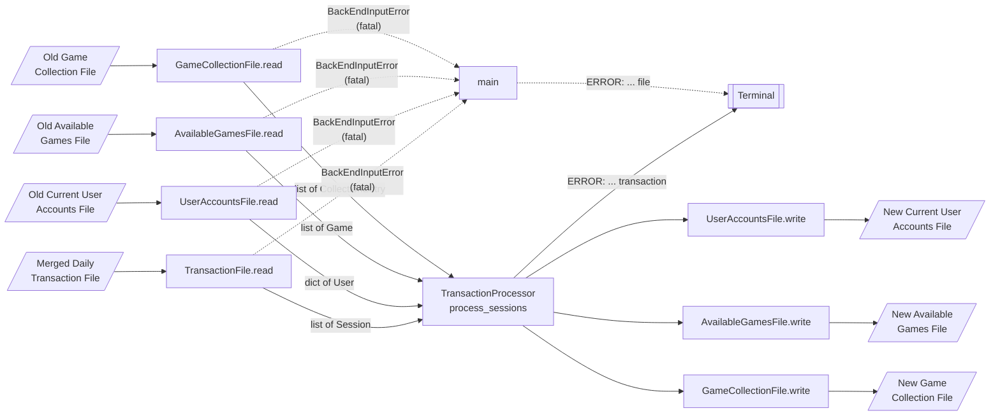
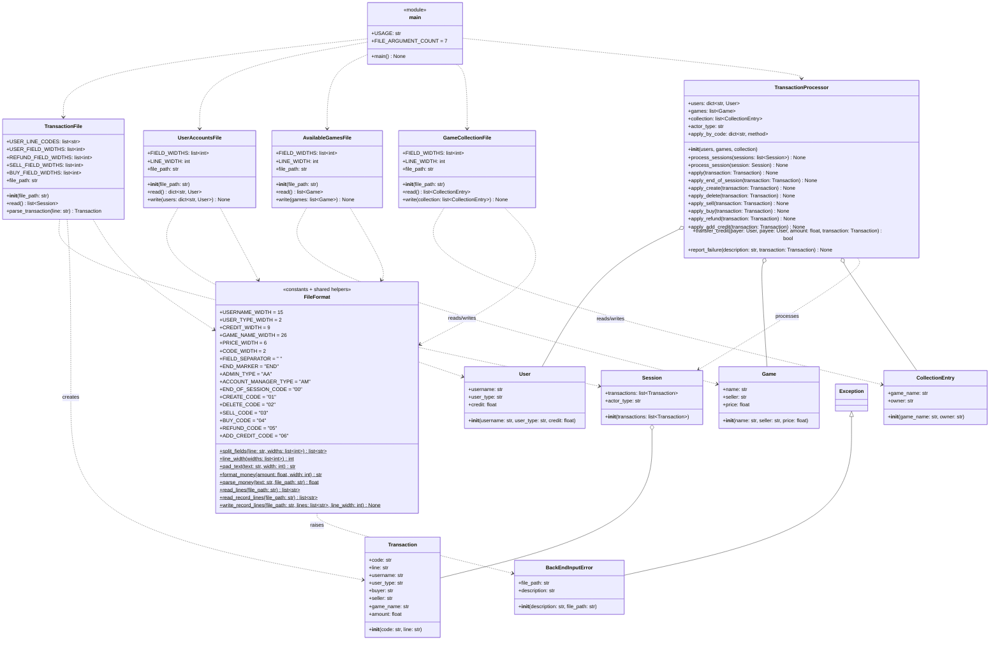

# Back End Design: Games Distribution System (Phase 4 Rapid Prototype)

## 1. Overview

The Back End is an overnight batch program written in Python 3 (standard library only). It reads the
Merged Daily Transaction File produced by the Front End (Front End C) and the three "old" data files
(user accounts, available games, game collection), then applies every transaction in order, session
by session. Transactions that would break a constraint (negative balance, duplicate username, or an
Account Manager permission rule) are skipped, and an `ERROR:` line is printed to the terminal. If an input file
turns out to be malformed, the program prints a fatal `ERROR:` line naming that file and stops.
Otherwise it writes the three "new" data files for the next day's Front End.

## 2. Inputs and outputs

| Kind | What | Read / written by |
|---|---|---|
| Input file | Merged Daily Transaction File | `TransactionFile.read()` |
| Input file | Old Current User Accounts File | `UserAccountsFile.read()` |
| Input file | Old Available Games File | `AvailableGamesFile.read()` |
| Input file | Old Game Collection File | `GameCollectionFile.read()` |
| Output file | New Current User Accounts File | `UserAccountsFile.write()` |
| Output file | New Available Games File | `AvailableGamesFile.write()` |
| Output file | New Game Collection File | `GameCollectionFile.write()` |
| Terminal | Failed-constraint log: `ERROR: <description> <transaction line>` | `TransactionProcessor.report_failure()` |
| Terminal | Fatal input error: `ERROR: <description> <file>` | `main()` (catches `BackEndInputError`) |

**Code layout (`backend/`):**

| Module | Contains |
|---|---|
| `main.py` | header comment, `main()` that wires everything together |
| `file_format.py` | `FileFormat`, `BackEndInputError` |
| `records.py` | `User`, `Game`, `CollectionEntry`, `Transaction`, `Session` |
| `data_files.py` | `UserAccountsFile`, `AvailableGamesFile`, `GameCollectionFile`, `TransactionFile` |
| `transaction_processor.py` | `TransactionProcessor` |

## 3. Class diagram

## 4. Intention of every class and method

| Class | Method | Intention |
|---|---|---|
| `FileFormat` | (class) | Holds every field width, transaction code and user-type constant, plus the only parsing/formatting helpers, so no file class repeats them. |
| `FileFormat` | `split_fields` | Cuts a fixed-width line into trimmed field strings, given the widths of the fields separated by single spaces. |
| `FileFormat` | `line_width` | Returns the full length of a line made of the given fields, counting one separator between fields. |
| `FileFormat` | `pad_text` | Left-justifies text in a field of the given width, padding it with spaces. |
| `FileFormat` | `format_money` | Formats an amount with two decimals, zero-padded on the left to the given width (e.g. `000110.00`). |
| `FileFormat` | `parse_money` | Converts a money field to a float, raising `BackEndInputError` for the given file if it isn't a number. |
| `FileFormat` | `read_lines` | Returns every line of an input file, raising `BackEndInputError` if it can't be opened (shared by every reader). |
| `FileFormat` | `read_record_lines` | Returns every line of a data file before its `END` line, raising `BackEndInputError` if it has no `END` line. |
| `FileFormat` | `write_record_lines` | Writes the given lines to a data file followed by an `END` line padded to the file's line width. |
| `BackEndInputError` | (class) | Exception that signals a fatal problem in an input file. |
| `BackEndInputError` | `__init__` | Stores the description and the path of the file that caused the error. |
| `User` | (class) | One user account: username, user type and credit balance. |
| `User` | `__init__` | Stores the username, type and credit. |
| `Game` | (class) | One game for sale: name, seller and price. |
| `Game` | `__init__` | Stores the game name, seller and price. |
| `CollectionEntry` | (class) | One owned game: the game name and its owner. |
| `CollectionEntry` | `__init__` | Stores the game name and owner. |
| `Transaction` | (class) | One parsed line of the daily transaction file; only the fields its code uses are filled in. |
| `Transaction` | `__init__` | Stores the code and the original line (for error messages), with every other field left empty. |
| `Session` | (class) | The transactions of one Front End session, plus the type of the user who was logged in. |
| `Session` | `__init__` | Stores the session's transactions and takes `actor_type` from its closing `00` line. |
| `UserAccountsFile` | (class) | Reads and writes the Current User Accounts File. |
| `UserAccountsFile` | `__init__` | Stores the path of the accounts file. |
| `UserAccountsFile` | `read` | Returns every account in the file as a dict of `User` keyed by username. |
| `UserAccountsFile` | `write` | Writes every user as a 28-character account line, then the `END` line. |
| `AvailableGamesFile` | (class) | Reads and writes the Available Games File. |
| `AvailableGamesFile` | `__init__` | Stores the path of the available games file. |
| `AvailableGamesFile` | `read` | Returns every game for sale in the file as a list of `Game`. |
| `AvailableGamesFile` | `write` | Writes every game as a 49-character line, then the `END` line. |
| `GameCollectionFile` | (class) | Reads and writes the Game Collection File. |
| `GameCollectionFile` | `__init__` | Stores the path of the game collection file. |
| `GameCollectionFile` | `read` | Returns every owned game in the file as a list of `CollectionEntry`. |
| `GameCollectionFile` | `write` | Writes every entry as a 42-character line, then the `END` line. |
| `TransactionFile` | (class) | Reads the Merged Daily Transaction File and groups it into sessions. |
| `TransactionFile` | `__init__` | Stores the path of the merged transaction file. |
| `TransactionFile` | `read` | Parses every line and starts a new `Session` after each `00` line, returning the list of sessions. |
| `TransactionFile` | `parse_transaction` | Splits one line into a `Transaction` using the layout for its code, raising `BackEndInputError` for an unknown code. |
| `TransactionProcessor` | (class) | Applies transactions to the in-memory users, games and collection, enforcing every constraint. |
| `TransactionProcessor` | `__init__` | Stores the users, games and collection that the transactions will change, and builds the code → `apply_` method table. |
| `TransactionProcessor` | `process_sessions` | Processes every session in the order the Front End wrote them. |
| `TransactionProcessor` | `process_session` | Remembers the session's actor type, then applies each of its transactions in order. |
| `TransactionProcessor` | `apply` | Sends a transaction to the `apply_` method for its code (looked up in `apply_by_code`). |
| `TransactionProcessor` | `apply_end_of_session` | Does nothing (a `00` line only marks the end of a session). |
| `TransactionProcessor` | `apply_create` | Adds a new user, unless the name is taken or an Account Manager is creating an admin. |
| `TransactionProcessor` | `apply_delete` | Removes a user and their games for sale, unless an Account Manager is deleting an admin. |
| `TransactionProcessor` | `apply_sell` | Adds a game to the available games, unless the seller is an Account Manager. |
| `TransactionProcessor` | `apply_buy` | Moves the price from buyer to seller and adds the game to the buyer's collection, unless the buyer is an Account Manager or can't afford it. |
| `TransactionProcessor` | `apply_refund` | Moves the refund amount from the seller to the buyer, unless the seller can't afford it. |
| `TransactionProcessor` | `apply_add_credit` | Sets the user's credit to the new balance recorded by the Front End (see §6). |
| `TransactionProcessor` | `transfer_credit` | Moves an amount from one user to another and returns True, or reports a negative-balance failure and returns False. |
| `TransactionProcessor` | `report_failure` | Prints `ERROR: <description> <transaction line>` for a failed constraint. |
| `main.py` | `main` | Reads the seven file names from the command line, reads the inputs, runs the processor, writes the outputs, and turns a `BackEndInputError` into a fatal `ERROR:` message. |

## 5. Transaction codes

| Code | Transaction | Applied by | Constraint checks (failure → `ERROR:` line, transaction skipped) |
|---|---|---|---|
| `00` | end of session | `apply_end_of_session` | none (also marks the session boundary in `TransactionFile.read`) |
| `01` | create | `apply_create` | username must be unique; AM actor may not create an `AA` user |
| `02` | delete | `apply_delete` | user must exist; AM actor may not delete an `AA` user |
| `03` | sell | `apply_sell` | seller may not be `AM` |
| `04` | buy | `apply_buy` | buyer may not be `AM`; buyer's balance may not go negative (`transfer_credit`) |
| `05` | refund | `apply_refund` | seller's balance may not go negative (`transfer_credit`) |
| `06` | add credit | `apply_add_credit` | none (the Front End already enforced the limits) |

## 6. File formats used

All widths come from Front End C, the source of truth: `frontend/frontend_code/Transaction_Writer.cpp`
(writing, lines 45–75) and `frontend/frontend_code/Readers.cpp` (reading, lines 42–90). Fields are separated
by one space. Text is left-justified and space-padded. Money is zero-padded with two decimals.

| File / line | Layout (width) | Total chars |
|---|---|---|
| `00`/`01`/`02`/`06` | `CODE(2) USERNAME(15) TYPE(2) CREDIT(9)` | 31 |
| `05` refund | `CODE(2) BUYER(15) SELLER(15) CREDIT(9)` | 44 |
| `03` sell | `CODE(2) GAME(26) SELLER(15) PRICE(6)` | 52 |
| `04` buy | `CODE(2) GAME(26) SELLER(15) BUYER(15) PRICE(6)` | 68 |
| Current User Accounts | `USERNAME(15) TYPE(2) CREDIT(9)` | 28 |
| Available Games | `GAME(26) SELLER(15) PRICE(6)` | 49 |
| Game Collection | `GAME(26) OWNER(15)` | 42 |

User types: `AA` admin, `FS` full-standard, `BS` buy-standard, `SS` sell-standard, `AM` account manager (new, see §7).

**Where Front End C differs from the spec (and what the Back End does):**

| Spec says | Front End C does | Back End follows |
|---|---|---|
| `03`/`04` game field drawn as 19 chars (`IIIIIIIIIIIIIIIIIII`), name limit 25 in the text | game name field is 26 (client clarification) | 26 |
| `03` seller drawn as 13 chars, `04` buyer as 14 | every username field is 15 (client clarification) | 15 |
| `06` "add amount to user's credit" | `06` credit field holds the user's **new total balance** (`Funds.cpp:55` writes `updated.get_total_credit()`) | `apply_add_credit` **sets** the balance to that value. Known limitation: if an earlier transaction for that user was rejected by the Back End, the set value still reflects the Front End's view. |
| Files end with an `END` record | `END` lines are padded with spaces to the full line width (`fixtures/*.txt`) | Reader detects `END` on the trimmed first field (also accepts a bare `END`). Writer pads `END` to the full line width to match. |
| `05` refund moves credit only | Front End also drops the game from the buyer's collection in memory, but the `05` line has no game name | Back End only moves the credit (it can't know which game). |

## 7. Requirement update: Account Manager (`AM`) user type

From the lecture update: an Account Manager can't buy or sell, has admin privileges for every other
transaction, and can't create or delete admins.

The `01`/`02` lines only name the *target* user, not who ran the command. The logged-in user is on
the session's closing `00` line (with their type), so `TransactionFile.read` groups lines into
`Session`s, and `Session.actor_type` comes from that `00` line. The four Back End checks are listed in §5.

**Front End C changes for AM** (in `frontend/frontend_code/`):

| File | Change |
|---|---|
| `User.cpp` | `AM` ↔ `"account-manager"` in `get_type_name` and `code_from_type_name` |
| `Session.cpp` / `Session.h` | AM in the static `type_name`; `is_admin()` true for `AA` or `AM`; new `is_account_manager()` |
| `Game_Transactions.cpp` | `buy` and `sell` reject an AM user |
| `Account_Management.cpp` | `create_user` rejects type `AA` when the actor is AM; `delete_user` rejects an `AA` target when the actor is AM; create prompt lists `account-manager` |

## 8. Known errors in this prototype (kept for Phase 5)

This is a rapid first version. These errors are left in on purpose for Phase 5 testing to find and fix.

| ID | Where | What goes wrong | Phase 5 test that exposes it |
|---|---|---|---|
| E1 | `transaction_processor.py`: `apply_sell`, `apply_buy`, `apply_refund`, `apply_add_credit` | A transaction naming a user who doesn't exist (e.g. a seller deleted earlier that day) crashes with a Python `KeyError` instead of printing an `ERROR:` line. | Delete a user, then buy from them in a later session. |
| E2 | `file_format.py`: `parse_money`; `transaction_processor.py`: `transfer_credit` | Money is stored as `float`, so many transactions can add up to a rounding error. | Many small buys/refunds on one account, compared with hand-worked cents. |
| E3 | `transaction_processor.py`: `apply_add_credit` | `06` sets the balance to Front End C's total, so a Back End rejection earlier for that user is overwritten. | A rejected buy followed by add credit for the same user. |
| E4 | `transaction_processor.py`: `apply_sell` | A game name already for sale is not rejected. | Two `03` lines with the same game name. |
| E5 | `transaction_processor.py`: `apply_refund` | A refund leaves the game in the buyer's collection (the `05` line has no game name). | Buy, then refund the same game. |
| E6 | `transaction_processor.py`: `apply_buy` | It doesn't check the game is for sale by that seller, or that the buyer doesn't already own it. | A `04` for a game not for sale; a second `04` for an owned game. |
| E7 | `data_files.py`: `TransactionFile.read` | Lines after the last `00` line are silently dropped. | A file whose last session has no `00` line. |
